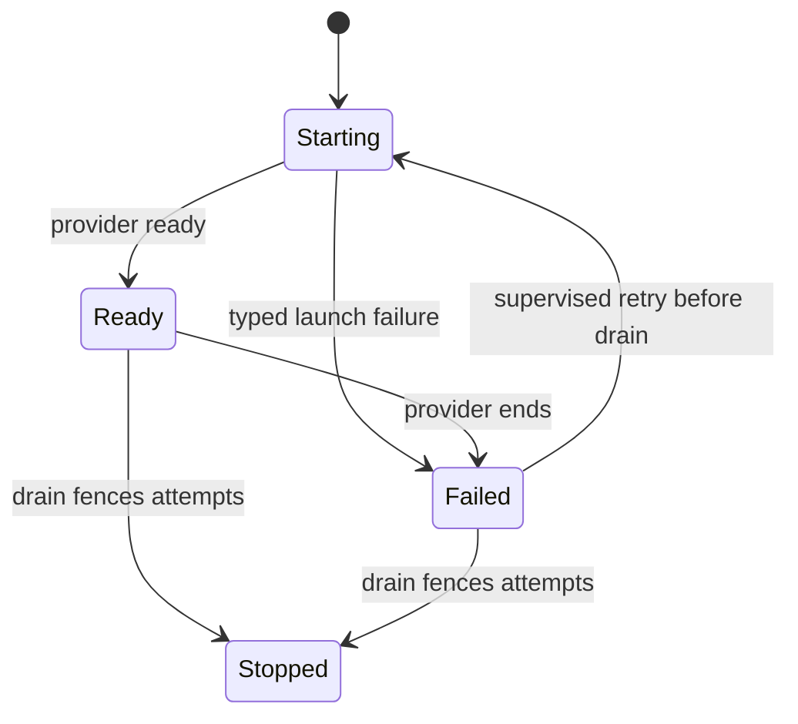

# Reach a gateway through a tunnel

A configured provider forwards WebSocket bytes to a loopback ingress. Those bytes still pass through the native TLS listener. Quick mode receives a provider address at startup; named mode uses its configured hostname and separately stored provider token.

The tunnel publishes Starting, Ready or a typed failure. Provider readiness is reachability, not pairing or product-session authentication. Supervision can retry failures until the owning lifetime drains. Already admitted work and new provider attempts have separate lifetimes.

## Bounded rule model

Provider readiness and native admission are separate facts. One supervised failure/retry lifetime checks that dispatch requires native authority and that draining cannot restart publication.

The configured safety rules are `ForwardingIsNotAuthority`, `NoRetryAfterDrain`, `DrainStopsPublication`. TLC explores the authored abstraction; it does not execute or prove the implementation.

| Model action | Source behavior abstracted |
| --- | --- |
| `ProviderReady` | Publish the provider address only after provider readiness. |
| `ProviderFails` | Retain a typed provider failure without fabricating readiness. |
| `Retry` | Retry the supervised provider only while its lifetime is not draining. |
| `NativeAdmission` | Admit a connection through the separate pinned native TLS and credential owner. |
| `Dispatch` | Dispatch product work only under native session admission. |
| `Drain` | Fence new provider attempts and begin the existing tunnel lifetime drain. |

## Verification limits

Native TLS cryptography, paired credential recovery, pending-secret filesystem receipts, WebSocket parsing, provider download verification and token rotation are not represented. A tunnel result does not grant a role or certify external network availability. The cited code and regression sources were inspected at the page checkpoint; their product test suites were not run in this modeling pass.

## Further reading

[application.rs](../../../../crates/nessa-server/src/tunnel/application.rs) · [ingress.rs](../../../../crates/nessa-server/src/tunnel/infrastructure/ingress.rs) · [ingress.rs](../../../../crates/nessa-server/tests/tunnel/ingress.rs)
