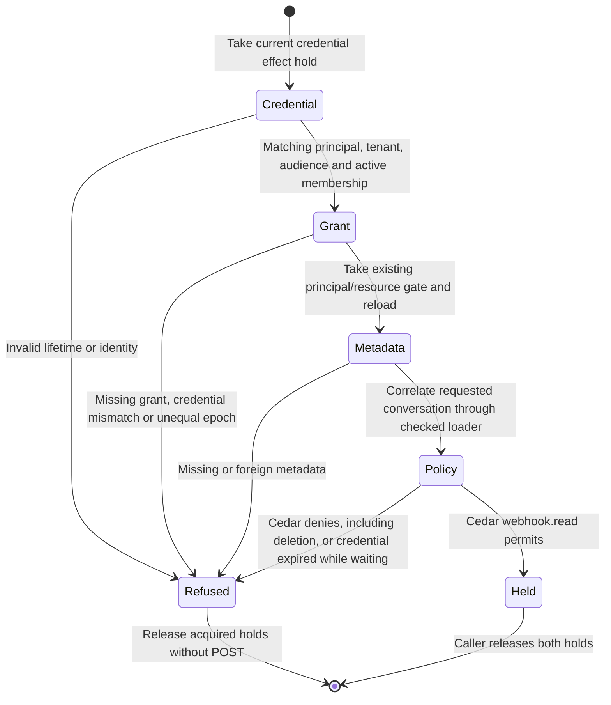

# Outbound webhook admission

This page covers principal sharing and authority admission for [outbound webhook delivery](webhook-foundation.md).
The mounted source and sender use these boundaries. Private registration and
persistence have [their own checkpoint](webhook-outbox.md); whole-feature review,
source-matched CI/platform/browser and stress acceptance remain required for
[issue #896](https://github.com/nessalabs/nessa-agent/issues/896).
Application installation (#1052) and inbound triggers (#1088) remain separate.

## Admission guards and effects

The credential registry supplies a coherent snapshot and owns mutation
publication. Its effect hold retains both a read fence and the canonical OS
lifetime lock. Dropping the last store reference cannot allow a replacement
store to revoke behind a detached live hold. Registry reads remain available.
The chart's Refused node means admission did not succeed; its typed result
distinguishes policy refusal from unavailable or mismatched metadata.
Synchronous mutations refuse Locked during a hold. The composed product revoke
owner waits on a blocking worker, then commits its existing revocation audit
and publication. Losing the socket observer does not cancel that worker.

The grant hold uses the existing `(resource kind, resource, principal)` gate.
It reloads the row after acquiring the gate. Unshare and replacement wait for
the same gate; a later attempt cannot reuse an earlier epoch. A principal
without a receiver is read as that principal, without creating a receiver.

The application correlates credential, principal, tenant, membership, audience,
grant credential, epoch and requested metadata before asking Cedar. The
WebhookReader subject has one permit: read a live conversation owned by the
registration's owner in the same tenant, with a read capability and the
credential's exact conversation.read restriction on this gateway. Owner,
comment, drive, artifact and other actions have no webhook permit.

### Fenced facts still need dispatch checks

`DeliveryHold` keeps the credential and grant holds. It does not suspend
absolute credential expiry. Admission checks lifetime again after all waits;
the mounted sender rechecks lifetime after its durable Sending receipt,
immediately before POST. Its dispatch deadline starts before fresh admission.
`DispatchAdmission` owns partial Auth/grant fences independently of the retained
metadata future. At deadline it permanently releases those fences and disables
POST while the runtime joins any physical read already in progress. Gate-only
acquisition supplies synchronization, not permission: the same application
validator reloads the exact credential/grant epoch and asks existing Cedar.
Canonical capture operations retain their separate source ownership through
physical SDK and cursor effects; this is not a blanket revoke-latency claim.

### Failures and recovery

Missing, revoked, expired, stale or mismatched authority refuses admission.
Unavailable metadata or authorities remain Unavailable, rather than a permanent
policy refusal. No transition in this chart writes an outbox row or sends HTTP.
The admission chart makes no persistence acknowledgement claim. The runtime
separately owns startup, source replay, Sending and actual response settlement;
[the outbox page](webhook-outbox.md) records their failure and recovery orderings.

## Evidence

- [Actual registry, grant and Cedar integration](https://github.com/nessalabs/nessa-agent/blob/d4b6e6cba2dd345c129d00f4115d272944f0f079/crates/nessa-server/tests/webhooks/infrastructure/admission.rs): one-chat filtering, unshare, stale epoch after re-share, credential revoke, expiry while waiting and no other Cedar authority.
- [Composed revoke owner](https://github.com/nessalabs/nessa-agent/blob/d4b6e6cba2dd345c129d00f4115d272944f0f079/crates/nessa-server/tests/composition/local_auth.rs): observe the queued writer, abort its observer, then confirm publication after hold release.
- [Registry regressions](https://github.com/nessalabs/nessa-agent/blob/d4b6e6cba2dd345c129d00f4115d272944f0f079/crates/nessa-auth/src/adapters/local/registry.rs): a hold prevents canonical registry reopening; read-only identity and caller-kind facts remain available.
- [Principal grant regression](https://github.com/nessalabs/nessa-agent/blob/d4b6e6cba2dd345c129d00f4115d272944f0f079/crates/nessa-server/tests/conversation/store.rs): unshare waits, and a re-share cannot revive the old epoch.

Historical d4b6e6cb source checks passed209 auth tests,29 webhook tests, the principal grant
regression and the composed revoke regression. These are admission and isolated
transport checks, not a usable product delivery E2E. Independent review corrected
expiry ordering, physical registry ownership and the actual revoke composition.

## Registered principal sharing

`ShareWebhookConversation` admits the caller's conversation ownership before
private registration lookup. It holds current Auth, reloads the same committed
registration identity/target under that hold, asks existing target Cedar, and
writes the canonical principal grant with no receiver. Comment and drive are
asked as WebhookReader and refused by existing policy. No receiver binding,
policy permit or owner fallback is manufactured. The grant transaction asks
conversation ownership again, and its original request/revision semantics remain.

| Boundary | Owner/effect |
| --- | --- |
| missing, stopped, substituted or foreign target | no grant; no source read or POST |
| registered read target | exact credential/principal/conversation; receiver absent |
| caller cancelled before mutation | acquired Auth released; no grant |
| caller cancelled during physical grant write | same original Auth owner remains in blocking work until commit/rollback |
| physical grant policy panics | joined Metadata failure, rollback/no grant, actual Auth released after unwind |
| later unshare, expiry or revocation | subsequent source/send admission checks current authority and epoch again |

The grant-only operation fails closed on unsupported adapters. It accepts the
resource, access, revision and actor/time plus the actual Auth hold; native code
derives the credential/principal and constructs a receiver-absent Grant. Its
native path retains Auth before the principal gate and metadata connection,
without acquiring the ownership wrapper's mutex. Each physical retry owns the
same original Auth fence. Ordinary receiver changes keep their existing path.
The actual transaction refuses a receiver-bearing live row before any replay
acknowledgement or fresh write. Receiver-bearing original journal evidence is
also refused after unshare. A valid receiver-absent original receipt still
replays after unshare without recreating the grant. Ordinary paired omission
continues to mean keep/lost reply. Refusal preserves the original row/journal.
Holding a mutation fence does not freeze expiry: lifetime is rechecked before
grant handoff, and source/send admission independently refuses an expired
credential even if historical grant metadata exists.

The current scoped review compared this page's linked sources since d4b6e6cb:
Auth's physical hold/fence and composed revoke methods are unchanged; coherent
origin/revocation snapshot decoding is newer and remains fail-closed. Existing
Cedar rules are unchanged. Current admission, grant writer and regression tests
were traced together. This does not re-audit unrelated issuance/session behavior
or advance their state pages. The admission diagram bytes are unchanged; no new
renderer or browser qualification is claimed.

Final author checks atf990b7df:220 webhook tests (fourteen new share cases),98
share-selected adjacent tests, the unchanged paired-grant cancellation case,
seven-package Clippy, formatting and architecture passed. [Initial caught and restored controls](../../../reviews/evidence/webhook-runtime/principal-source/share-controls.jsonl)
cover the unchanged application permission/expiry prefix.
[Seven fresh M1 controls](../../../reviews/evidence/webhook-runtime/principal-source/share-m1-controls.jsonl)
cover current/historical receiver evidence, exact grant construction and actual
physical Auth ownership. Round1
[reported the false receiver acknowledgement](../../../reviews/evidence/webhook-runtime/principal-source/share-review-1.md);
the native regression failed before this correction and passed afterward. The
positive share reads a genuine synthetic SDK source. [Evidence](../../../reviews/evidence/webhook-runtime/principal-source/README.md)
keeps failed fixture attempts, original CI failures and remaining gates.
This inner share path is not mounted command ownership, source-feed supervision,
sending, or recipient E2E. Fresh round2 and exact-head CI remain required.

## Registry writer handoff checkpoint

At source `9bef5b428a6b987136544109f5bf8e286e29297f`, ordinary physical
registry writers serialize on the existing canonical mutex before trying the
effect fence. A completed writer drops that fence before handing off the mutex.
The fence attempt remains nonblocking: a live credential read hold still refuses
a synchronous mutation. Async revocation awaits its fence without the registry
mutex, then retains both through the same canonical revocation commit. Neither
permission checks nor the pinned grant epoch are weakened.

The [ordering table](../../../design/webhook-delivery-implementation.md#ordinary-registry-writer-handoff)
describes the two acquisition orders and why no path waits for both. The new
regression uses a real no-op expiry held inside its Clock and competing actual
expiry/cancellation workers. It asserts both worker entries, the original held
state and no early result, then checks the canonical results after release.
The original source fails this regression with `Unavailable`; the corrected
source serializes the operations. This identifies a contention mechanism, not
the particular holder or cancellation site in historical platform CI.

Every other linked source is byte-identical to this page's preceding `f990b7df`
checkpoint. Only the registry writer change and its test are newly traced;
unrelated Auth state pages are unchanged. The admission diagram is unchanged,
because its states and permission decisions are unchanged. No new diagram render
or browser result is claimed. Product runtime and recipient delivery were
unmounted in that scoped publication candidate.

## Product grant ownership checkpoint

At source `20d8051b5e03419d7d0d1854413d7e29be1b6207`, the existing owner
product share command checks request shape and conversation ownership before
classifying its target from actual immutable Auth origin. A webhook target uses
the existing registration/grant/Cedar operation; no receiver scope is invented.
The ordinary target path remains the existing paired grant operation.

Admitted webhook share/unshare futures now belong to the same bounded runtime
owner as credential commands. Their original native operations and permission
checks remain unchanged. Socket loss cannot cancel the owned grant future;
shutdown waits for its physical write and records the actual result separately.
The regression holds a real canonical share or unshare write in its blocking
worker, closes product admission, and proves cleanup remains pending until
release. An authenticated ordinary nonowner is refused, ordinary unpaired targets
remain unpaired, and read+comment is refused by the actual capability policy.

The complete linked admission path was compared with the preceding checkpoint.
The new product/composition wiring and retained command owner are reviewed with
the unchanged inner Auth/grant/Cedar sources. The existing admission diagram is
unchanged; no new diagram render or browser qualification is claimed. Source
and sender mounting and recipient POST were still open at that checkpoint;
the mounted checkpoint below records the later composition. Final whole-feature
review remains a separate gate.

## Mounted delivery checkpoint

At source `fc713591785970b8eca5ec20ad819024bf131cb0`, the product owner
flow issues/registers the configured principal and shares only the selected
conversation. The one retained runtime captures actual canonical records under
current principal authority, queues exact recordsPage bytes and sends through
the existing bounded signed HTTPS adapter. Ordinary credential/grant paths remain
their native operations; webhook credentials obtain no paired-reader authority.

Construction prepares dependencies without spawning a sender. The root starts
it after fallible listener/signal setup, immediately before entering the existing
retained serve/cleanup owner. Shutdown seals admission and joins actual physical
work; failed, unknown or exceeded-deadline evidence prevents confirmed cleanup.
The [outbox checkpoint](webhook-outbox.md#supervised-delivery-checkpoint) describes
positive response reconciliation, late expiry and the unchanged retention bound.

The isolated recipient fixtures use actual owner WebSocket commands, native
Auth/Cedar and canonical SDK records. Only the granted chat is delivered; HMAC,
retry identity/timestamp/signature/bytes, unshare/revoke/expiry/old-epoch no-send,
capability refusal, cold recovery and physical POST/revocation/shutdown ownership
are exercised. Only the test socket and in-memory CA replace public transport
preparation; production routing, TLS, deadline and byte policies are unchanged.
Historical unmounted/checkpoint statements above describe their earlier scoped
publications. The inner diagrams remain unchanged. Final whole-feature review,
source-matched CI/platform/browser and stress acceptance remain separate gates.

## Dispatch and credential lifecycle correction

Source `365f769078a3d2298340952ba519edc515468332` preserves current main
`5bb482a6b7c11dea2ddb64a2898edb6c623b0a19`, including Channels, GitHub App
and the later panel/stress integration. The correction addresses the
[whole-feature round-one findings](../../../reviews/evidence/webhook-runtime/delivery-composition/review-1.md).
That report remains changes-required at its original source; it is not a clean
review of this newer checkpoint.

Fresh dispatch admission, Sending and POST share one 15-second deadline. The
runtime releases partial fences independently while retaining and joining real
metadata/SQL work. It checks the last interruptible COMMIT boundary; an already
running filesystem sync can still finish a late conditional commit under
W-audit-race. An expired attempt cannot POST. Known complete responses retain
their actual outcome before callbacks and settle after authority is released.
Live reads reconcile unowned Sending and retry idle credential stops without a
grant or queued delivery; first reader/revocation facts remain unchanged.

Issuance distinguishes active registration authority, installed stopped history
and uncertain uninstalled reservations. Expired/stopped reissue acknowledges the
old stop before installing a new identity. Retained intents select replay even
after private seed removal; they do not become an ordinary credential route.
Once all private history is retired, no permanent principal classification is
inferred. Genuine unregistered principals retain native ordinary issuance.

At this exact source, 265 webhook tests passed with no retention exclusions,
38 host tests and the native principal-grant gate regression passed; required
seven-package all-target Clippy, formatting and 108 architecture tests/checker
passed. [Evidence and exclusions](../../../reviews/evidence/webhook-runtime/delivery-composition/README.md)
retain the original interrupted fixture, failed controls, source-specific results
and outstanding gates. Final assembled independent review and exact-head
CI/platform/browser/default-and-raised-stress remain required. The existing
inner diagrams describe the same authority and durable states and are unchanged;
no new renderer or browser result is claimed. Only these three feature pages and
their linked source changes are newly reconciled, not unrelated Auth/SDK pages.
