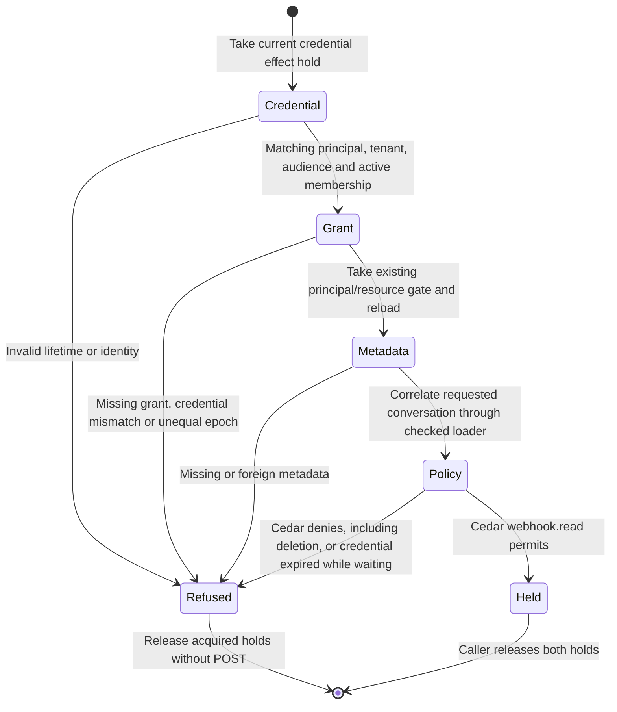

# Outbound webhook admission

This page covers inner principal sharing and authority holds for [outbound webhook delivery](webhook-foundation.md).
It mounts no product command or sender. Private registration and persistence have
[their own checkpoint](webhook-outbox.md); full runtime/recipient composition remains
required for [issue #896](https://github.com/nessalabs/nessa-agent/issues/896).
Application installation (#1052) and inbound triggers (#1088) remain separate.

## Admission guards and effects

The credential registry supplies a coherent snapshot and owns mutation
publication. Its effect hold retains both a read fence and the canonical OS
lifetime lock. Dropping the last store reference cannot allow a replacement
store to revoke behind a detached live hold. Registry reads remain available.
The chart's Refused node means admission did not succeed; its typed result
distinguishes policy refusal from unavailable or mismatched metadata.
Synchronous mutations refuse Locked during a hold. The composed product revoke
owner waits on a blocking worker, then commits its existing revocation audit
and publication. Losing the socket observer does not cancel that worker.

The grant hold uses the existing `(resource kind, resource, principal)` gate.
It reloads the row after acquiring the gate. Unshare and replacement wait for
the same gate; a later attempt cannot reuse an earlier epoch. A principal
without a receiver is read as that principal, without creating a receiver.

The application correlates credential, principal, tenant, membership, audience,
grant credential, epoch and requested metadata before asking Cedar. The
WebhookReader subject has one permit: read a live conversation owned by the
registration's owner in the same tenant, with a read capability and the
credential's exact conversation.read restriction on this gateway. Owner,
comment, drive, artifact and other actions have no webhook permit.

### Fenced facts still need dispatch checks

`DeliveryHold` keeps the credential and grant holds. It does not suspend
absolute credential expiry. Admission checks lifetime again after all waits;
the future sender must call `is_valid_at` after its durable Sending receipt,
immediately before POST. The attempt must be bounded while its actual holds survive until physical work
has stopped. The worker enforcing those calls is not implemented at this checkpoint.

### Failures and recovery

Missing, revoked, expired, stale or mismatched authority refuses admission.
Unavailable metadata or authorities remain Unavailable, rather than a permanent
policy refusal. No transition in this chart writes an outbox row or sends HTTP.
This chart makes no delivery recovery claim. Private outbox/retirement behavior
is documented separately; composed startup, source replay and sending remain unfinished.

## Evidence

- [Actual registry, grant and Cedar integration](https://github.com/nessalabs/nessa-agent/blob/d4b6e6cba2dd345c129d00f4115d272944f0f079/crates/nessa-server/tests/webhooks/infrastructure/admission.rs): one-chat filtering, unshare, stale epoch after re-share, credential revoke, expiry while waiting and no other Cedar authority.
- [Composed revoke owner](https://github.com/nessalabs/nessa-agent/blob/d4b6e6cba2dd345c129d00f4115d272944f0f079/crates/nessa-server/tests/composition/local_auth.rs): observe the queued writer, abort its observer, then confirm publication after hold release.
- [Registry regressions](https://github.com/nessalabs/nessa-agent/blob/d4b6e6cba2dd345c129d00f4115d272944f0f079/crates/nessa-auth/src/adapters/local/registry.rs): a hold prevents canonical registry reopening; read-only identity and caller-kind facts remain available.
- [Principal grant regression](https://github.com/nessalabs/nessa-agent/blob/d4b6e6cba2dd345c129d00f4115d272944f0f079/crates/nessa-server/tests/conversation/store.rs): unshare waits, and a re-share cannot revive the old epoch.

Historical d4b6e6cb source checks passed209 auth tests,29 webhook tests, the principal grant
regression and the composed revoke regression. These are admission and isolated
transport checks, not a usable product delivery E2E. Independent review corrected
expiry ordering, physical registry ownership and the actual revoke composition.

## Registered principal sharing

`ShareWebhookConversation` admits the caller's conversation ownership before
private registration lookup. It holds current Auth, reloads the same committed
registration identity/target under that hold, asks existing target Cedar, and
writes the canonical principal grant with no receiver. Comment and drive are
asked as WebhookReader and refused by existing policy. No receiver binding,
policy permit or owner fallback is manufactured. The grant transaction asks
conversation ownership again, and its original request/revision semantics remain.

| Boundary | Owner/effect |
| --- | --- |
| missing, stopped, substituted or foreign target | no grant; no source read or POST |
| registered read target | exact credential/principal/conversation; receiver absent |
| caller cancelled before mutation | acquired Auth released; no grant |
| caller cancelled during physical grant write | same original Auth owner remains in blocking work until commit/rollback |
| physical grant policy panics | joined Metadata failure, rollback/no grant, actual Auth released after unwind |
| later unshare, expiry or revocation | subsequent source/send admission checks current authority and epoch again |

The credential-owning grant operation fails closed on unsupported adapters. Its
native path retains Auth before the principal gate and metadata connection,
without acquiring the ownership wrapper's mutex. Each physical retry owns the
same original Auth fence. Ordinary receiver changes keep their existing path.
Holding a mutation fence does not freeze expiry: lifetime is rechecked before
grant handoff, and source/send admission independently refuses an expired
credential even if historical grant metadata exists.

The current scoped review compared this page's linked sources since d4b6e6cb:
Auth's physical hold/fence and composed revoke methods are unchanged; coherent
origin/revocation snapshot decoding is newer and remains fail-closed. Existing
Cedar rules are unchanged. Current admission, grant writer and regression tests
were traced together. This does not re-audit unrelated issuance/session behavior
or advance their state pages. The admission diagram bytes are unchanged; no new
renderer or browser qualification is claimed.

Final author checks at36edb8e:217 webhook tests (eleven new share cases),94
share-selected adjacent tests, the unchanged paired-grant cancellation case,
seven-package Clippy, formatting and architecture passed. [Seven caught and
restored controls](../../../reviews/evidence/webhook-runtime/principal-source/share-controls.jsonl)
cover permission, identity, expiry and actual physical Auth ownership. The
positive share reads a genuine synthetic SDK source. [Evidence](../../../reviews/evidence/webhook-runtime/principal-source/README.md)
keeps failed fixture attempts, original CI failures and remaining gates.
This inner share path is not mounted command ownership, source-feed supervision,
sending, or recipient E2E. Independent review and exact-head CI remain required.
