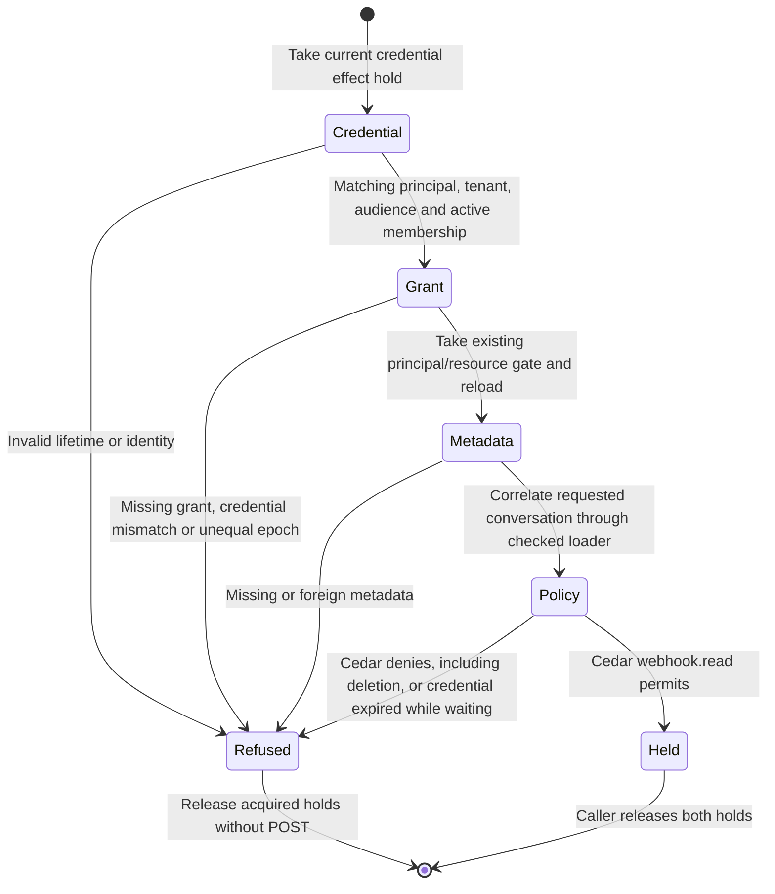

# Outbound webhook admission

This checkpoint adds the authority holds needed by [outbound webhook delivery](webhook-foundation.md).
It does not register an endpoint, queue a record or run a sender. Those remain
required for [issue #896](https://github.com/nessalabs/nessa-agent/issues/896).
Application installation (#1052) and inbound triggers (#1088) remain separate.

## Admission guards and effects

The credential registry supplies a coherent snapshot and owns mutation
publication. Its effect hold retains both a read fence and the canonical OS
lifetime lock. Dropping the last store reference cannot allow a replacement
store to revoke behind a detached live hold. Registry reads remain available.
The chart's Refused node means admission did not succeed; its typed result
distinguishes policy refusal from unavailable or mismatched metadata.
Synchronous mutations refuse Locked during a hold. The composed product revoke
owner waits on a blocking worker, then commits its existing revocation audit
and publication. Losing the socket observer does not cancel that worker.

The grant hold uses the existing `(resource kind, resource, principal)` gate.
It reloads the row after acquiring the gate. Unshare and replacement wait for
the same gate; a later attempt cannot reuse an earlier epoch. A principal
without a receiver is read as that principal, without creating a receiver.

The application correlates credential, principal, tenant, membership, audience,
grant credential, epoch and requested metadata before asking Cedar. The
WebhookReader subject has one permit: read a live conversation owned by the
registration's owner in the same tenant, with a read capability and the
credential's exact conversation.read restriction on this gateway. Owner,
comment, drive, artifact and other actions have no webhook permit.

### Fenced facts still need dispatch checks

`DeliveryHold` keeps the credential and grant holds. It does not suspend
absolute credential expiry. Admission checks lifetime again after all waits;
the future sender must call `is_valid_at` after its durable Sending receipt,
immediately before POST. That caller must release holds at its attempt deadline.
The worker enforcing those calls is not implemented at this checkpoint.

### Failures and recovery

Missing, revoked, expired, stale or mismatched authority refuses admission.
Unavailable metadata or authorities remain Unavailable, rather than a permanent
policy refusal. No transition in this chart writes an outbox row or sends HTTP.
There is no delivery recovery claim here: durable outbox, outcome reconciliation,
registration retirement and source replay remain unfinished.

## Evidence

- [Actual registry, grant and Cedar integration](https://github.com/nessalabs/nessa-agent/blob/d4b6e6cba2dd345c129d00f4115d272944f0f079/crates/nessa-server/tests/webhooks/infrastructure/admission.rs): one-chat filtering, unshare, stale epoch after re-share, credential revoke, expiry while waiting and no other Cedar authority.
- [Composed revoke owner](https://github.com/nessalabs/nessa-agent/blob/d4b6e6cba2dd345c129d00f4115d272944f0f079/crates/nessa-server/tests/composition/local_auth.rs): observe the queued writer, abort its observer, then confirm publication after hold release.
- [Registry regressions](https://github.com/nessalabs/nessa-agent/blob/d4b6e6cba2dd345c129d00f4115d272944f0f079/crates/nessa-auth/src/adapters/local/registry.rs): a hold prevents canonical registry reopening; read-only identity and caller-kind facts remain available.
- [Principal grant regression](https://github.com/nessalabs/nessa-agent/blob/d4b6e6cba2dd345c129d00f4115d272944f0f079/crates/nessa-server/tests/conversation/store.rs): unshare waits, and a re-share cannot revive the old epoch.

Local source checks passed 209 auth tests, 29 webhook tests, the principal grant
regression and the composed revoke regression. These are admission and isolated
transport checks, not a usable product delivery E2E. Independent review corrected
expiry ordering, physical registry ownership and the actual revoke composition.

The separate [durable outbox checkpoint](webhook-outbox.md) describes later
persistence work. This navigation link does not advance this page's historical
source review checkpoint or claim runtime composition.
