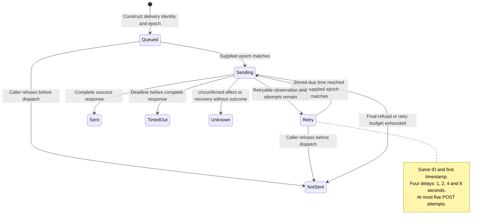
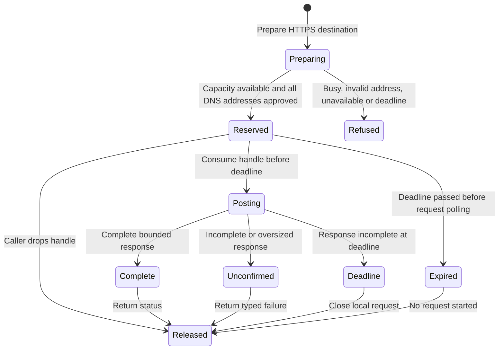

# Outbound webhook foundation

Nessa has delivery values, exact signed message encoding, and a bounded HTTPS
adapter for the outbound webhook plan. The gateway does not compose them yet.
No webhook can be registered or receive conversation records through the product
socket in this source checkpoint.

The charts describe returned values and adapter calls. They do not describe a
durable outbox, a running worker, or a completed access-grant implementation.
The [implementation checklist](../../../design/webhook-delivery-implementation.md)
separates this slice from the remaining [issue #896](https://github.com/nessalabs/nessa-agent/issues/896)
gates. Inbound workflow triggers (#1088) and application registrations (#1052)
remain separate work.

## Delivery value transitions

One immutable value carries the delivery ID, admitted grant epoch, attempt count,
first timestamp and phase. A transition returns a replacement; its caller owns
persisting that replacement and its causal audit before performing an effect.
That persistence owner is not implemented in this slice.

### Admitted value, not a storage acknowledgement

Admission compares the supplied current epoch with the value's admitted epoch,
checks the due time, and returns Sending with the original timestamp retained.
It refuses an older or newer supplied epoch. It does not read a grant, evaluate
Cedar, check credential expiry, or hold revocation still. A future caller must
obtain that authority from the existing grant and auth owners.

Sending is intended to commit before any POST bytes. The value alone does not
enforce that ordering. The integration must hold the grant revision and
registration permit through the attempt, audit, and bounded recovery paths.

### Uncertain remote effect

A partial, malformed, oversized or unconfirmed response becomes Unknown. Reqwest
does not distinguish a lost response from a partial status line at its generic
request-error boundary, so this adapter conservatively refuses to retry either.
Proven connection failures and complete 408, 429 or 5xx responses can retry.

Recovering a Sending value without its outcome returns Unknown and does not
admit that ID again. This is a tested domain transition, not implemented restart
storage. A complete 2xx means a complete HTTP response; it cannot establish
exactly-once remote effects. Recipients deduplicate by delivery ID.

## Prepared transport call

The adapter reserves capacity and validates a fresh DNS answer before a caller
would save Sending. Preparation has no MAC key or body and sends no POST. The
returned handle can be consumed once. Its POST error type has no Busy variant.

### Reserve before saving Sending

One shared adapter admits at most four preparations or POSTs, without an
unbounded waiting queue. The OS DNS adapter has another four permits. A blocking
lookup retains its permit even when its waiter is cancelled, until the physical
worker returns. Its physical duration and runtime shutdown are not bounded here.

The whole DNS answer is refused if it is empty, oversized or contains any
address outside the public-unicast subset. The approved answer is pinned into a
fresh client. TLS checks the original hostname. Proxy use, implicit HTTP
retries, HTTP/2 and redirects are disabled. The domain rejects userinfo, query,
fragment, non-HTTPS, IP-literal and non-default-port destinations.

### One deadline across preparation and POST

The 15-second budget starts when preparation reserves capacity. DNS, the caller's
admission/save interval, connect, TLS, POST and the complete response share that
same deadline. An expired handle checks the deadline before constructing or
polling a request. Dropping a call closes its local HTTP future; it does not
undo a remote effect.

The response body is discarded in chunks, with a 16-KiB cap checked against
both declared and observed size. Hyper's HTTP/1 parser separately has a finite
header-buffer bound; 16 KiB is not a custom header cap. Destination, message,
key and failure diagnostics omit URL paths, record contents and remote text.

## Signed bytes

The encoder preserves a supplied compact record JSON value and wraps it
in `conversationId`, `incarnation`, `position`, `record` order. It refuses an
oversized or malformed record before retaining the final body. The HMAC uses
the existing SHA256 primitive and three big-endian u64 length-prefixed fields:
canonical decimal Unix milliseconds, UUID delivery ID, exact body bytes.

Headers carry `Nessa-Webhook-Timestamp`, `Nessa-Webhook-Id`, and
`Nessa-Webhook-Signature` with `v1=` followed by 64 lowercase hex digits. Retries
keep the first timestamp, ID and body, so the signature stays stable. A receiver
must account for the retry window when applying its timestamp-age policy.

The actual record-page owner DTO contains a decimal-string position, record ID,
and base64 payload. A regression encodes that DTO without decoding or rewriting
it. The synthetic `{text:...}` golden only tests framing and is not the record
schema. The future source adapter must use the owner's actual representation.

## Remaining integration and verification

Still unimplemented: owner-issued registration and retirement, principal share
admission through Cedar, current credential checks, shared revoke permits,
capability-filtered record source, transactional outbox/replay cursor, audit
acknowledgement, retention, live/restart reconciliation and incarnation reset.
Consequently this slice cannot establish the one-chat, unshare/revoke,
stale-grant-before-send or forbidden conversation.send integration gates.

Tests for this source live under
[domain](../../../../crates/nessa-server/tests/webhooks/domain/delivery.rs),
[application values](../../../../crates/nessa-server/tests/webhooks/application/message.rs),
[message encoding](../../../../crates/nessa-server/tests/webhooks/infrastructure/message.rs), and
[HTTPS infrastructure](../../../../crates/nessa-server/tests/webhooks/infrastructure/https.rs).
The TLS fixture is a disposable loopback recipient with a test-only key and
trust root, generated only in memory. The CA signs an eight-day server leaf
with server-auth EKU and the recipient.test SAN. The client retains production
platform TLS verification; untrusted-root and wrong-hostname controls require
a certificate error before HTTP bytes. This replaces the fixed 100-year
certificate that failed macOS verification. Linux tests pass; the native macOS
and Windows result belongs to the new exact-head CI run, not this local result.
The fixture does not exercise registration, gateway admission or durable
restart. A source checkpoint records review scope, not test execution or deployment.

The separate [durable outbox checkpoint](webhook-outbox.md) describes later
persistence work. This navigation link does not advance this page's historical
source review checkpoint or claim runtime composition.
