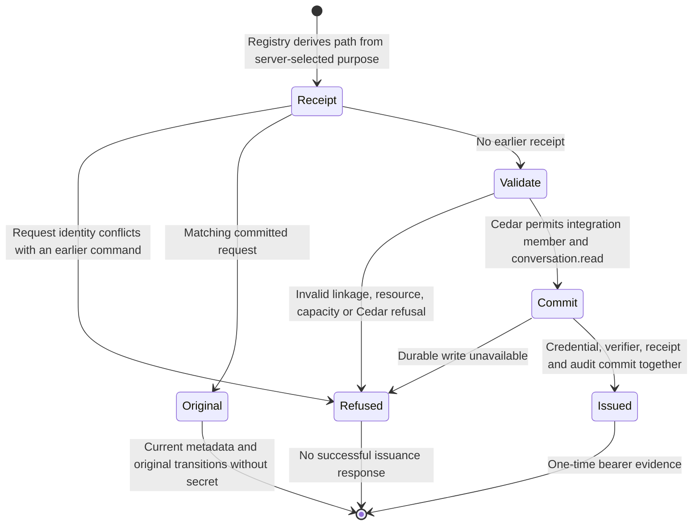
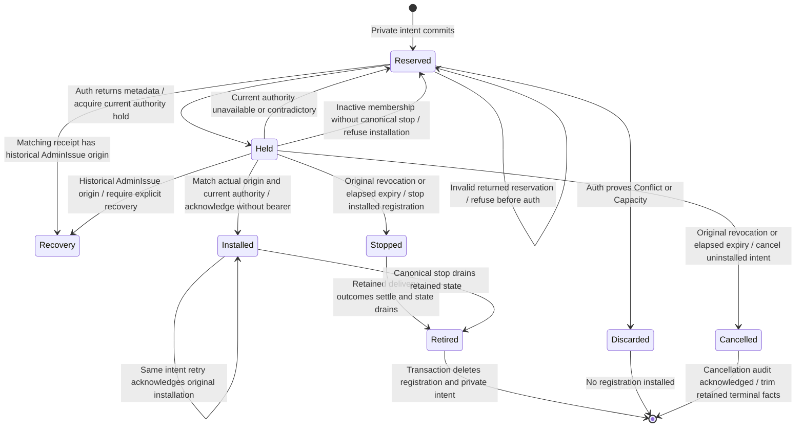

# Webhook credential issuance

The auth boundary can issue a read-only integration credential through the
existing registry. Private startup seeds select a principal on the existing
owner `credential.issue` command. The runtime retains registration work and
returns actual metadata with `secretUnavailable`, while ordinary principals keep
their existing one-time-secret behavior. Application installation (#1052) remains
separate. Canonical source, queue and signed sender are mounted with isolated
recipient coverage; whole-feature review and platform/browser/stress acceptance
remain separate gates.

## Guards and effects

The server-selected `CredentialIssuePurpose::Webhook` maps to `WebhookIssue`.
The existing `GrantPolicyEvaluator` asks Cedar who may receive the credential
and which grants it may hold. The webhook forbids permit only an integration
member with `conversation.read`; the existing member/admin policies own the role
decision. The registry owns identity linkage, audience, resource validation,
receipt capacity, durable mutation and transition evidence. Destination or MAC
key possession supplies no authority.

## Refusal and recovery

The existing fingerprint includes the webhook purpose. Changing between ordinary
and webhook issuance under the same issuer/request refuses before a registry
write, including after restart. A matching retry returns the original selected
credential ID and immutable transitions, even if a new ID or issuance time was
proposed. It cannot recover the bearer secret; the existing explicit recovery is
revoke and reissue. Metadata reflects the credential's current lifecycle, including
later revocation. The inner registration use case correlates that returned identity
and original transition against its retained inputs before installation.

The fresh-command refusal test compares registry bytes before and after each
denied request. Storage failure remains a typed failure, not proof of a remote
effect. This operation makes no HTTP request and does not claim delivery or
exactly-once remote effects. Attempt admission and durable delivery recovery are
owned by the [admission](webhook-admission.md) and [outbox](webhook-outbox.md)
pages.

## Destination installation

`RegisterWebhook` selects the webhook purpose and issuance-time projection before
reserving one immutable private intent. The SQLite owner retains the selected IDs,
original issuer/request, observation, destination and key. Same-input retries reuse
the original proposal; changed caller inputs or configuration conflict before auth.
The application-owned intent resolver also binds the returned reservation to the
original call immediately before auth, allowing only retained server selections
to differ. SQL replay asks that same resolver; it does not implement a second rule.
There are at most 64 intents, with 16-KiB issuance JSON and a borrowed whole-row byte
budget before owned configuration allocation. An intent is proposed input, not an
authorization decision or an auth receipt.

The auth owner reads the actual first journal transition with current credential,
membership and revision. One validated origin type retains the original cause,
actor, time, command correlation and journal identity. Parsing validates its
representation; authority comes from the existing injected reader and hold.
Registration compares that actual origin with its reserved command and checks the
returned receipt's actual sequence, revision and domain evidence.
It compares the complete current credential and membership with the returned metadata
and original inputs under an existing credential hold. An authority already revoked, expired or inactive at admission
installs nothing. Actual original revocation or elapsed expiry cancels an uninstalled
reservation; an installed replay instead goes through the existing stop-and-drain
owner. Cleanup keeps that same hold through sink acknowledgement and uses the
original stop evidence, even if membership has since become inactive. Inactive
membership alone grants no installation and creates no synthetic stop. A cleanup
failure remains a typed stopped-with-cleanup-failure result; an unavailable or
contradictory Auth snapshot retains the reservation for reconciliation. Absolute expiry can advance during installation; a saved
registration supplies no send permission, and delivery still requires fresh
admission. A lost auth or installation acknowledgement retains the
intent for retry. Initial success and matching replay both return a secret-free
RegisteredWebhook with registration ID and credential metadata. The auth port's
new bearer is consumed and discarded inside registration. It is not returned,
logged or stored in its intent. Ordinary credential.issue retains its existing
one-time-secret and unavailable-on-replay behavior. Replaying a retired receipt
cannot resurrect a destination; the auth owner must prove the newly proposed selected
ID was not issued before that uninstalled proposal can be discarded.

Installed identity has a mandatory foreign key to the original intent. The restoration
owner correlates target, configuration and observation before owed publication. The
schema owner compares every non-internal SQLite definition against its single schema,
including immutable guards and transactional retirement cleanup. Removing a guard,
weakening a reference or adding an effectful trigger rejects cold restoration.

This inner use case is **not** the W1 coordinator or a supervised command owner.
The concrete runtime now supplies W1 serialization, retained credential work,
actual revoke/stop coordination, original pending-command startup recovery and
the private product configuration entry point. The inner use case alone does
not establish those properties.

## Evidence and limits

The earlier source `6cfb9673` passed 212 auth unit tests and116 canonical
webhook tests. Its [registration evidence](../../../reviews/evidence/webhook-runtime/registration/README.md),
[repair controls](../../../reviews/evidence/webhook-runtime/registration/repair/README.md)
and [incomplete historical review](../../../reviews/evidence/webhook-runtime/registration/review-2/README.md)
remain preserved. That failed delivery has not been retried or reconstructed.
These are historical checks, not qualification of the new correction.

The correction uses actual retained origin and returns no bearer
output. [New correction evidence](../../../reviews/evidence/webhook-runtime/origin/README.md)
records its separate tests, failure controls and fresh review status.

The historical product-command checkpoint below added registration, W1
coordination and actual revoke/stop ownership. The later mounted checkpoint
records source capture, supervised sending and isolated recipient coverage.
Canonical scripted Chromium/WebKit and feature stress/chaos remain applicable
and unqualified. A documentation render does not qualify those gates.

## Original purpose and product session entry

Actual webhook issuance records a distinct WebhookIssue cause. The journal
validator checks its representation and original command receipt before effects;
restoration applies existing Cedar webhook grant restrictions to that origin.
There is no second purpose table. Access reads carry the original fact in the same
committed snapshot as current metadata; existing holds fence mutation.

Bearer and opaque-session entry ask the existing Cedar evaluator for session.enter.
Cedar admits the ordinary original issuing causes and refuses webhook origin.
This grants no conversation operation. Retirement removes private configuration,
while original auth provenance remains. Current expiry, revocation and membership
checks still apply. Operations continue to authorize with fresh state.

A failed registration may already have committed auth issuance. It retains the
actual auth fact and private intent; it refuses destination installation rather
than claiming rollback.

Historical AdminIssue is preserved exactly. Registration does not infer webhook
purpose from read-only grants or an old destination. Such an ambiguous origin
returns OriginRecoveryRequired without installing anything. Matching webhook receipt
replay reads the actual original fact before selecting command transitions. Missing
original correlation, a local operator or a different existing historical actor
therefore produce explicit recovery, not transient auth unavailability. The auth
reader and receipt owner use the same origin decoder. The private intent and auth
bytes remain; ordinary Product replay keeps its existing behavior. Explicit revoke and a
fresh issuance/request are required. Automatic cleanup of an already-issued,
uninstalled intent still needs the pending lifecycle coordinator; meanwhile the
private intent cap bounds retention. Other contradictory facts are inconsistent.
Ordinary product issuance is unchanged. Application installation and its session
model remain owned by #1052.

The recovery-classification correction at this source checkpoint is covered by
five accepted historical shapes, repeated registration, byte-preservation and
intent-retention checks in the linked registration tests. [Fresh review round 1](../../../reviews/evidence/webhook-runtime/origin/review-1/report.md)
reproduced the missing classification; the subsequent fresh round 2 result is linked below.

[Fresh round 2](../../../reviews/evidence/webhook-runtime/origin/review-2/report.md)
is clean for this source at candidate8346c4ae: all severity buckets empty, M1
independently verified fixed. No crate source changes follow source1c1355b5 in
that candidate. Runtime, lifecycle and full-feature qualification remain pending.

## Cancellation recovery source review

This page was checked against source `97c9c1d13adfe7ade3a3ca06e140ec47ff69df04`
for original Auth stop, uninstalled cancellation, installed stop handoff, retained
ownership and restoration/publication agreement. A revocation committed between
the issue reply and its current hold advances only the reply's revocation field
from the actual held journal fact. Complete credential equality still rejects
changed audience, grants or other bindings before cleanup. The actual-Auth race
is covered for uninstalled and installed ownership, with substitution refusals
and valid retry controls.

The corrected source passed192 webhook tests, seven-package all-target Clippy,
architecture, formatting and diff checks. The original race probe failed before
correction; removing full current-binding agreement fails its new regression.
The earlier13 cancellation controls retain their earlier scope rather than
claiming this exact final tree. [Independent round one](../../../reviews/evidence/webhook-runtime/recovery-cancellation/review-1.md)
found this race and the stopped-versus-drained diagram error.
[Fresh round two](../../../reviews/evidence/webhook-runtime/recovery-cancellation/review-2.md)
is clean at every priority and independently passed192 webhook tests, indexed
SQL plans and state-page source/link checks. Its reviewed candidate1a7ca49e
contains the same production/test bytes as this source checkpoint. Historical source-qualified results retain their
original revisions. Runtime composition, recipient E2E and browser rendering
remain unqualified.

## Retained product command checkpoint

The existing private `config.json` accepts at most 64 `webhooks` seeds. Each
selects `principalId`, an HTTPS `url` and a padded-base64 `macKey` encoding exactly
32 bytes. Validation precedes opening webhook storage, and diagnostics redact
URL/key material. No seeds and no existing database create no webhook files.
An existing private outbox is still opened and reconciled after seeds are removed.
Configuration does not issue a credential or perform DNS/HTTP work by itself.

| Boundary | Current owner behavior |
| --- | --- |
| owner issues configured principal | preserve original durable intent and actual Auth transitions, install under current authority, return secret-unavailable metadata |
| owner issues another principal | preserve the existing native ordinary issuance/replay/revoke contract |
| repeated configured request | resolve the original identity; a different command first observes installed current/expired/stopped history; uncertain uninstalled history is not displaced |
| fresh request after expiry or stop | acknowledge the original stop before a distinct registration; stopped nonterminal history stays separate and grants/cursors are not inherited |
| seeds removed while an intent remains | matching replay keeps its immutable configuration and Webhook purpose; a fresh request cannot fall through to ordinary issuance; unreadable history is not absence |
| caller disconnects | admitted work remains in the bounded runtime job set |
| public webhook share/unshare | validate caller attribution before target classification; reuse existing owner Act/Unshare policy actions respectively, including unshare on deleted conversations; retain the authorized native grant operation, with unshare on the independent control lane; ordinary targets keep their existing grant path |
| first command panic | seal admission and mark failure before waking the response observer |
| startup after interrupted issuance | reopen actual private stores and replay the original intent without recovering or issuing another bearer |
| shutdown | seal admission, poll other drains and join actual credential/grant work before reporting its typed outcome |
| drain failure, unknown result or exceeded deadline | keep separate webhook evidence in the process report; do not confirm cleanup from another owner's success |

The actual loopback WebSocket fixture exercises owner issue/register/share,
ordinary issuance/replay/revoke, request identity, ordinary/configured contention,
capability and nonowner refusal, lost observers, cold recovery and the production
cleanup function. A new regression originally reproduced successful cleanup while
a real canonical share write remained paused. Retaining share/unshare in the
same job owner makes cleanup wait for both physical operations.

This source checkpoint reviews the complete linked issuance path. Relative to
`97c9c1d`, the original linked-source changes are the independently reviewed
registry writer handoff, actual registration transition return, bounded intent
enumeration and closing the synthetic Windows audit handle before rename. The
new runtime/product/cleanup sources are traced together. The two inner issuance
and installation diagrams remain byte-identical: their transitions still apply.
No new diagram render, browser or recipient-delivery result is claimed.

[Product command evidence](../../../reviews/evidence/webhook-runtime/product-composition/README.md)
records exact source/test boundaries, original failures and caught controls.
The source and sender were unmounted in that slice. The later mounted checkpoint
below records composition without claiming final #896 acceptance.

## Mounted delivery checkpoint

At source `fc713591785970b8eca5ec20ad819024bf131cb0`, the product owner
flow issues/registers the configured principal and shares only the selected
conversation. The one retained runtime captures actual canonical records under
current principal authority, queues exact recordsPage bytes and sends through
the existing bounded signed HTTPS adapter. Ordinary credential/grant paths remain
their native operations; webhook credentials obtain no paired-reader authority.

Construction prepares dependencies without spawning a sender. The root starts
it after fallible listener/signal setup, immediately before entering the existing
retained serve/cleanup owner. Shutdown seals admission and joins actual physical
work; failed, unknown or exceeded-deadline evidence prevents confirmed cleanup.
The [outbox checkpoint](webhook-outbox.md#supervised-delivery-checkpoint) describes
positive response reconciliation, late expiry and the unchanged retention bound.

The isolated recipient fixtures use actual owner WebSocket commands, native
Auth/Cedar and canonical SDK records. Only the granted chat is delivered; HMAC,
retry identity/timestamp/signature/bytes, unshare/revoke/expiry/old-epoch no-send,
capability refusal, cold recovery and physical POST/revocation/shutdown ownership
are exercised. Only the test socket and in-memory CA replace public transport
preparation; production routing, TLS, deadline and byte policies are unchanged.
Historical unmounted/checkpoint statements above describe their earlier scoped
publications. The inner diagrams remain unchanged. Final whole-feature review,
source-matched CI/platform/browser and stress acceptance remain separate gates.

## Dispatch and credential lifecycle correction

Source `365f769078a3d2298340952ba519edc515468332` preserves current main
`5bb482a6b7c11dea2ddb64a2898edb6c623b0a19`, including Channels, GitHub App
and the later panel/stress integration. The correction addresses the
[whole-feature round-one findings](../../../reviews/evidence/webhook-runtime/delivery-composition/review-1.md).
That report remains changes-required at its original source; it is not a clean
review of this newer checkpoint.

Fresh dispatch admission, Sending and POST share one 15-second deadline. The
runtime releases partial fences independently while retaining and joining real
metadata/SQL work. It checks the last interruptible COMMIT boundary; an already
running filesystem sync can still finish a late conditional commit under
W-audit-race. An expired attempt cannot POST. Known complete responses retain
their actual outcome before callbacks and settle after authority is released.
Live reads reconcile unowned Sending and retry idle credential stops without a
grant or queued delivery; first reader/revocation facts remain unchanged.

Issuance distinguishes active registration authority, installed stopped history
and uncertain uninstalled reservations. Expired/stopped reissue acknowledges the
old stop before installing a new identity. Retained intents select replay even
after private seed removal; they do not become an ordinary credential route.
Once all private history is retired, no permanent principal classification is
inferred. Genuine unregistered principals retain native ordinary issuance.

At this exact source, 265 webhook tests passed with no retention exclusions,
38 host tests and the native principal-grant gate regression passed; required
seven-package all-target Clippy, formatting and 108 architecture tests/checker
passed. [Evidence and exclusions](../../../reviews/evidence/webhook-runtime/delivery-composition/README.md)
retain the original interrupted fixture, failed controls, source-specific results
and outstanding gates. Final assembled independent review and exact-head
CI/platform/browser/default-and-raised-stress remain required. The existing
inner diagrams describe the same authority and durable states and are unchanged;
no new renderer or browser result is claimed. Only these three feature pages and
their linked source changes are newly reconciled, not unrelated Auth/SDK pages.
