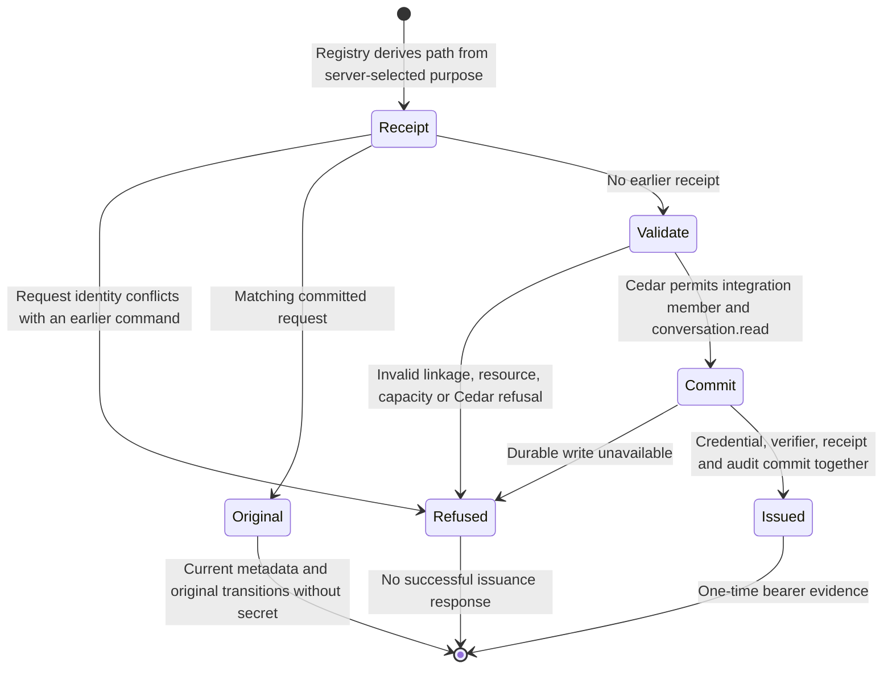
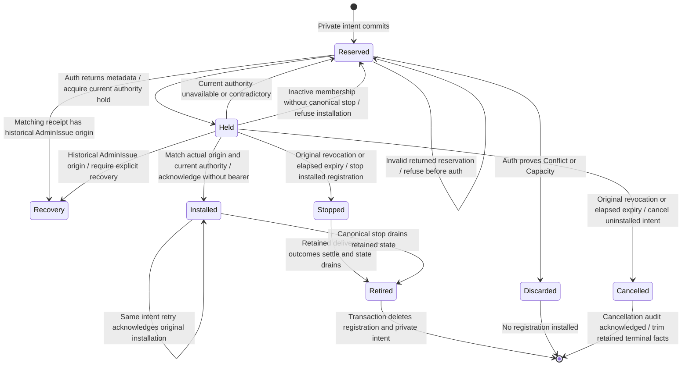

# Webhook credential issuance

The auth boundary can issue a read-only integration credential through the
existing registry. This checkpoint implements that issuing path and receipt
identity, plus an inner registration use case. The product handler still selects ordinary issuance: there is no
webhook configuration field or composed endpoint registration yet. Application
installation (#1052) remains separate.

## Guards and effects

The server-selected `CredentialIssuePurpose::Webhook` maps to `WebhookIssue`.
The existing `GrantPolicyEvaluator` asks Cedar who may receive the credential
and which grants it may hold. The webhook forbids permit only an integration
member with `conversation.read`; the existing member/admin policies own the role
decision. The registry owns identity linkage, audience, resource validation,
receipt capacity, durable mutation and transition evidence. Destination or MAC
key possession supplies no authority.

## Refusal and recovery

The existing fingerprint includes the webhook purpose. Changing between ordinary
and webhook issuance under the same issuer/request refuses before a registry
write, including after restart. A matching retry returns the original selected
credential ID and immutable transitions, even if a new ID or issuance time was
proposed. It cannot recover the bearer secret; the existing explicit recovery is
revoke and reissue. Metadata reflects the credential's current lifecycle, including
later revocation. The inner registration use case correlates that returned identity
and original transition against its retained inputs before installation.

The fresh-command refusal test compares registry bytes before and after each
denied request. Storage failure remains a typed failure, not proof of a remote
effect. This operation makes no HTTP request and does not claim delivery or
exactly-once remote effects. Attempt admission and durable delivery recovery are
owned by the [admission](webhook-admission.md) and [outbox](webhook-outbox.md)
pages.

## Destination installation

`RegisterWebhook` selects the webhook purpose and issuance-time projection before
reserving one immutable private intent. The SQLite owner retains the selected IDs,
original issuer/request, observation, destination and key. Same-input retries reuse
the original proposal; changed caller inputs or configuration conflict before auth.
The application-owned intent resolver also binds the returned reservation to the
original call immediately before auth, allowing only retained server selections
to differ. SQL replay asks that same resolver; it does not implement a second rule.
There are at most 64 intents, with 16-KiB issuance JSON and a borrowed whole-row byte
budget before owned configuration allocation. An intent is proposed input, not an
authorization decision or an auth receipt.

The auth owner reads the actual first journal transition with current credential,
membership and revision. One validated origin type retains the original cause,
actor, time, command correlation and journal identity. Parsing validates its
representation; authority comes from the existing injected reader and hold.
Registration compares that actual origin with its reserved command and checks the
returned receipt's actual sequence, revision and domain evidence.
It compares the complete current credential and membership with the returned metadata
and original inputs under an existing credential hold. An authority already revoked, expired or inactive at admission
installs nothing. Actual original revocation or elapsed expiry cancels an uninstalled
reservation; an installed replay instead goes through the existing stop-and-drain
owner. Cleanup keeps that same hold through sink acknowledgement and uses the
original stop evidence, even if membership has since become inactive. Inactive
membership alone grants no installation and creates no synthetic stop. A cleanup
failure remains a typed stopped-with-cleanup-failure result; an unavailable or
contradictory Auth snapshot retains the reservation for reconciliation. Absolute expiry can advance during installation; a saved
registration supplies no send permission, and delivery still requires fresh
admission. A lost auth or installation acknowledgement retains the
intent for retry. Initial success and matching replay both return a secret-free
RegisteredWebhook with registration ID and credential metadata. The auth port's
new bearer is consumed and discarded inside registration. It is not returned,
logged or stored in its intent. Ordinary credential.issue retains its existing
one-time-secret and unavailable-on-replay behavior. Replaying a retired receipt
cannot resurrect a destination; the auth owner must prove the newly proposed selected
ID was not issued before that uninstalled proposal can be discarded.

Installed identity has a mandatory foreign key to the original intent. The restoration
owner correlates target, configuration and observation before owed publication. The
schema owner compares every non-internal SQLite definition against its single schema,
including immutable guards and transactional retirement cleanup. Removing a guard,
weakening a reference or adding an effectful trigger rejects cold restoration.

This inner use case is **not** the W1 coordinator or a supervised command owner.
Caller cancellation, complete revocation coordination, automatic pending-command
recovery and the product configuration entry point still require runtime composition.

## Evidence and limits

The earlier source `6cfb9673` passed 212 auth unit tests and116 canonical
webhook tests. Its [registration evidence](../../../reviews/evidence/webhook-runtime/registration/README.md),
[repair controls](../../../reviews/evidence/webhook-runtime/registration/repair/README.md)
and [incomplete historical review](../../../reviews/evidence/webhook-runtime/registration/review-2/README.md)
remain preserved. That failed delivery has not been retried or reconstructed.
These are historical checks, not qualification of the new correction.

The parent selected actual retained origin and removal of unnecessary bearer
output. [New correction evidence](../../../reviews/evidence/webhook-runtime/origin/README.md)
records its separate tests, failure controls and fresh review status.

Product registration, W1 coordination across ordinary issuance, revocation/expiry stop
composition, source capture, supervised sending and actual recipient E2E remain
unfinished. Canonical scripted Chromium/WebKit and feature stress/chaos remain
applicable and unqualified. A documentation render does not qualify those gates.

## Original purpose and product session entry

Actual webhook issuance records a distinct WebhookIssue cause. The journal
validator checks its representation and original command receipt before effects;
restoration applies existing Cedar webhook grant restrictions to that origin.
There is no second purpose table. Access reads carry the original fact in the same
committed snapshot as current metadata; existing holds fence mutation.

Bearer and opaque-session entry ask the existing Cedar evaluator for session.enter.
Cedar admits the ordinary original issuing causes and refuses webhook origin.
This grants no conversation operation. Retirement removes private configuration,
while original auth provenance remains. Current expiry, revocation and membership
checks still apply. Operations continue to authorize with fresh state.

A failed registration may already have committed auth issuance. It retains the
actual auth fact and private intent; it refuses destination installation rather
than claiming rollback.

Historical AdminIssue is preserved exactly. Registration does not infer webhook
purpose from read-only grants or an old destination. Such an ambiguous origin
returns OriginRecoveryRequired without installing anything. Matching webhook receipt
replay reads the actual original fact before selecting command transitions. Missing
original correlation, a local operator or a different existing historical actor
therefore produce explicit recovery, not transient auth unavailability. The auth
reader and receipt owner use the same origin decoder. The private intent and auth
bytes remain; ordinary Product replay keeps its existing behavior. Explicit revoke and a
fresh issuance/request are required. Automatic cleanup of an already-issued,
uninstalled intent still needs the pending lifecycle coordinator; meanwhile the
private intent cap bounds retention. Other contradictory facts are inconsistent.
Ordinary product issuance is unchanged. Application installation and its session
model remain owned by #1052.

The recovery-classification correction at this source checkpoint is covered by
five accepted historical shapes, repeated registration, byte-preservation and
intent-retention checks in the linked registration tests. [Fresh review round 1](../../../reviews/evidence/webhook-runtime/origin/review-1/report.md)
reproduced the missing classification; the subsequent fresh round 2 result is linked below.

[Fresh round 2](../../../reviews/evidence/webhook-runtime/origin/review-2/report.md)
is clean for this source at candidate8346c4ae: all severity buckets empty, M1
independently verified fixed. No crate source changes follow source1c1355b5 in
that candidate. Runtime, lifecycle and full-feature qualification remain pending.

## Cancellation recovery source review

This page was checked against source `97c9c1d13adfe7ade3a3ca06e140ec47ff69df04`
for original Auth stop, uninstalled cancellation, installed stop handoff, retained
ownership and restoration/publication agreement. A revocation committed between
the issue reply and its current hold advances only the reply's revocation field
from the actual held journal fact. Complete credential equality still rejects
changed audience, grants or other bindings before cleanup. The actual-Auth race
is covered for uninstalled and installed ownership, with substitution refusals
and valid retry controls.

The corrected source passed192 webhook tests, seven-package all-target Clippy,
architecture, formatting and diff checks. The original race probe failed before
correction; removing full current-binding agreement fails its new regression.
The earlier13 cancellation controls retain their earlier scope rather than
claiming this exact final tree. [Independent round one](../../../reviews/evidence/webhook-runtime/recovery-cancellation/review-1.md)
found this race and the stopped-versus-drained diagram error; fresh review of the
corrections remains pending. Historical source-qualified results retain their
original revisions. Runtime composition, recipient E2E and browser rendering
remain unqualified.
