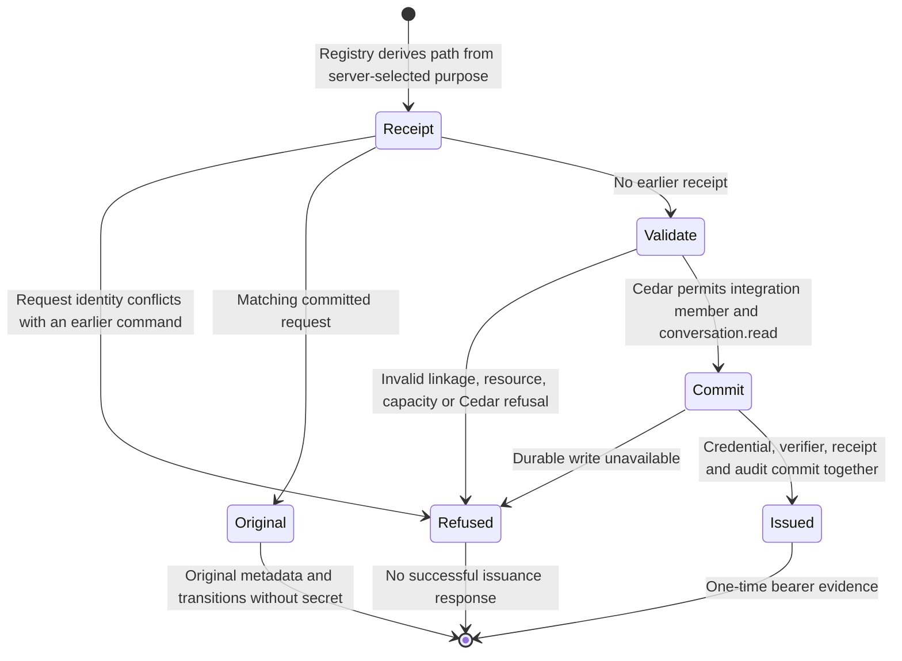

# Webhook credential issuance

The auth boundary can issue a read-only integration credential through the
existing registry. This checkpoint implements that issuing path and receipt
identity. The product handler still selects ordinary issuance: there is no
webhook configuration field or composed endpoint registration yet. Application
installation (#1052) remains separate.

## Guards and effects

The server-selected `CredentialIssuePurpose::Webhook` maps to `WebhookIssue`.
The existing `GrantPolicyEvaluator` asks Cedar who may receive the credential
and which grants it may hold. The webhook forbids permit only an integration
member with `conversation.read`; the existing member/admin policies own the role
decision. The registry owns identity linkage, audience, resource validation,
receipt capacity, durable mutation and transition evidence. Destination or MAC
key possession supplies no authority.

## Refusal and recovery

The existing fingerprint includes the webhook purpose. Changing between ordinary
and webhook issuance under the same issuer/request refuses before a registry
write, including after restart. A matching retry returns the original selected
credential ID and immutable transitions, even if a new ID or issuance time was
proposed. It cannot recover the bearer secret; the existing explicit recovery is
revoke and reissue. Configuration intent and endpoint installation must correlate
that returned identity before installing a destination; that coordinator is
still pending.

The fresh-command refusal test compares registry bytes before and after each
denied request. Storage failure remains a typed failure, not proof of a remote
effect. This operation makes no HTTP request and does not claim delivery or
exactly-once remote effects. Attempt admission and durable delivery recovery are
owned by the [admission](webhook-admission.md) and [outbox](webhook-outbox.md)
pages.

## Evidence and limits

At this exact source, the full auth library suite passed **212 tests**. The
[registry tests](../../../../crates/nessa-auth/tests/adapters/local/webhook_issue.rs)
exercise policy refusal before writes, cross-purpose receipt substitution in
both directions, cold replay, original transitions and unavailable secret.
The [Cedar matrix](../../../../crates/nessa-auth/src/adapters/cedar/evaluator_tests.rs)
checks principal kinds, actions and issuing paths. Six fail/restore probes caught
removal of the relevant kind/action restrictions, path mapping/use and receipt
purpose binding; every restored control passed with byte-identical source.

Required seven-package all-target Clippy with `-D warnings`, server all-target
check and the architecture checker passed. The first architecture invocation
could not find Cargo on PATH; the corrected invocation passed. The pre-existing
lease const-evaluation notice remains in check/Clippy output.

Registration, W1 coordination across ordinary issuance, revocation/expiry stop
composition, source capture, supervised sending and actual recipient E2E remain
unfinished. Canonical scripted Chromium/WebKit and feature stress/chaos remain
applicable and unqualified. A documentation render does not qualify those gates.
