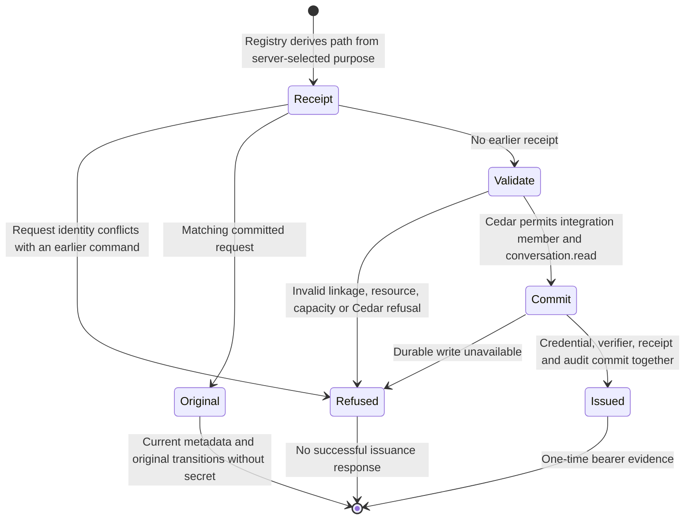
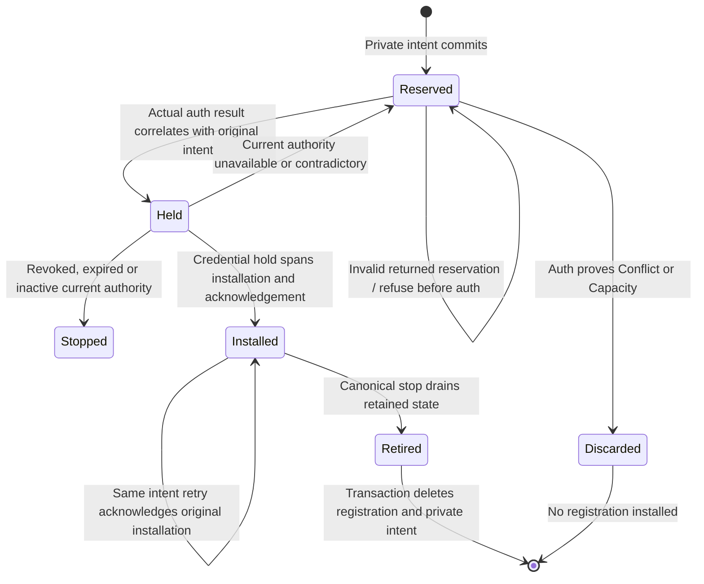

# Webhook credential issuance

The auth boundary can issue a read-only integration credential through the
existing registry. This checkpoint implements that issuing path and receipt
identity, plus an inner registration use case. The product handler still selects ordinary issuance: there is no
webhook configuration field or composed endpoint registration yet. Application
installation (#1052) remains separate.

## Guards and effects

The server-selected `CredentialIssuePurpose::Webhook` maps to `WebhookIssue`.
The existing `GrantPolicyEvaluator` asks Cedar who may receive the credential
and which grants it may hold. The webhook forbids permit only an integration
member with `conversation.read`; the existing member/admin policies own the role
decision. The registry owns identity linkage, audience, resource validation,
receipt capacity, durable mutation and transition evidence. Destination or MAC
key possession supplies no authority.

## Refusal and recovery

The existing fingerprint includes the webhook purpose. Changing between ordinary
and webhook issuance under the same issuer/request refuses before a registry
write, including after restart. A matching retry returns the original selected
credential ID and immutable transitions, even if a new ID or issuance time was
proposed. It cannot recover the bearer secret; the existing explicit recovery is
revoke and reissue. Metadata reflects the credential's current lifecycle, including
later revocation. The inner registration use case correlates that returned identity
and original transition against its retained inputs before installation.

The fresh-command refusal test compares registry bytes before and after each
denied request. Storage failure remains a typed failure, not proof of a remote
effect. This operation makes no HTTP request and does not claim delivery or
exactly-once remote effects. Attempt admission and durable delivery recovery are
owned by the [admission](webhook-admission.md) and [outbox](webhook-outbox.md)
pages.

## Destination installation

`RegisterWebhook` selects the webhook purpose and issuance-time projection before
reserving one immutable private intent. The SQLite owner retains the selected IDs,
original issuer/request, observation, destination and key. Same-input retries reuse
the original proposal; changed caller inputs or configuration conflict before auth.
The application-owned intent resolver also binds the returned reservation to the
original call immediately before auth, allowing only retained server selections
to differ. SQL replay asks that same resolver; it does not implement a second rule.
There are at most 64 intents, with 16-KiB issuance JSON and a borrowed whole-row byte
budget before owned configuration allocation. An intent is proposed input, not an
authorization decision or an auth receipt.

The auth domain's validated transition type owns lifecycle evidence validation;
registration checks its relationship to the original command and request correlation.
It compares the complete current credential and membership with the returned metadata
and original inputs under an existing credential hold. A revoked, expired or inactive
result installs nothing. A lost auth or installation acknowledgement retains the
intent for retry and never recovers a bearer secret. Replaying a retired receipt
cannot resurrect a destination; the auth owner must prove the newly proposed selected
ID was not issued before that uninstalled proposal can be discarded.

Installed identity has a mandatory foreign key to the original intent. The restoration
owner correlates target, configuration and observation before owed publication. The
schema owner compares every non-internal SQLite definition against its single schema,
including immutable guards and transactional retirement cleanup. Removing a guard,
weakening a reference or adding an effectful trigger rejects cold restoration.

This inner use case is **not** the W1 coordinator or a supervised command owner.
Caller cancellation, complete revocation coordination, automatic pending-command
recovery and the product configuration entry point still require runtime composition.

## Evidence and limits

The full auth library suite passed **212 tests** at this source. The canonical
server webhook suite passed **116 tests**. The registration [evidence](../../../reviews/evidence/webhook-runtime/registration/README.md)
retains the 21 original caught-and-restored probes and earlier failures. The
[repair evidence](../../../reviews/evidence/webhook-runtime/registration/repair/README.md)
records 12 further caught-and-restored probes for original-call resolution and
transient failure classification. Review round1 is preserved as not clean;
fresh review of the correction is pending. Auth source has not changed since its
212-test run. The [registry tests](../../../../crates/nessa-auth/tests/adapters/local/webhook_issue.rs)
exercise policy refusal before writes, cross-purpose receipt substitution in
both directions, cold replay, original transitions and unavailable secret.
The [Cedar matrix](../../../../crates/nessa-auth/src/adapters/cedar/evaluator_tests.rs)
checks principal kinds, actions and issuing paths. Six fail/restore probes caught
removal of the relevant kind/action restrictions, path mapping/use and receipt
purpose binding; every restored control passed with byte-identical source.

Required seven-package all-target Clippy with `-D warnings`, server all-target
check and the architecture checker passed. The first architecture invocation
could not find Cargo on PATH; the corrected invocation passed. The pre-existing
lease const-evaluation notice remains in check/Clippy output.

Product registration, W1 coordination across ordinary issuance, revocation/expiry stop
composition, source capture, supervised sending and actual recipient E2E remain
unfinished. Canonical scripted Chromium/WebKit and feature stress/chaos remain
applicable and unqualified. A documentation render does not qualify those gates.

The intended no-product-session classification still needs an auth-owned immutable
purpose fact and the existing Cedar product-entry boundary. The issuing-path purpose
currently binds the receipt; it does not persist a credential-use classification.
This gap is not addressed by looking up only active registration rows. General
application installation and its session model remain owned by #1052.
