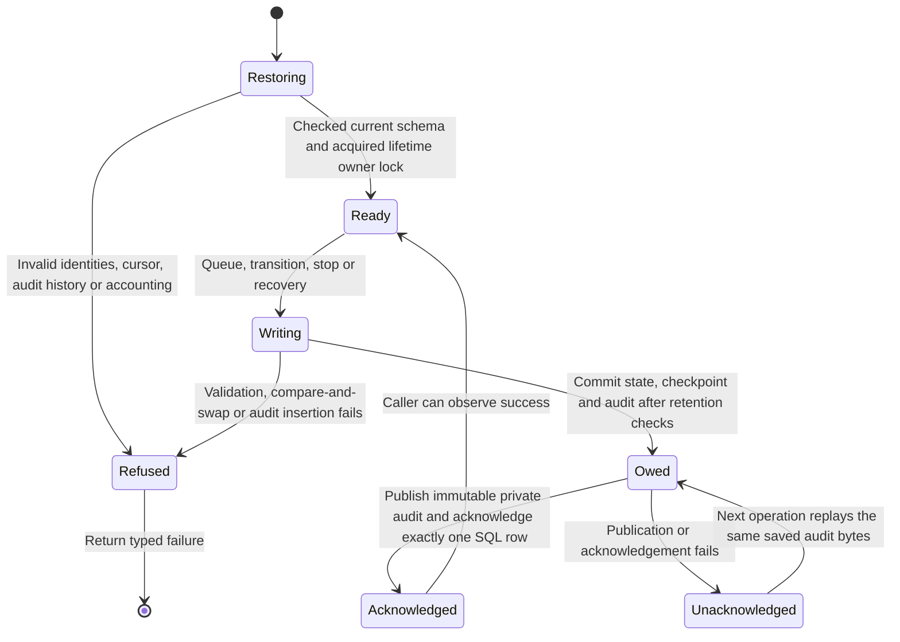

# Durable outbound webhook state

The private outbox keeps each selected record's delivery identity, exact bytes,
source checkpoint and causal audit together. An interrupted audit publication
can resume without creating a new delivery. This page describes persistence
beneath [delivery mechanics](webhook-foundation.md) and
[current authority admission](webhook-admission.md).

This checkpoint is an uncomposed storage adapter. No product command registers
it, no authorized source reader feeds it, and no supervised sender consumes it.
Those pieces and capability/revoke delivery E2E remain required for
[issue #896](https://github.com/nessalabs/nessa-agent/issues/896).
The storage registration methods accept trusted facts; they do not authorize
credential issuance or sharing. Application installation #1052 and inbound
workflow triggers #1088 remain separate.

## Restoration redesign

The parent explicitly authorized a focused redesign after the prior bounded
review handoff. The original [findings and reproductions](../../../reviews/evidence/webhook-outbox/blocked-review.md)
remain historical evidence. This source replaces open audit JSON with one
closed record type and routes every cursor read through a complete decoder.
Fresh review of this redesign is pending; it is not full feature acceptance.

The same typed audit validator serves writing, restoration and publication.
It rejects unknown fields, malformed identities and actors, negative timestamps,
impossible before/after transitions and mismatched checkpoint projections.
Delivery evidence retains complete before and after snapshots; the existing
domain transition methods validate their legal relationship. Restored retained
chains keep their target/checkpoint and source-change context, and end at the
current delivery row. Validation streams one predecessor at a time.

Registration retirement evidence contains its original target and revocation
or expiry actor. It can be replayed after the registration has been deleted;
restoration does not reconstruct an actor from current ownership. The cursor
decoder covers identity, scope, integer position and reset flag at startup and
before live duplicate acknowledgement. SQLite corruption refusals map to
Invalid; transient I/O remains Unavailable.

## Acknowledging one durable operation

The outbox owns the operation below. Publication acknowledgement is local audit
durability; it says nothing about a recipient's effects.

### State committed and audit still owed

A queued row and its contiguous source cursor commit in the same SQLite
transaction as audit evidence. A repeated identical checkpoint returns the
original delivery ID. Different bytes, scope or epoch refuse conflict instead
of replacing a delivery. Predecessor comparison prevents skipping a record.
Pending work is read from durable rows, four at a time.

Every write uses one journal commit owner. It enforces pending and terminal
retention accounting, removes eligible published projections and retires a
drained stopped registration. The audit publisher writes immutable private
files, synchronizes them and their directory, then acknowledges exactly one
SQL row. Existing files must contain the identical saved bytes. An unavailable
publisher returns a visible failure even after SQL committed. The next
operation publishes owed evidence before admitting further work.

That uncertain acknowledgement is not permission to POST again. The future
sender must reconcile durable Sending and outcome records while retaining its
known observation. A Sending row restored without a durable outcome becomes
terminal Unknown. The storage recovery method performs no HTTP.

## Source replacement and stopping

A physical source change marks its cursor reset-required. Queued and Retry
rows are refused with the observing reader's identity and their actual prior
phase. A Sending row retains its observation responsibility. The same write
captures immutable source-change context on that row without claiming a
phase transition. If its later response schedules Retry, common cleanup
refuses that Retry with the captured context even after a cursor reset.
A known success stays success; restart without an observation stays Unknown.

Registration stop records its canonical cause, initiator and stop time, and
refuses pending work in one transaction. Sending still settles its own
observation. A later retry is refused using the saved stop cause. After its
published terminal projections drain, the registration, URL, key and cursors
are deleted with retirement evidence. Actual credential-revoke coordination
and first-expiry-observer persistence are not yet implemented.

## Bounds and private data

The adapter holds one canonical filesystem owner lock. Four retained blocking
operation permits bound physical work, including work whose waiting caller
was cancelled. The owner and permit survive until that physical operation
returns. Cancellation cannot open a replacement store behind an active worker.

There are at most 64 registrations, 1024 pending rows and 1024 retained terminal
rows per registration. Startup checks these counts before collecting bulk
work; bounded scans take at most the owner limit plus one sentinel. Existing
schema bounds include a 128-KiB body and 16-KiB audit record. Terminal SQL
projections may be removed only after audit publication; immutable audit files
have no automatic retention policy in this slice. Registering these constants
in the generated limits catalog remains part of runtime integration.

Private registration storage contains the URL and 32-byte key. Audit evidence
contains identities, checkpoints, before/after meaning, cause and initiator;
it excludes endpoint, key, record payload and remote response text. Destination
and transport policy remain owned by the linked delivery mechanics page.

### Failures and recovery

| Failure or interrupted ordering | Saved result and recovery |
| --- | --- |
| Cursor conflict or failed audit insertion | Transaction rolls back; no partial checkpoint, identity or audit. |
| Audit projection unavailable after SQL commit | Return unavailable; next operation replays the saved evidence first. |
| Projection file exists with different bytes | Refuse without replacing historical evidence. |
| SQL publication acknowledgement affects zero rows | Conflict; do not spin or report publication success. |
| Sending observer disappears or process restarts | Startup recovery records Unknown; no automatic POST. |
| Stop or source replacement reaches retention ceiling | Shared commit owner trims only eligible published rows in the same write. |
| Invalid typed identity, cursor, lifecycle, audit history, encoding or capacity | Refuse before publication, cleanup or filtered ready scans. |
| Caller stops awaiting a blocking operation | Physical worker retains its capacity permit and owner lock until completion. |

## Evidence and remaining gates

The [outbox adapter tests](https://github.com/nessalabs/nessa-agent/blob/1c3085add14833a862681f6697f1e4ea31f9ba86/crates/nessa-server/tests/webhooks/infrastructure/outbox.rs)
exercise actual private SQLite/filesystem state with synthetic keys and no
recipient network. They cover checkpoint identity, compare-and-swap, stop and
source replacement, unknown restart, audit failures, restoration and capacity,
physical ownership after cancellation and retained-history limits.

This source checkpoint passed 69 webhook tests, including 39 outbox tests,
and required seven-package Clippy, architecture, formatting and diff checks.
This redesign adds malformed
historical audit, transition/chain, complete cursor and lost-ack retirement
recovery regressions. Twenty-nine new copied-source mutations were caught and
the affected tests passed after restoration. Canonical checks and the pending fresh
review checkpoint are recorded in [typed-state evidence](../../../reviews/evidence/webhook-outbox/typed-state/README.md).
Historical earlier checks do not establish acceptance of newer source.

Canonical Chromium/WebKit, stress and chaos evidence remains an applicable
integration gate. The foundation's hosted browser setup timed out before
assertions ran; local pinned browser binaries were unavailable. The
[validation handoff](../../../reviews/evidence/webhook-validation-gates/README.md)
records exact inputs and exclusions. No browser gate is waived by this
adapter being unmounted. Full registration, authorized source selection,
current-authority dispatch, live outcome reconciliation and capability/revoke
E2E remain unfinished.
