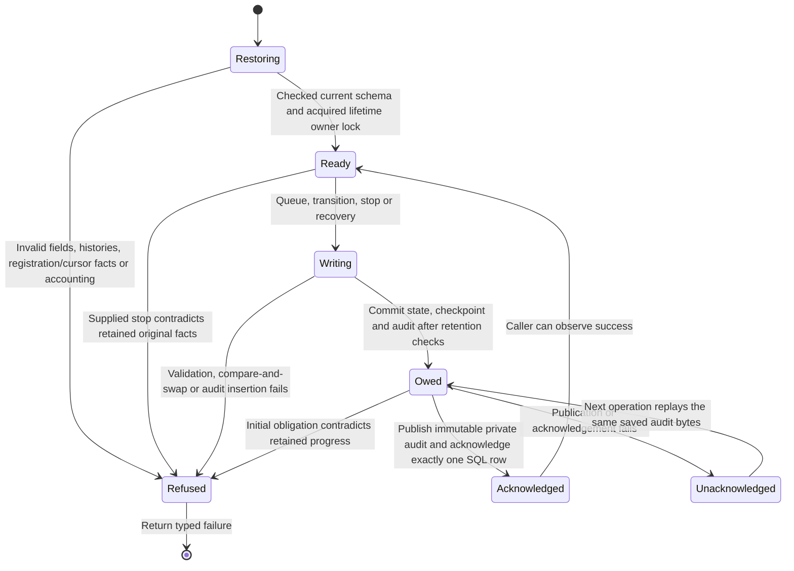
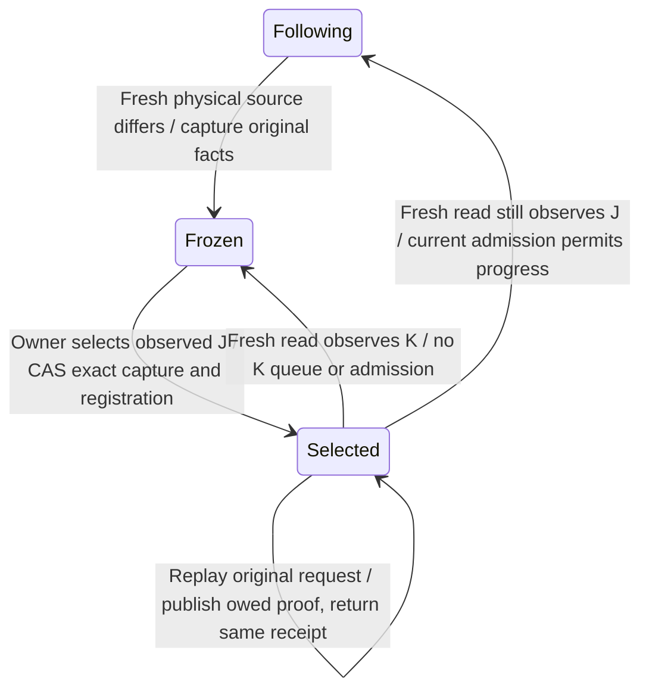
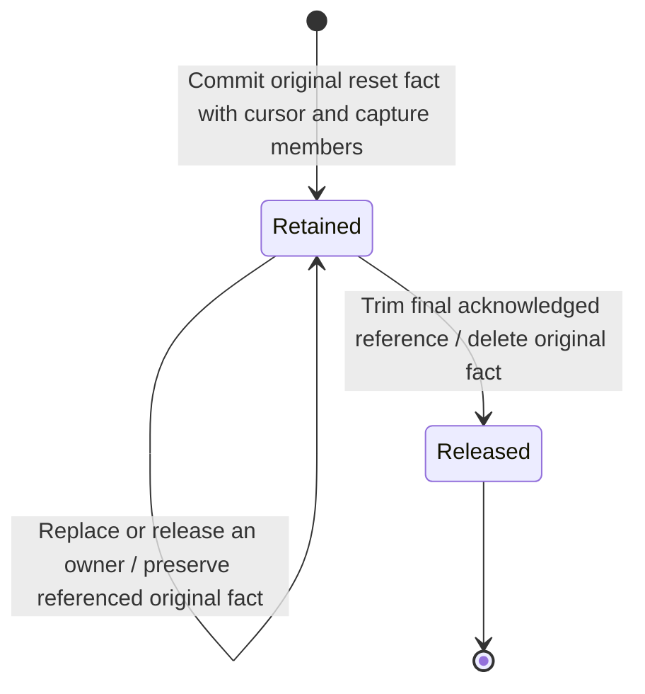
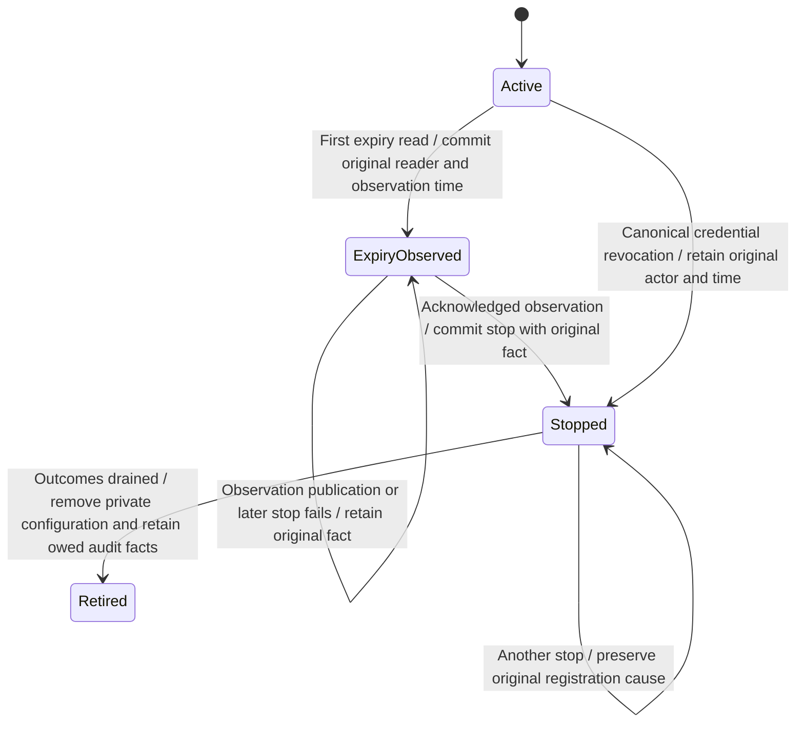

# Durable outbound webhook state

The private outbox keeps each selected record's delivery identity, exact bytes,
source checkpoint and causal audit together. An interrupted audit publication
can resume without creating a new delivery. This page describes persistence
beneath [delivery mechanics](webhook-foundation.md) and
[current authority admission](webhook-admission.md).

The current runtime connects owner issuance/registration and principal sharing to
canonical source capture, this private outbox and signed delivery. Construction
returns passive dependencies; the root starts the one retained sender after
fallible startup and joins it through the same process cleanup owner. Application
installation #1052 and inbound workflow triggers #1088 remain separate.

## Principal read boundary

The [principal source use case](record-reads.md#principal-source-reads) obtains
bounded canonical SDK head/pages under current Auth, exact grant revision and
Cedar. It constructs no paired receiver. A saved cursor is only progress; each
physical read and dispatch asks current authority again. A source replacement
captures its original reset fact and freezes the cursor, including an empty
replacement head. Bounded source preparation pauses without cursor or POST effects.

## Cancelling a stopped uninstalled reservation

The inner registration use case checks actual original Auth issuance and current
credential identity before cleanup. An original revocation or elapsed expiry
cancels an uninstalled private intent without installing its destination. The
SQLite owner checks the saved intent and original stop before publishing any
owed evidence, then atomically records cancellation and deletes the private
intent. An installed replay uses the existing stop-and-drain owner instead.
Neither path sends HTTP or grants delivery permission.

Cancelled and drained are distinct retained terminal kinds. Both use the same
indexed credential ownership check, which rejects duplicate retained owners and
live/retired overlap. Restoration and publication correlate retained target,
original stop and audit history: cancellation cannot claim an installation,
expiry observation or drain. A drained registration may retain its valid
original lifecycle history. The registration-leading history query reads at most
five rows: four legal lifecycle facts and one contradiction sentinel. Lost audit
acknowledgement replays identical bytes and preserves the first observer; only
acknowledged evidence may be trimmed. A different private schema is refused.

The runtime retains these native operations across caller cancellation and
joins their actual results at shutdown; startup replays their original inputs.
The cancellation tests exercise original revocation, expiry boundaries,
supersession, inactive membership cleanup, held Auth reads, publication failure,
cold restoration, conflicting histories and distinct-credential controls.

## Observing an actual credential stop

The inner stop use case holds the current Auth snapshot while it asks the outbox
to stop that credential. A revocation must carry the original journal record;
missing or mismatched evidence fails before the stop is requested. Without a
revocation, only elapsed expiry creates an expiry observation. A credential whose
start time is still in the future does not create an expiry event. This use case
is mounted by retained revoke, startup and reader observation paths. The
runtime owns cancellation and shutdown; this inner future alone supplies neither.

The same bounded stop value is stored with live registrations, retirements and
causal audit. It retains the original principal or offline operator, revocation
cause, replacement identity, sequence, revision and command correlation. Original
Auth command and effective revocation times stay in seconds; the first local stop
observation stays in milliseconds. Expiry retains its actual first reader instead
of inventing an Auth event. A later revocation does not replace prior expiry.

A current-bound Auth fact and a decoded retained record are distinct types.
Decoding retained shape establishes neither journal origin nor current permission.
Restoration correlates it with the owning registration and audit; live delivery
still needs current credential, grant and Cedar admission. A new stop input is
checked against retained original facts before owed audit publication. A different
original record refuses; a retry of the same record preserves the first local
observation, including after retirement and cold restore. The credential lookup
uses a bounded indexed selection and refuses ambiguous retained ownership.

The [actual-source tests](../../../../crates/nessa-server/tests/webhooks/infrastructure/outbox/registration_stop.rs)
cover original facts, the held Auth read through sink acknowledgement, lost
acknowledgement, restoration and substitution before
publication. [Row and lookup tests](../../../../crates/nessa-server/tests/webhooks/infrastructure/outbox/stop_rows.rs)
check borrowed allocation budgets, valid maximum stop bytes and bounded lookup
work at the registration ceiling. This source checkpoint records inspected code,
not platform, browser, CI or full feature qualification.

## Restoration redesign

The parent explicitly authorized a focused redesign after the prior bounded
review handoff. The original [findings and reproductions](../../../reviews/evidence/webhook-outbox/blocked-review.md)
remain historical evidence. This source replaces open audit JSON with one
closed record type and routes every cursor read through a complete decoder.
The first two fresh reviews found missing contextual correlations. Their
[reports and exact demonstrations](../../../reviews/evidence/webhook-outbox/typed-state/README.md)
remain preserved as findings at their historical source. The parent adopted a
total contextual restoration owner. Fresh review at `5bb457db` then found a source-reset
provenance gap and a live selection-cost regression. The [report](../../../reviews/evidence/webhook-outbox/total-context/review-1/report.md)
and original demonstrations remain preserved. The parent adopted a shared immutable
reset owner, originally implemented at `b3dc0d46`. Its validation and review
status belongs to [shared reset evidence](../../../reviews/evidence/webhook-outbox/shared-reset/README.md).
Fresh [independent round two](../../../reviews/evidence/webhook-outbox/shared-reset/review-2/report.md)
is clean at `546de7af`, with all priority buckets empty. This clears the persistence
review gate. Full feature acceptance remains separate.

The same typed audit validator serves writing, restoration and publication.
It rejects unknown fields, malformed identities and actors, negative timestamps,
impossible before/after transitions and mismatched checkpoint projections.
Delivery evidence retains complete before and after snapshots; the existing
domain transition methods validate their legal relationship. Restored retained
chains keep their target/checkpoint and source-change context, and end at the
current delivery row. Validation streams one predecessor at a time.

Authority-stop delivery evidence also retains the credential stop's original
cause, actor and time, separate from this observation's time. Its projections
must agree with that saved context. While the owning registration remains,
restore checks this context against its immutable stop fact. A live registration
cannot supply credential-stop evidence. Settled source context must equal the
current delivery's complete context. Sending may retain a reset before its first outcome audit. Its immutable capture
membership names the original Sending state; history must reach that state before
projecting the reset identity. Recovery carries the original reset cause forward.

The restoration owner matches every closed audit variant explicitly. Registration
Issue evidence matches the original target and issuance time; Stop matches its
original cause, actor and time. Cursor evidence matches the retained prior
checkpoint plus the captured replacement scope, reader and observation time.
Delivery evidence matches its retained target/checkpoint and credential stop;
its history must end at the current delivery. Publication validates all owed
records before writing the first immutable audit file.

Retirement deletes private URL/key/cursors while retaining secret-free original
target, issuance, stop and retirement-time facts. Those facts name the exact
retirement audit, whose deferred foreign key prevents losing that owed identity.
Issue/Stop evidence from the same atomic retirement can correlate against these
facts after the private registration has gone. Drained requires this retirement
and no live registration. Acknowledged audit projections and retirement facts
trim together. Recovery never reconstructs an actor from current ownership.

The cursor decoder covers identity, scope, integer position, reset flag and
shared reset reference at startup and before live duplicate acknowledgement.
A frozen cursor requires its original source-change fact. An initial following
cursor carries no reset reference; after an owner reset it retains the immutable
selection identity as its durable capture generation. This remains checked after the published cursor audit has been trimmed.
SQLite corruption refusals map to Invalid; transient I/O remains Unavailable.

## Acknowledging one durable operation

The outbox owns the operation below. Publication acknowledgement is local audit
durability; it says nothing about a recipient's effects.

### State committed and audit still owed

A queued row and its contiguous source cursor commit in the same SQLite
transaction as audit evidence. A repeated identical checkpoint returns the
original delivery ID. Different bytes, scope or epoch refuse conflict instead
of replacing a delivery. Predecessor comparison prevents skipping a record.
Pending work is read from durable rows, four at a time.

Every write uses one journal commit owner. It enforces pending and terminal
retention accounting, removes eligible published projections and retires a
drained stopped registration. The audit publisher writes immutable private
files, synchronizes them and their directory, then acknowledges exactly one
SQL row. Existing files must contain the identical saved bytes. An unavailable
publisher returns a visible failure even after SQL committed. The next
operation publishes owed evidence before admitting further work.

That uncertain acknowledgement is not permission to POST again. The future
sender must reconcile durable Sending and outcome records while retaining its
known observation. A Sending row restored without a durable outcome becomes
terminal Unknown. The storage recovery method performs no HTTP.

## Explicit owner reset

The reset, attempt pin and public status changes are checked at the source
revision recorded above. Whole-feature independent review and source-matched
CI/platform/browser acceptance remain separate gates.

`conversation.webhook.cursor` reads the current scoped checkpoint for a registered
webhook target. While frozen, it returns the server-issued capture UUID as
`requestId`. `conversation.webhook.reset` accepts that request, conversation and
target credential; it accepts no scope, epoch or offset from the caller. Both
commands run under retained product ownership, fresh credential and Cedar checks.
Reset uses existing owner and target-sharing policy with current target facts;
no webhook credential gains paired-reader authority.

The canonical SDK Head selects the complete observed scope J. Native reset
atomically compares the registration/credential installation and exact frozen
capture, retains the original before-image and actor/time, and binds J at position
zero with a new immutable selection generation. Existing deliveries retain their
original identity, payload, capture and outcome. A delayed old Head or Page cannot
cross that generation, including when scope and position look identical again.

J may cease to be current before the native reset commits. The result truthfully
reports the observed selection and receipt, not resumed delivery or a
current-at-commit guarantee. If the next read observes K, the existing source
change transition freezes J again; K needs another explicit reset. Failed freeze
publication stops the cycle. Already-Sending work retains its original outcome
responsibility; current credential/grant revocation fences still govern dispatch.

Replay freshly authorizes and returns the original selected J, actor/time and
receipt after later replacement, reset or restart, without another rewind. A
retained choice alone is not an acknowledged response: owed audit publication
must complete before success. Changed actor, target, conversation or registration
generation refuses. Receipts share the existing bounded reset fact family and
remain while their registration lives; drained registration retirement removes
them with private configuration. Capacity refusal leaves the frozen cursor intact.

## Optional observed source Head

The default owner cursor response remains a native read without canonical-read
admission, reader capacity or physical Head I/O. Explicit `includeSourceHead: true`
first authorizes the owner, conversation and actual registration, snapshots the
native checkpoint, then uses the same bounded principal reader as the supervised
sender. `observedSourceHead` is a separate, later observation. Compare every scope
field before comparing its Head with the native position; physical replacement
between observations is allowed and does not cause this query to freeze or reset.

A requested read failure, exhausted reader capacity or deadline returns an
explicit refusal, never a missing Head presented as healthy. The existing passive
read deadline limits the caller's wait; retained runtime ownership keeps physical
work, its credential hold and reader permit until completion even after timeout
or caller loss. No native connection or attempt-pin mutex spans physical I/O.
The query performs no audit publication, cursor advancement, queue or transport.
`server.health` remains a separate read without physical source work.

The browser stress step captures one Head after its unique visible witness turn
commits, then waits for the native cursor to reach that fixed checkpoint in the
same complete scope. Independent read-only webhook-native delivery rows must also
show queued, zero-attempt, unstamped state through that Head. The disposable
localhost destination retains production address refusal. This is capture/no-send
evidence; positive signed TLS delivery is exercised separately by recipient E2E.
The seeded count defaults to one and the raised check uses three. Browser execution
and source-matched platform qualification remain pending for this local candidate.

## Pending outcomes and transient refusal

An exact-delivery pin starts under the native connection mutex before Sending and
remains through physical completion, response/unposted settlement and consumed
acknowledgement. Ordinary native mutations promptly return Unavailable throughout
this interval, including publication outage. Canonical credential revoke and grant
unshare independently commit and prevent later unauthorized dispatch. Read-only
`server.health` exposes namespace pending outcome, temporary native exclusion and
the last operation-local refusal without database I/O or target/secret disclosure.
Preparation refusal creates no pin, Sending, POST or attempt increment; paced
registration rotation prevents a permanently refused target starving a sibling.

A principal can legitimately have more conversations than one bounded discovery
pass accepts. An overflowing registration pauses fresh capture for that pass;
its grants remain removable, sibling registrations continue and the next paced
pass reads current grants again. Discovery takes at most 1,025 rows and refuses
the complete candidate set when more than 1,024 validated matches are present.
It reports the existing source-unavailable observation without sealing shared
command admission. Existing queued work still requires its own fresh admission.
Malformed returned metadata remains a fatal supervisor refusal. The
[discovery correction](../../../reviews/evidence/webhook-runtime/owner-reset-composition/discovery-overflow.md)
records the distinction, recovery contract and qualification scope.

## Source replacement and stopping

A physical source change creates one immutable fact containing a new reset identity,
registration, conversation, prior checkpoint, observed scope, original reader and
observation time. The same transaction points the cursor at it and captures affected
deliveries' identities and original states as immutable membership. Queued and Retry
rows refuse immediately. A Sending row retains responsibility for its outcome.
Its first reset remains attached after later cursor replacement or deletion; a
later reset cannot overwrite that cause. Logical grant epochs may differ while
sharing the same physical source.

Audit snapshots project the shared fact and must match it before publication.
Immediate refusal uses the original reset time. Later Sending-to-Retry cleanup
retains that original reader and reset time while recording its own cleanup time.
Known success stays success; restart without an observation stays Unknown.

Cursor, delivery membership and audit references retain the fact. Indexed reference
counters are checked against their actual owners at restoration and for owed
publication. Triggers prohibit changing original facts or membership and release a
fact after its last reference disappears. The outbox schema owner checks all owned
non-internal SQLite definitions against the canonical schema before interpreting
state, including the private intent's immutable guard and retirement trigger. Retirement and audit trimming
release references in the same transaction; they do not invent historical actors.

Registration stop records its canonical cause, initiator and stop time, and
refuses pending work in one transaction. Sending still settles its own
observation. A later retry is refused using the saved stop cause. After its
published terminal projections drain, the registration, URL, key and cursors
are deleted with retirement evidence. Secret-free original retirement facts
survive until that exact audit is acknowledged and trimmed. Expiry accepts a typed
lifecycle observer even before a delivery exists, or an actual delivery observer.
The first committed observer and stop time survive later observations, settlement,
retirement and restart. The decoder rejects alternate spellings and oversized
timestamps; audit projections correlate to the original stop fact. No delivery ID
or human actor is fabricated for lifecycle expiry. Actual credential-revoke and
expiry observation are composed by the retained runtime. Fresh due selection
avoids preparing work already retired by an earlier attempt; a pre-dispatch
refusal CAS conflict proves no acknowledgement and creates no substitute audit.

[Expiry evidence](../../../reviews/evidence/webhook-runtime/expiry/README.md)
records the source checkpoints, failure/recovery tests and mutation controls.
The page's source checkpoint advances only this outbox review; diagrams are
unchanged. This is persistence evidence, not a claim of recipient E2E or product
session isolation. Historical registration findings remain preserved in
[registration review status](../../../reviews/evidence/webhook-runtime/registration/review-2/README.md).
The parent-selected correction now reads actual auth origin and returns a
secret-free acknowledgement. Its [fresh qualification](../../../reviews/evidence/webhook-runtime/origin/README.md)
is separate from that incomplete historical review.

## Bounds and private data

The adapter holds one canonical filesystem owner lock. Four retained blocking
operation permits bound physical work, including work whose waiting caller
was cancelled. The owner and permit survive until that physical operation
returns. Cancellation cannot open a replacement store behind an active worker.

There are at most 64 registrations, 1024 pending rows and 1024 retained terminal
rows and 1024 cursors per registration. A registration can retain at most 3072
reset facts of at most 16 KiB each (48 MiB of fact text), plus one capture snapshot
of at most 512 bytes per retained delivery. Cursor and reset creation refuse
Capacity before a partial write. Fact and member reads apply SQL byte bounds
before materializing text. At most 64 secret-free retirements can await audit
cleanup. Retirement restoration, identity lookup and indexed credential selection
share one borrowed-budgeted row projection including its registration ID. Malformed
oversized IDs reject before an owned identity is allocated; there is no separate
outer ID read. The [round ONE finding and correction evidence](../../../reviews/evidence/webhook-runtime/general-stop/README.md#independent-review-and-retirement-identity-correction)
preserve the failing-before allocation probe and valid nearby controls. Startup
checks these counts before collecting bulk
work; bounded scans take at most the owner limit plus one sentinel. Existing
schema bounds include a 128-KiB body and 16-KiB audit record. Terminal SQL
projections may be removed only after audit publication; immutable audit files
have no automatic retention policy in this slice. Registering these constants
in the generated limits catalog remains part of runtime integration.

Private registration storage contains the URL and 32-byte key. Audit evidence
contains identities, checkpoints, before/after meaning, cause and initiator;
it excludes endpoint, key, record payload and remote response text. Destination
and transport policy remain owned by the linked delivery mechanics page.

### Failures and recovery

| Failure or interrupted ordering | Saved result and recovery |
| --- | --- |
| Cursor conflict or failed audit insertion | Transaction rolls back; no partial checkpoint, identity or audit. |
| Audit projection unavailable after SQL commit | Return unavailable; next operation replays the saved evidence first. |
| Projection file exists with different bytes | Refuse without replacing historical evidence. |
| SQL publication acknowledgement affects zero rows | Conflict; do not spin or report publication success. |
| Sending has no active physical owner or held outcome | Live/restart reconciliation records Unknown; no automatic POST. |
| Sending write/ACK fails | Keep its actual original identity; guarded Queued/Retry becomes NotSent with audit-unavailable cause, actual Sending becomes Unknown; storage failure pauses the sender without permanently sealing commands. |
| Dispatch admission or Sending exceeds its deadline | Release partial authority, disable POST and join physical work. A late conditional COMMIT is uncertain until read/reconciled; it is not a rollback or ACK. |
| Complete response precedes slow settlement | Capture the actual response first, release dispatch authority, retain the original decision and retry local settlement without repeating POST. |
| Stop or source replacement reaches retention ceiling | Shared commit owner trims only eligible published rows in the same write. |
| Invalid identity, cursor/reset observation, audit-to-owning facts, history, encoding or capacity | Refuse before publication, cleanup or filtered ready scans. |
| Caller stops awaiting a blocking operation | Physical worker retains its capacity permit and owner lock until completion. |

## Evidence and remaining gates

The [outbox adapter tests](https://github.com/nessalabs/nessa-agent/blob/b3dc0d4688e473fa40bbbeddf00bb9f510130bf1/crates/nessa-server/tests/webhooks/infrastructure/outbox.rs)
exercise actual private SQLite/filesystem state with synthetic keys and no
recipient network. They cover checkpoint identity, compare-and-swap, stop and
source replacement, unknown restart, audit failures, restoration and capacity,
physical ownership after cancellation and retained-history limits.

The [shared reset tests](https://github.com/nessalabs/nessa-agent/blob/b3dc0d4688e473fa40bbbeddf00bb9f510130bf1/crates/nessa-server/tests/webhooks/infrastructure/outbox/source_reset.rs)
add immutable membership, later cursor deletion/replacement, retirement/recovery,
transaction rollback, bounded factory and pre-allocation checks.
This checkpoint also retains refusal regressions for contradictory Registration, Cursor
and Delivery evidence, the whole owed batch, secret-free retirement identity
and capacity, missing or changed original facts, reset observations after audit
trim, and lost-ack valid recovery after private registration deletion. The prior
review demonstrations are historical bug evidence, not fixed test passes.

Historical validation and findings remain in [total-context evidence](../../../reviews/evidence/webhook-outbox/total-context/README.md).
Historical reset-source checks and review status are in [shared reset evidence](../../../reviews/evidence/webhook-outbox/shared-reset/README.md).
Current registration and schema checks are recorded in [registration evidence](../../../reviews/evidence/webhook-runtime/registration/README.md): 116 canonical webhook tests and 12 correction failure/restore probes. Auth source is unchanged since the 212-test run. [Correction evidence](../../../reviews/evidence/webhook-runtime/registration/repair/README.md) distinguishes the preserved not-clean first review from an incomplete round2 with open origin/evidence findings at this source.
Historical checks do not establish acceptance of newer source. Independent
persistence review at `546de7af` checked the unchanged `b3dc0d46` source and is
clean; gateway/browser qualification and full feature acceptance remain open.

Canonical Chromium/WebKit, stress and chaos evidence remains an applicable
integration gate. The foundation's hosted browser setup timed out before
assertions ran; local pinned browser binaries were unavailable. The
[validation handoff](../../../reviews/evidence/webhook-validation-gates/README.md)
records exact inputs and exclusions. At that scoped checkpoint the adapter was unmounted; this waived no browser
gate. Full registration, authorized source selection, current-authority dispatch,
live outcome reconciliation and capability/revoke
E2E remain unfinished.

## Expiry observation before stopping

A registration retains the first reader that notices expiry before it stops. That reader can be the issuing principal, an actual delivery, or restart. The observation and its audit have a separate durability acknowledgement. If stopping then fails, another reader resumes the original fact rather than replacing its actor or time. A later canonical auth revocation remains a separate journal event.

The current outbox revocation input covers a known principal. Auth now exposes its actual original revocation fact under the existing held snapshot, including offline and supersession provenance. The runtime now consumes that original fact through the held stop use case; it never invents an actor. The combined historical test below covers explicit owner revocation; current mounted controls are recorded separately.

The immutable registration lifecycle value owns legal replacements and its decoder checks local phase/fact combinations. However, [fresh independent review M1](../../../reviews/evidence/webhook-runtime/lifecycle-observation/review-1/report.md) found missing contextual phase/acknowledgement/work relationships: a substituted Stopped phase can publish an owed observation or silently clean genuine Queued work, and a retired fact can accept a reintroduced owed observation. The [f75 correction](../../../reviews/evidence/webhook-runtime/lifecycle-observation/m1-repair/README.md) adds complete retained phase/ack/work validation before both restoration and publication. It reuses one domain Queued compatibility predicate for queue admission, and checks distinct Queued registration IDs through the existing ready index without scanning terminal history. It rejects all three demonstrated contradictions, preserves valid lateSending-to-Retry recovery, and leaves indistinguishable missing history unclaimed. Its147canonical tests andsix controls passed at that source. [Round2](../../../reviews/evidence/webhook-runtime/lifecycle-observation/review-2/report.md) independently confirms M1 fixed, but reports the adjacent owed-Issue prerequisite contradiction M2. That original report and failing required-rejection probe remain preserved. That checkpoint stayed unpublished pending correction qualification. One observation per already-bounded registration adds no unbounded history.

## Issuance acknowledgement before later work

The initial projection must acknowledge before another outbox operation commits
later work. Restoration and live publication now share one retained-progress
summary. It consumes the existing record and contextual validators and classifies
the closed audit/cause variants. A schema inventory checks all eight persisted
families. Intents establish original input binding; members derive their
registration through their reset/delivery owners. These facts grant no authority.

An owed initial projection requires an Active registration and exactly one
retained initial identity, with no published initial identity, later audit or
current retained work contradicting it. Cursors, every delivery phase, immutable
reset facts and retirements participate. Retained published records are checked
before classification. Registration-leading keys and the new audit index scope
reads to the affected registration; validation streams audit rows and bounds the
registration set. Existing capacity and durability rules are unchanged.

A genuine pending projection can recover under the same identity even if its
file already exists and only SQL acknowledgement was lost. Unrelated registrations'
work does not block it. Published original history remains valid through later
phases and retirement. Erased proof cannot establish historical acknowledgement:
when all proof has been trimmed, this design provides no stronger historical
guarantee. It does not add a durable acknowledgement log or synthesize history.

[M2 evidence](../../../reviews/evidence/webhook-runtime/lifecycle-observation/m2-repair/README.md)
and [independent round three](../../../reviews/evidence/webhook-runtime/lifecycle-observation/review-3/report.md)
remain historical findings. Round three reproduced M3 at 4c993d45: reset/Cursor
proof survived deletion of current cursor/delivery rows, and a published original
Issue contradicted a competing owed UUID. Parent chose the total retained-proof
summary, implemented at this source checkpoint. [Structural correction evidence](../../../reviews/evidence/webhook-runtime/lifecycle-observation/retained-progress/README.md)
records both desired-contract regressions failing against the old owner and
passing after correction, scoped/retention tests and mutation controls. [Fresh independent structural review](../../../reviews/evidence/webhook-runtime/lifecycle-observation/retained-progress/review-1/report.md)
is clean at e8f1564f, with 214 Auth and 133 owner/probe checks plus four caught/restored
mutations. This qualifies the inner lifecycle correction; full feature and merge
gates remain open.
The exact canonical schema now includes the registration-leading audit index;
a different private schema is refused before effects rather than silently migrated.

This source review compared the owning outbox changes since efa4020c, traced the
initial-publication, restoration, reset, retirement and cleanup relationships,
and checked their regression tests. It advances only this page, not the unrelated
issuance/admission pages. The inner auth/expiry integration remains a synthetic
owner test rather than a running command coordinator or recipient E2E.

This is an inner lifecycle checkpoint. The retained command supervisor, startup reader, credential/grant admission and sender still require composition; this chart does not claim that they run. [Private evidence](../../../reviews/evidence/webhook-runtime/lifecycle-observation/README.md) distinguishes completed isolated tests from pending canonical checks and independent review.

## Retained-state cleanup work

Terminal retention uses one indexed cutoff per registration instead of ranking
every retained row on each maintenance pass. The newest1024 count includes
rows whose audit is still owed; an older row is deleted only after its audit
acknowledges. Deleting that terminal row retires only its published audit
history in the same transaction. Owed and nonterminal history remains available
for recovery/refusal. Published registration projections have their own indexed
cleanup; they do not require scanning retained delivery histories.

This changes query work, not delivery authority, audit flushes or replay order.
The original full-boundary tests and ceilings remain unchanged. [Cost evidence](../../../reviews/evidence/webhook-runtime/retention-cost/README.md)
records source611b5a87,120 canonical webhook passes,212 auth unit+55 integration
passes, nine mutation controls and measured work reductions. Windows is still
unqualified: its old-head job timed out, and unchanged flush counts leave
filesystem cost to be checked by actual permitted CI. This page's diagrams retain
the same lifecycle and require render validation at the new checkpoint.

## Assembled correction checkpoint

Source `8f83f7394251814575429f5f1362cb3abac61687` combines the clean original-issuance correction (`1c1355b5`) and cleanup-cost correction (`611b5a87`). Their independent reports are scoped to their original bases; [assembled correction round2](../../../reviews/evidence/webhook-runtime/assembled-corrections/review-2/report.md) is clean at ecbb440e. It also includes the earlier typed expiry-observer helper (`7b83e425`), which that review explicitly covered. That helper does not implement the separate observation-before-stop lifecycle. That reviewed correction excluded W24. The composition adds the observation-before-stop lifecycle described above. That checkpoint had 160 webhook tests and seven-package Clippy passing, with clean independent structural review at e8f1564f. Full outbound delivery was then uncomposed; the mounted checkpoint below supersedes that implementation status.

Windows and scripted gateway Chromium/WebKit, stress/chaos, recipient capability/revoke E2E and exact-head CI remain unqualified. Historical timeout and unrelated cleanup failures remain evidence, not passing gates.

## Cancellation recovery source review

This page was checked against source `97c9c1d13adfe7ade3a3ca06e140ec47ff69df04`
for original Auth stop, uninstalled cancellation, installed stop handoff, retained
ownership and restoration/publication agreement. A revocation committed between
the issue reply and its current hold advances only the reply's revocation field
from the actual held journal fact. Complete credential equality still rejects
changed audience, grants or other bindings before cleanup. The actual-Auth race
is covered for uninstalled and installed ownership, with substitution refusals
and valid retry controls.

The corrected source passed192 webhook tests, seven-package all-target Clippy,
architecture, formatting and diff checks. The original race probe failed before
correction; removing full current-binding agreement fails its new regression.
The earlier13 cancellation controls retain their earlier scope rather than
claiming this exact final tree. [Independent round one](../../../reviews/evidence/webhook-runtime/recovery-cancellation/review-1.md)
found this race and the stopped-versus-drained diagram error.
[Fresh round two](../../../reviews/evidence/webhook-runtime/recovery-cancellation/review-2.md)
is clean at every priority and independently passed192 webhook tests, indexed
SQL plans and state-page source/link checks. Its reviewed candidate1a7ca49e
contains the same production/test bytes as this source checkpoint. Historical source-qualified results retain their
original revisions. Runtime composition, recipient E2E and browser rendering
remain unqualified.

Exact published-head CI run40176448006 timed out in Windows server-lib after45
minutes. Its stop-retention and terminal-retention tests crossed60seconds at
09:01:07–08UTC; the last other outbox result was09:01:21 and timeout09:10:36.
There was no recorded assertion failure or per-iteration progress. Both unchanged
full-boundary tests complete on this Linux candidate under syscall tracing:
terminal59.05s/30,772flushes; stop39.15s/36,920flushes, matching prior flush counts.
The loops are finite and the tests hold no connection guard across an await.
These observations establish Linux completion, not Windows progress or absence
of a Windows-specific I/O stall. Windows remains an open qualification blocker;
no timeout, retention limit, assertion or durability flush was weakened.

## Later published-head Windows failure

Published cancellation head `d947da064be72322f4a8514bc5017eba865b84a6`, run40181752735,
failed two explicit complete-retired-history cancellation tests before its Windows
server job timed out. Bulk-reset and terminal retention later completed; only
stop-retention was still unfinished at timeout. The [source evidence](../../../reviews/evidence/webhook-runtime/principal-source/README.md)
retains exact names/times and the original log hash. The earlier timeout-only
receipts above remain historical; they do not describe this later run. Windows
qualification is still blocked, with an independent read-only diagnosis pending.

## Supervised delivery checkpoint

Source `fc713591785970b8eca5ec20ad819024bf131cb0` composes the existing
Auth/grant/source/transport owners. A physical POST follows actual durable Sending
acknowledgement and a final absolute-expiry check. Expiry during that acknowledgement
uses `admission_expired`: Sending becomes NotSent without polling transport, while
retaining its actual attempt and timestamp. A received observation is stored in
the supervisor before later Clock or persistence callbacks. An identical retained
response transition can establish a prior commit; original before/after/time and
complete retained context must match before publication. Missing evidence never
establishes an acknowledgement. Cold Sending without a durable outcome becomes
Unknown and is not automatically POSTed.

A late response can belong to a queued row older than 1,024 newer terminal rows.
The unchanged indexed cutoff protects owed facts; a bounded fallback reclaims
only enough oldest published alternatives from affected registrations to meet
the unchanged 1,024-terminal limit. It visits no unrelated published history when
no terminal audit is owed: the measured counter is 80 VM steps at 128, 512 and
1,024 rows. No flush, acknowledgement, assertion or production budget was relaxed.

[Composition evidence](../../../reviews/evidence/webhook-runtime/delivery-composition/README.md)
distinguishes actual product/TLS delivery controls, native retention effects and
historical receipts. All three original full-boundary retention cases pass on
this source; they are no longer excluded from the final local suite. The three
inner diagrams are unchanged: the new caller and cause use their existing legal
states. No new render or browser/platform qualification is claimed. Older scoped
sections above retain their original source and review limits; they do not stand
in for final whole-feature review or source-matched CI/stress acceptance.

## Dispatch and credential lifecycle correction

Source `365f769078a3d2298340952ba519edc515468332` preserves current main
`5bb482a6b7c11dea2ddb64a2898edb6c623b0a19`, including Channels, GitHub App
and the later panel/stress integration. The correction addresses the
[whole-feature round-one findings](../../../reviews/evidence/webhook-runtime/delivery-composition/review-1.md).
That report remains changes-required at its original source; it is not a clean
review of this newer checkpoint.

Fresh dispatch admission, Sending and POST share one 15-second deadline. The
runtime releases partial fences independently while retaining and joining real
metadata/SQL work. It checks the last interruptible COMMIT boundary; an already
running filesystem sync can still finish a late conditional commit under
W-audit-race. An expired attempt cannot POST. Known complete responses retain
their actual outcome before callbacks and settle after authority is released.
Live reads reconcile unowned Sending and retry idle credential stops without a
grant or queued delivery; first reader/revocation facts remain unchanged.

Issuance distinguishes active registration authority, installed stopped history
and uncertain uninstalled reservations. Expired/stopped reissue acknowledges the
old stop before installing a new identity. Retained intents select replay even
after private seed removal; they do not become an ordinary credential route.
Once all private history is retired, no permanent principal classification is
inferred. Genuine unregistered principals retain native ordinary issuance.

At this exact source, 265 webhook tests passed with no retention exclusions,
38 host tests and the native principal-grant gate regression passed; required
seven-package all-target Clippy, formatting and 108 architecture tests/checker
passed. [Evidence and exclusions](../../../reviews/evidence/webhook-runtime/delivery-composition/README.md)
retain the original interrupted fixture, failed controls, source-specific results
and outstanding gates. Final assembled independent review and exact-head
CI/platform/browser/default-and-raised-stress remain required. The existing
inner diagrams describe the same authority and durable states and are unchanged;
no new renderer or browser result is claimed. Only these three feature pages and
their linked source changes are newly reconciled, not unrelated Auth/SDK pages.

## Subsecond owner observation correction

Source `69351af72cbd73179f7f8765424251ecf4a20b99` corrects cursor/reset admission
to compare Auth issue seconds with the integer-second projection of the native
registration observation. The exact original milliseconds remain part of native
registration identity and reset CAS. No state, transition, authority fence or
retention limit changes; the diagrams above remain applicable.

The strengthened cursor and public reset/replay controls use2345ms, retaining
native2345 while Auth records2seconds. The old guard fails the cursor control;
the corrected complete webhook suite passes295/295 without retention exclusions.
An independent affected review covers the time/identity relationship and existing
timestamp-substitution/ABA controls. This source checkpoint does not establish a
corrected remote platform or browser-stress pass.
