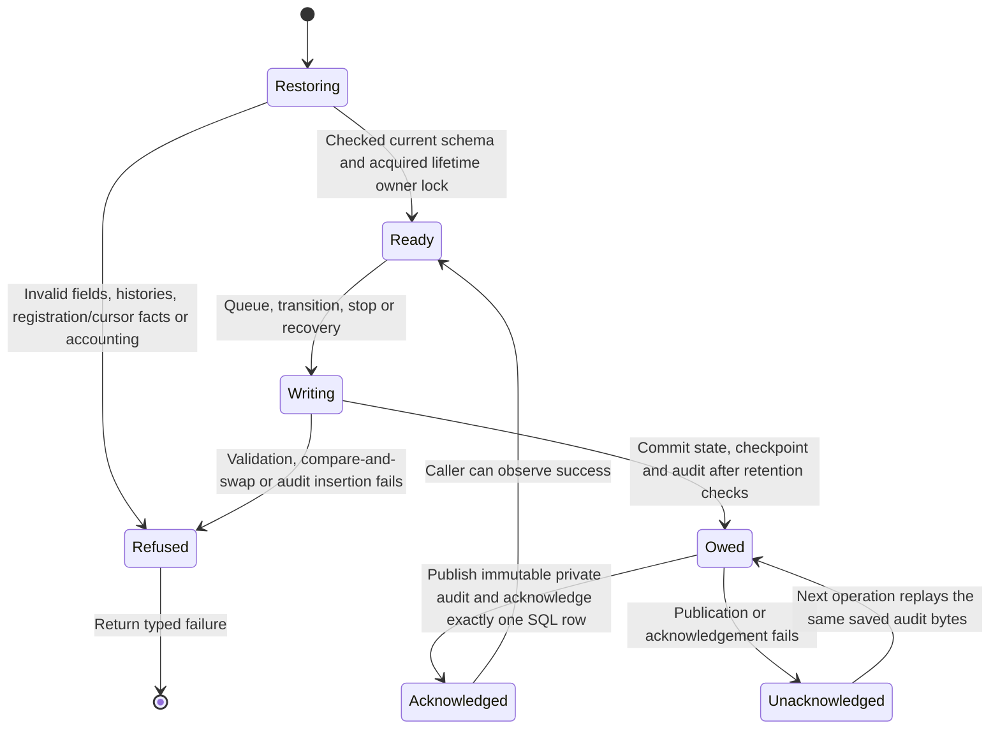
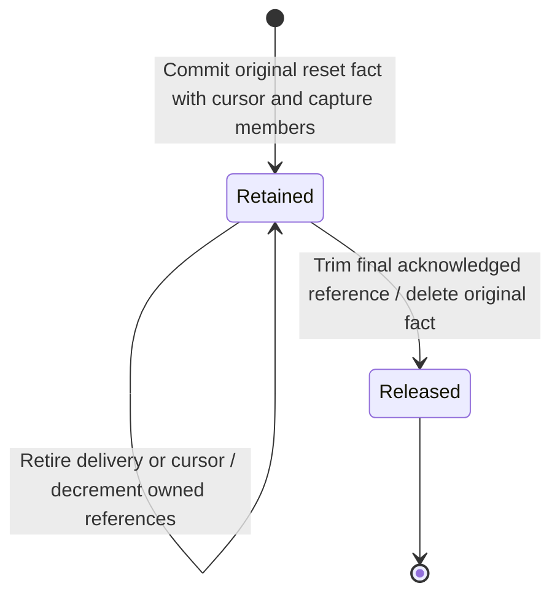
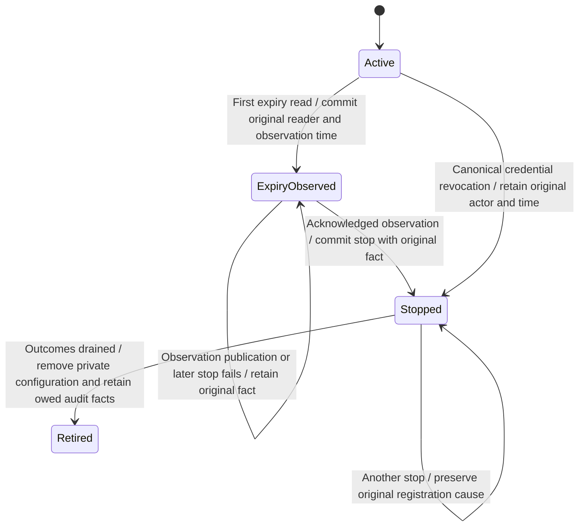

# Durable outbound webhook state

The private outbox keeps each selected record's delivery identity, exact bytes,
source checkpoint and causal audit together. An interrupted audit publication
can resume without creating a new delivery. This page describes persistence
beneath [delivery mechanics](webhook-foundation.md) and
[current authority admission](webhook-admission.md).

This checkpoint is an uncomposed storage adapter. No product command registers
it, no authorized source reader feeds it, and no supervised sender consumes it.
Those pieces and capability/revoke delivery E2E remain required for
[issue #896](https://github.com/nessalabs/nessa-agent/issues/896).
The [inner registration use case](webhook-issuance.md#destination-installation)
asks the existing auth owner and correlates its actual result before installing
under a current credential hold. The private intent supplies no permission verdict;
product command ownership, source replay and the sender remain pending. Application installation #1052 and inbound
workflow triggers #1088 remain separate.

## Restoration redesign

The parent explicitly authorized a focused redesign after the prior bounded
review handoff. The original [findings and reproductions](../../../reviews/evidence/webhook-outbox/blocked-review.md)
remain historical evidence. This source replaces open audit JSON with one
closed record type and routes every cursor read through a complete decoder.
The first two fresh reviews found missing contextual correlations. Their
[reports and exact demonstrations](../../../reviews/evidence/webhook-outbox/typed-state/README.md)
remain preserved as findings at their historical source. The parent adopted a
total contextual restoration owner. Fresh review at `5bb457db` then found a source-reset
provenance gap and a live selection-cost regression. The [report](../../../reviews/evidence/webhook-outbox/total-context/review-1/report.md)
and original demonstrations remain preserved. The parent adopted a shared immutable
reset owner, originally implemented at `b3dc0d46`. Its validation and review
status belongs to [shared reset evidence](../../../reviews/evidence/webhook-outbox/shared-reset/README.md).
Fresh [independent round two](../../../reviews/evidence/webhook-outbox/shared-reset/review-2/report.md)
is clean at `546de7af`, with all priority buckets empty. This clears the persistence
review gate. Full feature acceptance remains separate.

The same typed audit validator serves writing, restoration and publication.
It rejects unknown fields, malformed identities and actors, negative timestamps,
impossible before/after transitions and mismatched checkpoint projections.
Delivery evidence retains complete before and after snapshots; the existing
domain transition methods validate their legal relationship. Restored retained
chains keep their target/checkpoint and source-change context, and end at the
current delivery row. Validation streams one predecessor at a time.

Authority-stop delivery evidence also retains the credential stop's original
cause, actor and time, separate from this observation's time. Its projections
must agree with that saved context. While the owning registration remains,
restore checks this context against its immutable stop fact. A live registration
cannot supply credential-stop evidence. Settled source context must equal the
current delivery's complete context. Sending may retain a reset before its first outcome audit. Its immutable capture
membership names the original Sending state; history must reach that state before
projecting the reset identity. Recovery carries the original reset cause forward.

The restoration owner matches every closed audit variant explicitly. Registration
Issue evidence matches the original target and issuance time; Stop matches its
original cause, actor and time. Cursor evidence matches the retained prior
checkpoint plus the captured replacement scope, reader and observation time.
Delivery evidence matches its retained target/checkpoint and credential stop;
its history must end at the current delivery. Publication validates all owed
records before writing the first immutable audit file.

Retirement deletes private URL/key/cursors while retaining secret-free original
target, issuance, stop and retirement-time facts. Those facts name the exact
retirement audit, whose deferred foreign key prevents losing that owed identity.
Issue/Stop evidence from the same atomic retirement can correlate against these
facts after the private registration has gone. Drained requires this retirement
and no live registration. Acknowledged audit projections and retirement facts
trim together. Recovery never reconstructs an actor from current ownership.

The cursor decoder covers identity, scope, integer position, reset flag and
shared reset reference at startup and before live duplicate acknowledgement.
A reset requires its original fact; a following cursor carries
none. This remains checked after the published cursor audit has been trimmed.
SQLite corruption refusals map to Invalid; transient I/O remains Unavailable.

## Acknowledging one durable operation

The outbox owns the operation below. Publication acknowledgement is local audit
durability; it says nothing about a recipient's effects.

### State committed and audit still owed

A queued row and its contiguous source cursor commit in the same SQLite
transaction as audit evidence. A repeated identical checkpoint returns the
original delivery ID. Different bytes, scope or epoch refuse conflict instead
of replacing a delivery. Predecessor comparison prevents skipping a record.
Pending work is read from durable rows, four at a time.

Every write uses one journal commit owner. It enforces pending and terminal
retention accounting, removes eligible published projections and retires a
drained stopped registration. The audit publisher writes immutable private
files, synchronizes them and their directory, then acknowledges exactly one
SQL row. Existing files must contain the identical saved bytes. An unavailable
publisher returns a visible failure even after SQL committed. The next
operation publishes owed evidence before admitting further work.

That uncertain acknowledgement is not permission to POST again. The future
sender must reconcile durable Sending and outcome records while retaining its
known observation. A Sending row restored without a durable outcome becomes
terminal Unknown. The storage recovery method performs no HTTP.

## Source replacement and stopping

A physical source change creates one immutable fact containing a new reset identity,
registration, conversation, prior checkpoint, observed scope, original reader and
observation time. The same transaction points the cursor at it and captures affected
deliveries' identities and original states as immutable membership. Queued and Retry
rows refuse immediately. A Sending row retains responsibility for its outcome.
Its first reset remains attached after later cursor replacement or deletion; a
later reset cannot overwrite that cause. Logical grant epochs may differ while
sharing the same physical source.

Audit snapshots project the shared fact and must match it before publication.
Immediate refusal uses the original reset time. Later Sending-to-Retry cleanup
retains that original reader and reset time while recording its own cleanup time.
Known success stays success; restart without an observation stays Unknown.

Cursor, delivery membership and audit references retain the fact. Indexed reference
counters are checked against their actual owners at restoration and for owed
publication. Triggers prohibit changing original facts or membership and release a
fact after its last reference disappears. The outbox schema owner checks all owned
non-internal SQLite definitions against the canonical schema before interpreting
state, including the private intent's immutable guard and retirement trigger. Retirement and audit trimming
release references in the same transaction; they do not invent historical actors.

Registration stop records its canonical cause, initiator and stop time, and
refuses pending work in one transaction. Sending still settles its own
observation. A later retry is refused using the saved stop cause. After its
published terminal projections drain, the registration, URL, key and cursors
are deleted with retirement evidence. Secret-free original retirement facts
survive until that exact audit is acknowledged and trimmed. Expiry accepts a typed
lifecycle observer even before a delivery exists, or an actual delivery observer.
The first committed observer and stop time survive later observations, settlement,
retirement and restart. The decoder rejects alternate spellings and oversized
timestamps; audit projections correlate to the original stop fact. No delivery ID
or human actor is fabricated for lifecycle expiry. Actual credential-revoke and
expiry scheduling coordination remain uncomposed.

[Expiry evidence](../../../reviews/evidence/webhook-runtime/expiry/README.md)
records the source checkpoints, failure/recovery tests and mutation controls.
The page's source checkpoint advances only this outbox review; diagrams are
unchanged. This is persistence evidence, not a claim of recipient E2E or product
session isolation. Historical registration findings remain preserved in
[registration review status](../../../reviews/evidence/webhook-runtime/registration/review-2/README.md).
The parent-selected correction now reads actual auth origin and returns a
secret-free acknowledgement. Its [fresh qualification](../../../reviews/evidence/webhook-runtime/origin/README.md)
is separate from that incomplete historical review.

## Bounds and private data

The adapter holds one canonical filesystem owner lock. Four retained blocking
operation permits bound physical work, including work whose waiting caller
was cancelled. The owner and permit survive until that physical operation
returns. Cancellation cannot open a replacement store behind an active worker.

There are at most 64 registrations, 1024 pending rows and 1024 retained terminal
rows and 1024 cursors per registration. A registration can retain at most 3072
reset facts of at most 16 KiB each (48 MiB of fact text), plus one capture snapshot
of at most 512 bytes per retained delivery. Cursor and reset creation refuse
Capacity before a partial write. Fact and member reads apply SQL byte bounds
before materializing text. At most 64 secret-free retirements can await audit
cleanup. Startup checks these counts before collecting bulk
work; bounded scans take at most the owner limit plus one sentinel. Existing
schema bounds include a 128-KiB body and 16-KiB audit record. Terminal SQL
projections may be removed only after audit publication; immutable audit files
have no automatic retention policy in this slice. Registering these constants
in the generated limits catalog remains part of runtime integration.

Private registration storage contains the URL and 32-byte key. Audit evidence
contains identities, checkpoints, before/after meaning, cause and initiator;
it excludes endpoint, key, record payload and remote response text. Destination
and transport policy remain owned by the linked delivery mechanics page.

### Failures and recovery

| Failure or interrupted ordering | Saved result and recovery |
| --- | --- |
| Cursor conflict or failed audit insertion | Transaction rolls back; no partial checkpoint, identity or audit. |
| Audit projection unavailable after SQL commit | Return unavailable; next operation replays the saved evidence first. |
| Projection file exists with different bytes | Refuse without replacing historical evidence. |
| SQL publication acknowledgement affects zero rows | Conflict; do not spin or report publication success. |
| Sending observer disappears or process restarts | Startup recovery records Unknown; no automatic POST. |
| Stop or source replacement reaches retention ceiling | Shared commit owner trims only eligible published rows in the same write. |
| Invalid identity, cursor/reset observation, audit-to-owning facts, history, encoding or capacity | Refuse before publication, cleanup or filtered ready scans. |
| Caller stops awaiting a blocking operation | Physical worker retains its capacity permit and owner lock until completion. |

## Evidence and remaining gates

The [outbox adapter tests](https://github.com/nessalabs/nessa-agent/blob/b3dc0d4688e473fa40bbbeddf00bb9f510130bf1/crates/nessa-server/tests/webhooks/infrastructure/outbox.rs)
exercise actual private SQLite/filesystem state with synthetic keys and no
recipient network. They cover checkpoint identity, compare-and-swap, stop and
source replacement, unknown restart, audit failures, restoration and capacity,
physical ownership after cancellation and retained-history limits.

The [shared reset tests](https://github.com/nessalabs/nessa-agent/blob/b3dc0d4688e473fa40bbbeddf00bb9f510130bf1/crates/nessa-server/tests/webhooks/infrastructure/outbox/source_reset.rs)
add immutable membership, later cursor deletion/replacement, retirement/recovery,
transaction rollback, bounded factory and pre-allocation checks.
This checkpoint also retains refusal regressions for contradictory Registration, Cursor
and Delivery evidence, the whole owed batch, secret-free retirement identity
and capacity, missing or changed original facts, reset observations after audit
trim, and lost-ack valid recovery after private registration deletion. The prior
review demonstrations are historical bug evidence, not fixed test passes.

Historical validation and findings remain in [total-context evidence](../../../reviews/evidence/webhook-outbox/total-context/README.md).
Historical reset-source checks and review status are in [shared reset evidence](../../../reviews/evidence/webhook-outbox/shared-reset/README.md).
Current registration and schema checks are recorded in [registration evidence](../../../reviews/evidence/webhook-runtime/registration/README.md): 116 canonical webhook tests and 12 correction failure/restore probes. Auth source is unchanged since the 212-test run. [Correction evidence](../../../reviews/evidence/webhook-runtime/registration/repair/README.md) distinguishes the preserved not-clean first review from an incomplete round2 with open origin/evidence findings at this source.
Historical checks do not establish acceptance of newer source. Independent
persistence review at `546de7af` checked the unchanged `b3dc0d46` source and is
clean; gateway/browser qualification and full feature acceptance remain open.

Canonical Chromium/WebKit, stress and chaos evidence remains an applicable
integration gate. The foundation's hosted browser setup timed out before
assertions ran; local pinned browser binaries were unavailable. The
[validation handoff](../../../reviews/evidence/webhook-validation-gates/README.md)
records exact inputs and exclusions. No browser gate is waived by this
adapter being unmounted. Full registration, authorized source selection,
current-authority dispatch, live outcome reconciliation and capability/revoke
E2E remain unfinished.

## Expiry observation before stopping

A registration retains the first reader that notices expiry before it stops. That reader can be the issuing principal, an actual delivery, or restart. The observation and its audit have a separate durability acknowledgement. If stopping then fails, another reader resumes the original fact rather than replacing its actor or time. A later canonical auth revocation remains a separate journal event.

The current outbox revocation input covers a known principal. Auth now exposes its actual original revocation fact under the existing held snapshot, including offline and supersession provenance. The general outbox/runtime mapping remains pending; the coordinator must not invent an actor. The combined test below exercises actual explicit owner revocation without claiming that general mapping is composed.

The immutable registration lifecycle value owns legal replacements and its decoder checks local phase/fact combinations. However, [fresh independent review M1](../../../reviews/evidence/webhook-runtime/lifecycle-observation/review-1/report.md) found missing contextual phase/acknowledgement/work relationships: a substituted Stopped phase can publish an owed observation or silently clean genuine Queued work, and a retired fact can accept a reintroduced owed observation. The [f75 correction](../../../reviews/evidence/webhook-runtime/lifecycle-observation/m1-repair/README.md) adds complete retained phase/ack/work validation before both restoration and publication. It reuses one domain Queued compatibility predicate for queue admission, and checks distinct Queued registration IDs through the existing ready index without scanning terminal history. It rejects all three demonstrated contradictions, preserves valid lateSending-to-Retry recovery, and leaves indistinguishable missing history unclaimed. Its147canonical tests andsix controls passed at that source. [Round2](../../../reviews/evidence/webhook-runtime/lifecycle-observation/review-2/report.md) independently confirms M1 fixed, but reports the adjacent owed-Issue prerequisite contradiction M2. That original report and failing required-rejection probe remain preserved. W24 stays unpublished pending correction qualification. One observation per already-bounded registration adds no unbounded history.

## Issuance acknowledgement before later work

Initial issuance must acknowledge before another outbox operation commits later
work. If an owed original Issue is retained alongside ExpiryObserved, Stopped or
retirement, restoration refuses it before publication or cleanup. The same is
true for an Active registration with retained cursor or delivery work: those
facts prove that the initial obligation had to complete. The query uses the
existing registration-leading cursor and delivery keys; it does not scan terminal
history or allocate a second acknowledgement log.

A genuinely pending initial Issue on an Active registration with no such work
can recover. Its exact file may already exist if only local acknowledgement was
lost. Other registrations' work does not block it. Published original history
remains valid through later phases and retirement. Missing historical evidence
alone does not prove an impossible state or justify inventing prior events.

[The M2 correction evidence](../../../reviews/evidence/webhook-runtime/lifecycle-observation/m2-repair/README.md)
records fifteen live/cold refusal-and-repair histories, adjacent published-history
recovery, both initial failure modes and full-capacity query controls. A combined
actual-registry test preserves the first Owner or Restart expiry observation
through later actual auth revocation and retirement, then cold-restores the
original independent auth fact. These are inner owner tests, not a running
command coordinator or recipient E2E. This page's source review compared the
outbox changes since f75, traced the current restoration/publication/registry
owners and checked the new joint auth boundary. [Independent round3](../../../reviews/evidence/webhook-runtime/lifecycle-observation/review-3/report.md) confirms the concrete M1/M2 repairs but finds Major M3: a retained published Cursor and its immutable reset fact still prove initial completion after the current cursor/delivery are gone. A genuine published initial Issue also contradicts a competing owed initial identity. The current predicate omits those proofs. W24 remains unqualified and unpublished. The desired rejection test is preserved failing, distinct from acceptance demonstrations. The bounded review process now requires parent adjudication of total retained-progress classification versus stronger original identity and monotonic acknowledgement; no additional symptom patch has been applied.

This is an unpublished inner lifecycle checkpoint. The retained command supervisor, startup reader, credential/grant admission and sender still require composition; this chart does not claim that they run. [Private evidence](../../../reviews/evidence/webhook-runtime/lifecycle-observation/README.md) distinguishes completed isolated tests from pending canonical checks and independent review.

## Retained-state cleanup work

Terminal retention uses one indexed cutoff per registration instead of ranking
every retained row on each maintenance pass. The newest1024 count includes
rows whose audit is still owed; an older row is deleted only after its audit
acknowledges. Deleting that terminal row retires only its published audit
history in the same transaction. Owed and nonterminal history remains available
for recovery/refusal. Published registration projections have their own indexed
cleanup; they do not require scanning retained delivery histories.

This changes query work, not delivery authority, audit flushes or replay order.
The original full-boundary tests and ceilings remain unchanged. [Cost evidence](../../../reviews/evidence/webhook-runtime/retention-cost/README.md)
records source611b5a87,120 canonical webhook passes,212 auth unit+55 integration
passes, nine mutation controls and measured work reductions. Windows is still
unqualified: its old-head job timed out, and unchanged flush counts leave
filesystem cost to be checked by actual permitted CI. This page's diagrams retain
the same lifecycle and require render validation at the new checkpoint.

## Assembled correction checkpoint

Source `8f83f7394251814575429f5f1362cb3abac61687` combines the clean original-issuance correction (`1c1355b5`) and cleanup-cost correction (`611b5a87`). Their independent reports are scoped to their original bases; [assembled correction round2](../../../reviews/evidence/webhook-runtime/assembled-corrections/review-2/report.md) is clean at ecbb440e. It also includes the earlier typed expiry-observer helper (`7b83e425`), which that review explicitly covered. That helper does not implement the separate observation-before-stop lifecycle. That reviewed correction excluded W24. This unpublished composition checkout adds the observation-before-stop lifecycle described above; its139 combined canonical webhook tests and seven-package Clippy pass; independent lifecycle review remains pending.

Windows and scripted gateway Chromium/WebKit, stress/chaos, recipient capability/revoke E2E and exact-head CI remain unqualified. Historical timeout and unrelated cleanup failures remain evidence, not passing gates.
