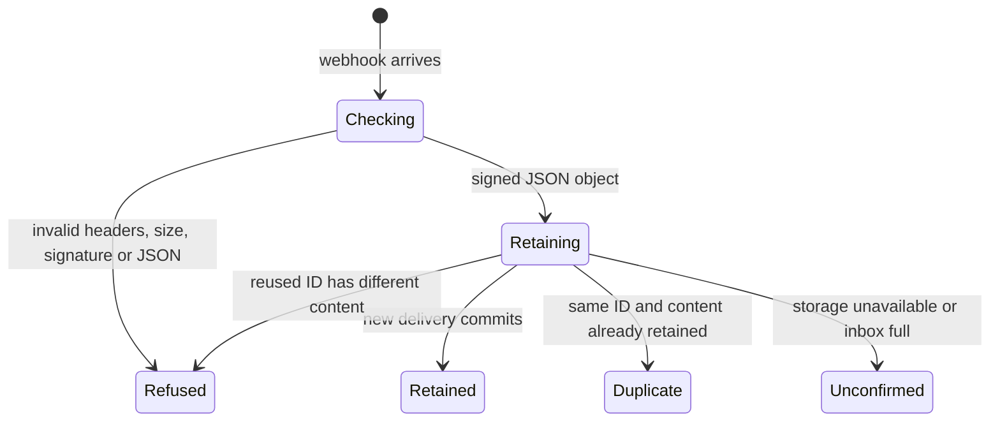

# GitHub webhook receiver

This small cloud service accepts GitHub events while a desktop is offline. It
checks the sender's signature, saves the original payload, and then acknowledges
receipt. It does not yet deliver those events into a desktop conversation.

The receiver is deployed on Workers Free and connected to the GitHub App. A real
GitHub ping returned 202 and its delivery ID was verified in D1. Configuration
and verification evidence are tracked on
[#1107](https://github.com/nessalabs/nessa-agent/issues/1107).

## Waiting for storage

A valid signature proves the request body came from the secret's holder. It does
not mean the event has been retained. The receiver waits for one atomic database
write that also checks capacity and delivery identity.

## A confirmed receipt

A new delivery gets 202 only after the database confirms it. An identical replay
gets 200 without replacing the original receipt. A changed event name or body
under an existing delivery ID gets 409. The original payload retains the sender,
installation and repository facts supplied by GitHub.

## A failed or lost storage answer

A full or unavailable inbox returns 503. A lost response can leave a delivery
stored even though the sender did not see acceptance. Redeliver its original ID
after fixing the cause. GitHub does not retry failed deliveries automatically.

The inbox holds at most 10,000 deliveries and 64 MiB of raw payload. It never
automatically evicts accepted events. An operator must export data and explicitly
authorize cleanup. A request above one MiB is refused before parsing.

## The gateway remains a separate owner

The existing [gateway event admission](../gateway/external-events.md) primitive
uses Nessa-specific signatures and current conversation authorization. This
receiver does not call it. Connecting an inbox to users or conversations needs
authenticated installation ownership, an explicit binding, and the existing
Cedar checks. GitHub payloads cannot choose that authority.

See the [operations runbook](../../../../packages/github-webhooks/README.md) and
[ordering contract](../../../adr/todo/1107-github-webhook-receiver.md).
