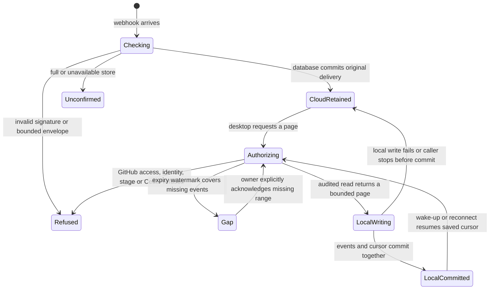

# GitHub webhook relay

GitHub sends signed events to a small Cloudflare inbox while Nessa is offline.
When Nessa connects, it proves which GitHub account it is using and fetches only
repositories that account can currently access. It saves each event page and its
cursor together on the device. The relay imports data without starting an agent
or choosing a conversation.

The development relay is deployed on Workers Free. A built native gateway opened
a live watch, imported a signed development fixture, then caught up after shutdown
and restart. The [verification record](../../../../packages/github-webhooks/relay-verification.json)
separates these live fixtures from the original GitHub ping evidence. Deployment
and review are tracked on [#1117](https://github.com/nessalabs/nessa-agent/issues/1117).

## The cloud receipt

The receiver verifies the raw body and waits for D1 to confirm retention before
returning 202. A retained identical delivery ID returns 200; changed bytes under
the same retained identity conflict. Only signed repository/installation identities
enter the relay index. Wake-up failure after retention does not erase the receipt;
a later reconnect reads the durable page.

GitHub does not automatically retry failed deliveries. The free service refuses
new events at its storage or provider quota limits. An operator may need to
redeliver original GitHub delivery IDs after resolving the cause.

## The private local inbox

The user connects repositories using their machine's signed-in GitHub CLI account.
The serving gateway discovers the binding, opens a stage-bound watch and reads
again to close the subscription race. Watch messages contain only a wake-up.
Every payload page rechecks the GitHub account and current repository access.
Private repositories require a GitHub credential with a proven `repo` OAuth scope.
Tokens are not persisted by Cloudflare.

Each local page transaction saves events, a cursor and audit evidence. Failure
before commit leaves that page eligible for replay. A saved cursor resumes after
restart. Each connection generation fences responses and cleanup from a removed
binding; disconnect/reconnect cannot revive the previous generation's pending work.
Local storage deduplicates a redelivered identity while its original copy remains.

The local owner can read the downloaded inbox without network access. OS ownership
protects that private database; no new unauthenticated local HTTP read route is
mounted. Existing [conversation admission](../gateway/external-events.md) remains
a separate authority if a future feature turns an event into a turn.

## Retention and catch-up gaps

Cloud retention has a seven-day target, with bounded five-minute cleanup sweeps.
Each sweep records affected delivery identities and advances a repository watermark
atomically with deletion. Sweeps can lag. The cloud cap is 10,000 deliveries and
64 MiB payload; this is a starter service, not unlimited capture.

A device whose cursor precedes an expired event gets an explicit gap, which is
saved locally. Reconnect does not silently skip it. The owner can acknowledge the
missing range; that transition records its original cursor and cause before
advancing. Local retention is seven days from import, cleaned during page commits,
with the same payload/event caps and at most 16 account/repository bindings.
Audit metadata is bounded to recent records, not an indefinite archive. Erasing
retention also ends that store's deduplication history.

## User and stage boundaries

The expected user ID is compared with the token's GitHub-verified identity. Cedar
uses current repository facts and OAuth scopes before a page is disclosed. An
installation can serve several authorized users; its owner is not a stand-in for
all of them. A read already admitted under one verified snapshot can finish after
a later permission change.

The desktop's existing build embeds its stage. That stage selects a compiled relay
and the corresponding local namespace. Development uses the current workers.dev
URL. Alpha, CI and production remain disabled until provisioned, with no fallback.
Each rollout stage requires separate cloud resources, secrets and a GitHub App,
because each app has one webhook URL. Users do not select stages.

See the [operations and module map](../../../../packages/github-webhooks/README.md)
and [ordering contract](../../../adr/todo/1117-github-relay.md).
