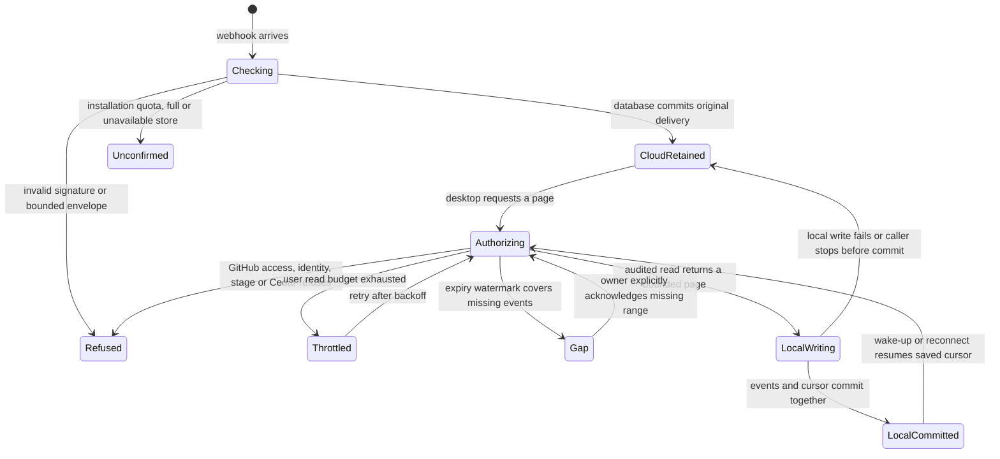
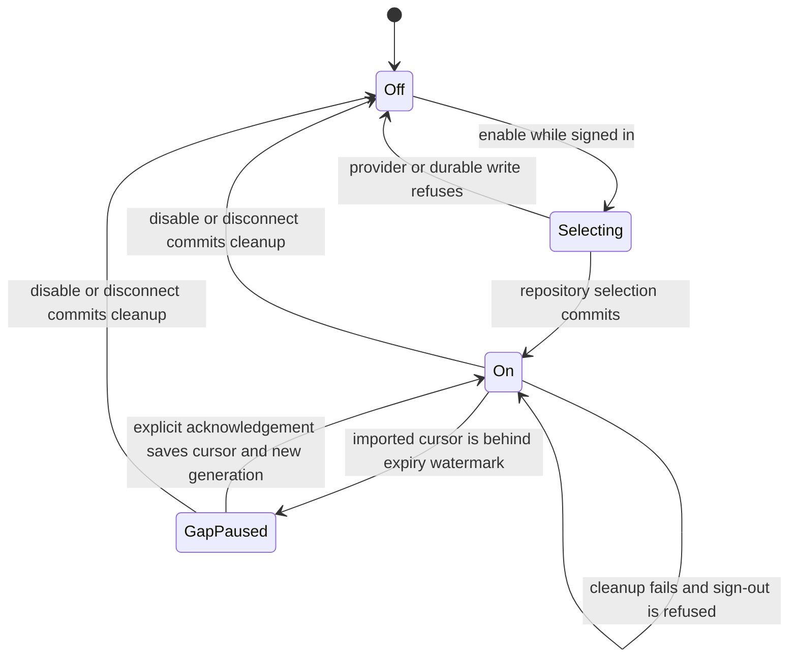
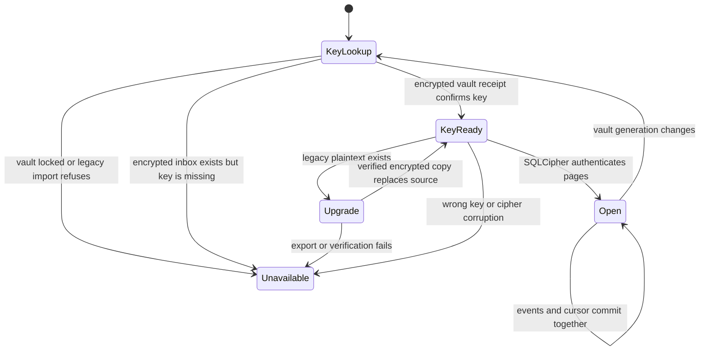

# GitHub webhook relay

GitHub sends signed events to a small Cloudflare inbox while Nessa is offline.
When Nessa connects, it proves which GitHub account it is using and fetches only
repositories that account can currently access. It saves each event page and its
cursor together on the device. The relay imports data without starting an agent
or choosing a conversation.

The development relay is deployed on Workers Free. A built native gateway opened
a live watch, imported a signed development fixture, then caught up after shutdown
and restart. The [verification record](../../../../packages/github-webhooks/relay-verification.json)
separates these live fixtures from the original GitHub ping evidence. Deployment
and review are tracked on [#1117](https://github.com/nessalabs/nessa-agent/issues/1117).

GitHub approval remains pending while the audit and encrypted-credential receipts
are written. Settings reports connected only after both receipts finish; a pending
save does not report signed out. See the [GitHub connection lifecycle](../../../design/github-connect.md).

## The cloud receipt

The receiver verifies the raw body and waits for D1 to confirm retention before
returning 202. A retained identical delivery ID returns 200; changed bytes under
the same retained identity conflict. Only signed repository/installation identities
enter the relay index. Wake-up failure after retention does not erase the receipt;
a later reconnect reads the durable page.

GitHub does not automatically retry failed deliveries. The free service refuses
new events at its storage or provider quota limits. An operator may need to
redeliver original GitHub delivery IDs after resolving the cause.

## The private local inbox

The user opts in through Settings after the existing Nessa GitHub App device
sign-in and repository selection. The relay reads the same token owner; it does
not require a second GitHub CLI login.
The serving gateway discovers the binding, opens a stage-bound watch and reads
again to close the subscription race. Watch messages contain only a wake-up.
Every payload page rechecks the GitHub account and current repository access.
For private repositories Cedar requires a proven classic `repo` OAuth scope or
the active Nessa App installation's repository membership and read/write
permissions for the event families. Metadata visibility alone is insufficient.
Tokens are not persisted by Cloudflare.

Each local page transaction saves events, a cursor and audit evidence. Failure
before commit leaves that page eligible for replay. A saved cursor resumes after
restart. Each connection generation fences responses and cleanup from a removed
binding; disconnect/reconnect cannot revive the previous generation's pending work.
Local storage deduplicates a redelivered identity while its original copy remains.

The local owner can read the downloaded inbox without network access. SQLCipher encrypts the whole database and rollback journal, including repository identities and audit records. Its separate random key lives in the passphrase-encrypted local vault. The native app unlocks it once per app session; closing that app or restarting the gateway seals it. The follower stops while locked and catches up after unlock. See [local vault](../gateway/local-vault.md). OS ownership also protects its files; no new unauthenticated local HTTP read route is
mounted. Existing [conversation admission](../gateway/external-events.md) remains
a separate authority if a future feature turns an event into a turn.

## Retention and catch-up gaps

Cloud retention has a seven-day target, with bounded five-minute cleanup sweeps.
Each sweep records affected delivery identities and advances a repository watermark
atomically with deletion. Sweeps can lag. The cloud cap is 10,000 deliveries and
64 MiB payload; this is a starter service, not unlimited capture.

A device whose cursor precedes an expired event gets an explicit gap, which is
saved locally. Reconnect does not silently skip it. The owner can acknowledge the
missing range; that transition records its original cursor and cause before
advancing. Local retention is seven days from import, cleaned during page commits,
with the same payload/event caps and at most 16 account/repository bindings.
Page commits and Settings selection trim local audit records. Direct gap and CLI
acceptance paths may exceed that row cap until the next cleanup; the
[source-observed follow-up](https://github.com/nessalabs/nessa-agent/issues/1185)
needs an API-level runtime regression and a transaction-owned correction. This
exception concerns encrypted local audit metadata, not the cloud payload cap.
Erasing retention also ends that store's deduplication history.

## User and stage boundaries

The expected user ID is compared with the token's GitHub-verified identity. Cedar
uses current repository facts, OAuth scopes and App installation facts before a page is disclosed. An
installation can serve several authorized users; its owner is not a stand-in for
all of them. A read already admitted under one verified snapshot can finish after
a later permission change.

The desktop's existing build embeds its stage. That stage selects a compiled relay
and the corresponding local namespace. Development uses the current workers.dev
URL. Alpha, CI and production remain disabled until provisioned, with no fallback.
Each rollout stage requires separate cloud resources, secrets and a GitHub App,
because each app has one webhook URL. Users do not select stages.

See the [operations and module map](../../../../packages/github-webhooks/README.md)
and [ordering contract](../../../adr/todo/1117-github-relay.md).

## Live-event opt-in

Settings shows a short, separate live-events row. The question-mark control opens
a bulleted help popup covering authorization, relay retention and disconnect.
Escape dismisses help and returns focus without closing Settings.

The connection is owned by the gateway, so its windows see the same setting.
Disabling removes the local selection and inbox in one audited transaction.
A GitHub command waiting behind another command keeps the vault unlock generation
it entered with. If the vault locks and unlocks during that wait, the queued
command refuses before it can change the newer sign-in or live-event selection.
The dispatcher regression holds a queued disconnect, restores an encrypted
credential under the next unlock, and checks that credential remains.
Disconnect waits for that cleanup before deleting the token. An already-returning
page is rejected by the removed binding's generation. A cleanup failure leaves
the selection intact and refuses sign-out. Cloud retention remains shared with
other authorized devices. Conversation and agent delivery is future work.

## Secret storage and fair use

The gateway keeps GitHub sign-in and a separate random inbox key in the encrypted
local vault, scoped by stage and instance. The owning native app unlocks the
vault once with a passphrase; reloads retain that session, while close, explicit
lock or gateway restart seal it. GitHub credential reads and writes retain the unlock generation that admitted
them. Delayed credential work cannot publish into a later unlock. An inbox
transaction already admitted with its key can finish after lock; account and
binding generations still fence disconnect/reconnect. New key acquisition
requires the current unlock.
See [local vault](../gateway/local-vault.md) for key derivation and session ownership.

An explicit one-time import may read pre-existing OS-store entries. Each legacy
entry is retired only after a verified encrypted receipt. Failed retirement or a
missing legacy inbox key preserves the source and refuses protected use. Normal
setup and unlock do not use the OS store. Disconnect removes the login and
payloads, while retaining the inbox key needed for encrypted cleanup evidence.

Key acquisition refuses a locked vault, missing or wrong keys, and corrupted
ciphertext. No replacement is created for encrypted data. Legacy plaintext is
exported to a verified encrypted temporary file and atomically replaced under a
shared process lock. Stop old gateways before upgrading. Old plaintext backups
and snapshots are not erased. An inbox backup needs its matching vault key;
there is no forgotten-passphrase recovery. Cloudflare sees webhook plaintext and
provides managed at-rest encryption, not end-to-end encryption.

Each signed installation retains at most 2,500 events / 16 MiB within the global
ceiling. GitHub-verified users receive 120 reads/minute and 6,000/day. Native edge
limits precede provider calls, but are approximate per Cloudflare location and
cannot guarantee availability under distributed floods. Four sockets per
user/repository and 128/room bound wake fanout. User-budget and repository-identity
metadata have admission caps; old gap markers are preserved. The Free allowance
remains shared and cannot support 10,000 busy users.

A 15-minute wake lease renews after 12 minutes. The native quiet-day test counts
240 page reads and 120 upgrades/repository, down from 2,880 HTTP requests/day.
Events, reconnects and Durable Object invocations add traffic. Every payload read
still rechecks GitHub access; revoked users may retain wake-only hints until
lease expiry, without event bodies.

This checkpoint reviews the receiver, native storage/follower, sign-in composition,
stage tables and Settings opt-in. The current source review covers the passphrase-vault composition and generation
fences. Local runtime checks use macOS; native Linux/Windows execution and
provider backup/log retention remain outside that local verification. [ADR 1132](../../../adr/todo/1132-github-relay-hardening.md) records
ordering tests and the security review.

Schema-owned counters admit metadata without recounting every user or repository.
Expiry accounting touches only the affected installation. A real D1 regression
counts trigger work as well as the outer cleanup query (836 row reads for
64 expirations across 4,096 installations).

[Hardening evidence](../../../../packages/github-webhooks/hardening-verification.json)
records the reviewed source, adversarial findings and development deployment.
Only this state page was reconciled for this hardening checkpoint.

Native page requests preserve the GitHub owner's redacted, zeroizing token type.
A fresh request-scoped credential is acquired for each page and released before
storage or idle watch waiting; reconnect/notifications observe token rotation.
HTTP success, 409 and 410 bodies share the bounded streamed decoder. The native
watch sets explicit frame/message limits before assembly while admitting valid
fragmented changed notifications and full RFC ping/pong control frames. These
bounds do not claim to erase third-party HTTP-library buffers or provide E2EE.
