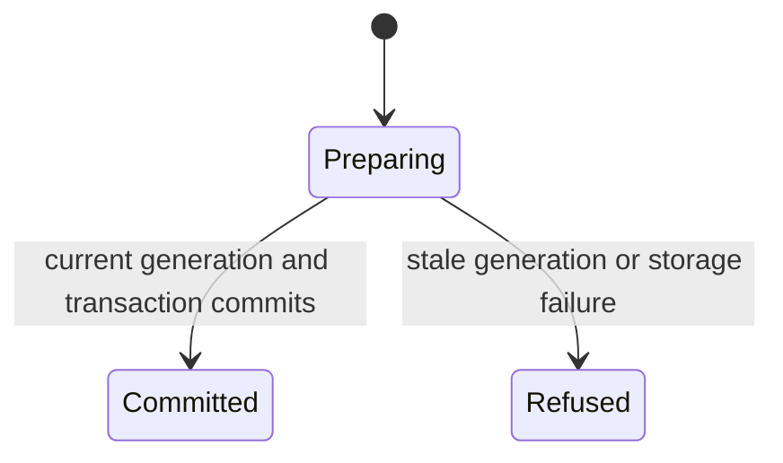

# Select private live event repositories

One transaction replaces the selected repository bindings. Removing a binding records its prior generation and removes its local events with their deletion evidence. Existing bindings retain their identity while a repository name may change. Explicit gap acceptance moves the cursor to at least the retained gap and clears that gap.

The commit runs through the current vault generation owner. A stale generation or failed transaction leaves the prior selection intact. This does not prove GitHub access, fetch events, or start an agent.

## Bounded rule model

Owns atomic binding removal, event deletion evidence and current-generation commit fencing. One selected repository bounds the transaction. Addition, name update and gap acceptance are described contracts outside these removal invariants; cloud authorization and catch-up belong to the relay page owner. This finite abstraction checks safety only. It does not execute or verify the implementation, promise eventual completion, or qualify external effects. Existing source checkpoints and historical test receipts retain their earlier scope. The scoped model review inspected `crates/nessa-server/src/github_relay/infrastructure/selection.rs`.
