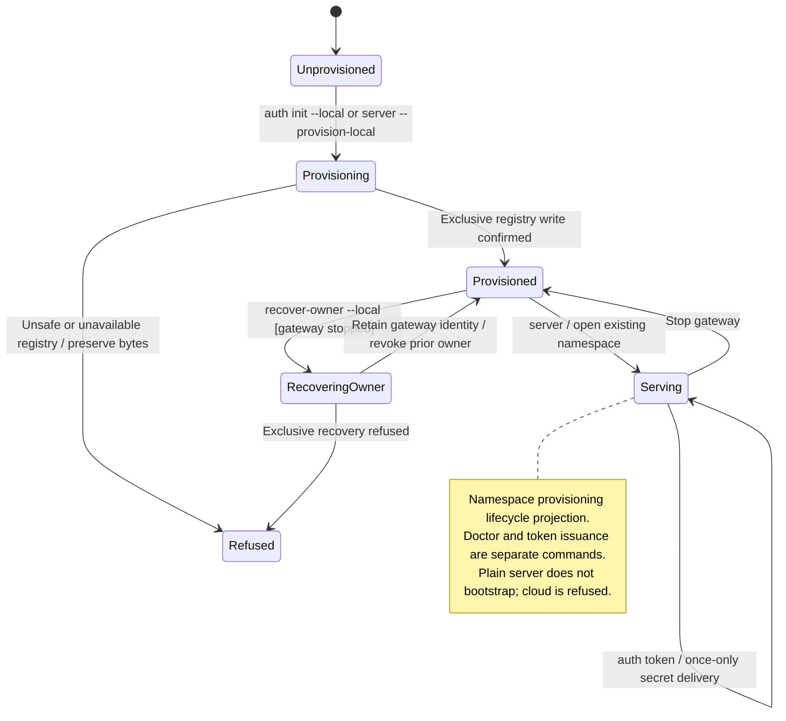

# bootstrap and diagnose access through the CLI

The CLI can diagnose an existing gateway, issue access tokens and perform explicit local setup or recovery. Starting the server does not silently create or replace its identity.

Online commands use authenticated gateway access. Offline recovery needs exclusive access to the credential file and preserves the gateway's identity. An unsafe file is left unchanged. A newly issued token is revealed once; issuing it is not automatically retried. Revocation survives restart and blocks later access checks.

## Further reading

[Source](../../../../guides/local-auth.md) · [Related source](../../../../../crates/nessa-server/src/cli/entrypoint/arguments.rs) · [Related tests](../../../../../crates/nessa-server/tests/cli/application.rs)

## Bounded rule model

Owns browser-token lifetime selection capped by the authenticated caller expiry and refusal when already expired. Current time is one and expiries range one through three. Offline credential recovery, exclusive locks, gateway identity and secret disclosure are excluded. This finite abstraction checks safety only. It does not execute or verify the implementation, promise eventual completion, or qualify external effects. Existing source checkpoints and historical test receipts retain their earlier scope. The scoped model review inspected `crates/nessa-server/src/cli/application/commands.rs`.
