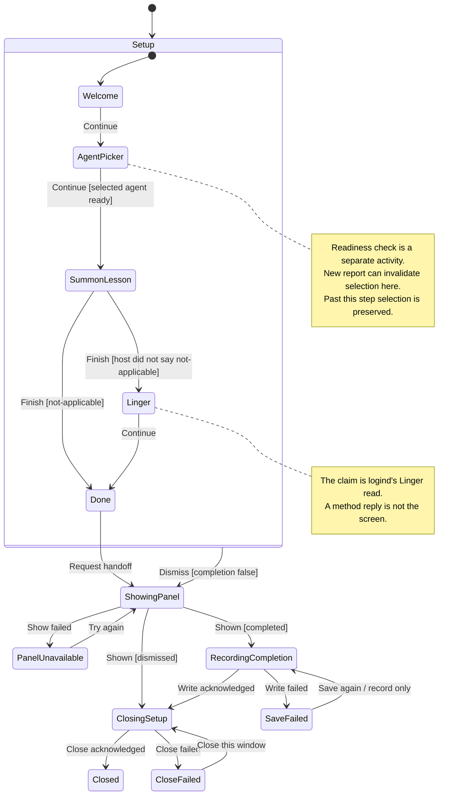

# complete setup, choose an agent, and learn the shortcut

Setup walks through welcome, agent choice and the summon shortcut before finishing. On Linux, when the host's linger read is not `not-applicable`, the shortcut is followed by the linger step. The claim on that step is logind's read. Claude, Codex and OpenCode are listed, but only an agent reported as ready can be selected.

Ready means the probe found the required installation, configuration and authentication for that agent. Missing installation, missing configuration, missing sign-in and an unknown result remain different states. A fresh report can invalidate a choice while the picker is open. Finishing saves the chosen agent; a save or window-close failure offers recovery instead of claiming setup completed.

## Further reading

[Source](../../../../../src/onboarding/model/onboarding.ts) · [Related source](../../../../../src/onboarding/ui/use-onboarding.ts) · [Related tests](../../../../../src/onboarding/model/onboarding.test.ts)

## Bounded rule model

Owns readiness-gated agent choice, invalidation while picker is visible and completion versus dismissal. Shortcut visibility lesson, Linux linger, persistence handoff and fresh final readiness probes are excluded. This finite abstraction checks safety only. It does not execute or verify the implementation, promise eventual completion, or qualify external effects. Existing source checkpoints and historical test receipts retain their earlier scope. The scoped model review inspected `src/onboarding/model/onboarding.ts`.
