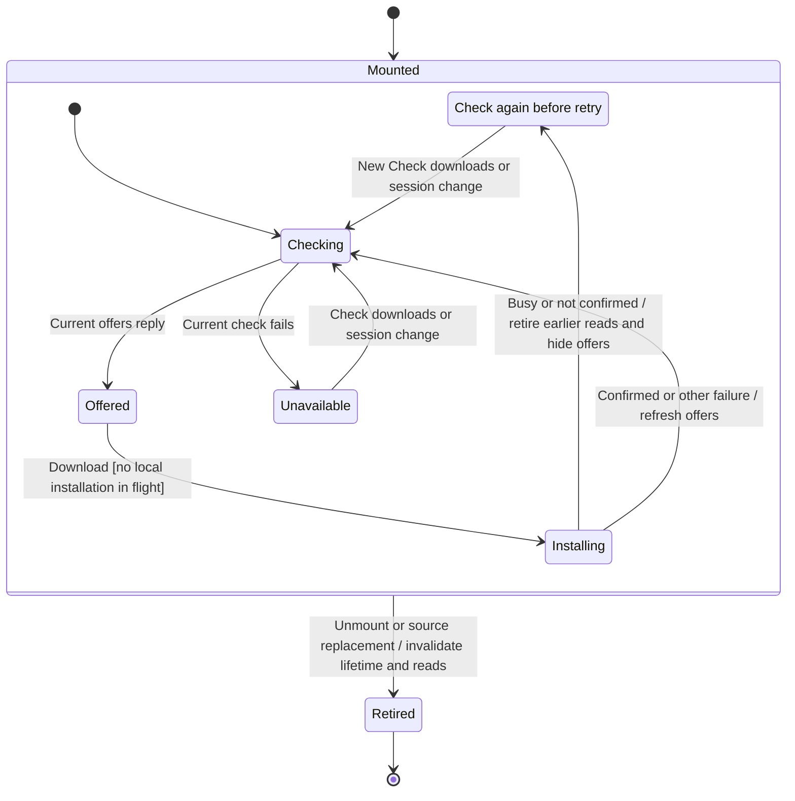

# Download a tested agent runtime

Setup shows the runtime releases the gateway offers. Choosing Download starts a gateway-owned installation, while the view waits for its outcome. Closing or replacing the view abandons that wait; it does not cancel physical installation.

An uncertain acknowledgement means installation might still be running. The surface hides offers and requires a newer check before another attempt is offered. This chart describes local presentation and dispatch, not a guarantee about the backend's physical deduplication or completion.

## Installation ownership

The hook coalesces local installation clicks with an in-flight guard. It captures its source lifetime before awaiting the command. A result from a replaced source does not clear the new view's pending state or notify its readiness owner.

An Installed outcome is distinct from agent sign-in and can carry an older-runtime cleanup warning. A known download, verification or storage refusal has its own sentence and refreshes the gateway's current offers. Source and adapter supply typed outcomes; the component does not parse their messages.

## Uncertain result and fresh evidence

Busy and Not confirmed retain the possibility of physical work. The view clears its offers and retires the revision of every offers read begun before processing that outcome. Such a read can finish later but cannot reintroduce Download. A check initiated after that point can restore current offers, including an installed runtime.

This is a frontend publication barrier. A later gateway read, not the old command's error string, supplies recovery evidence. The regression establishes that an obsolete offer cannot enable a second frontend dispatch; it does not assert that two requests would execute two physical installations.

## Ordering and preserved invariants

The [DI1–DI4 design table](../../../../design/user-flow-ordering.md#installation-offer-publication) owns the ordering contract. It covers click coalescing, both uncertain outcomes, fresh-check recovery and view/source retirement. The component tests and browser check drive those rows.

Before correction, uncertainty hid offers without retiring pending reads; an older reply could restore Download. The fix reuses the existing read revision rather than adding another retry authority. The checkpoint includes the corrected hook and its regression tests.

## Further reading

[Owning hook](../../../../../src/onboarding/ui/use-agent-downloads.ts) · [Regression cases](../../../../../src/onboarding/ui/agent-downloads.test.tsx) · [Credential saving](save-provider-credentials-and-download-a-runtime.md)
