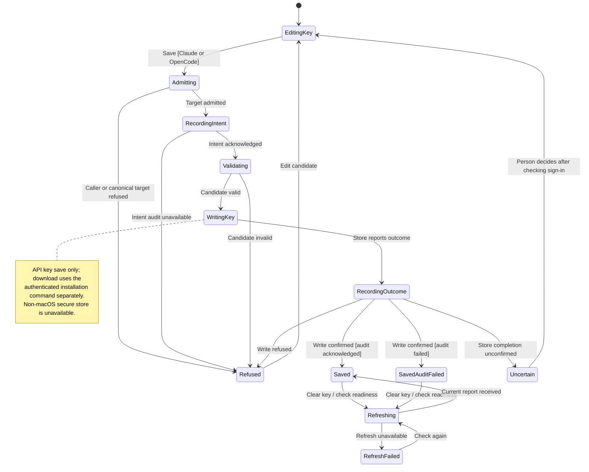
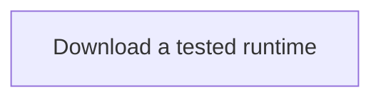

# save provider credentials and download a runtime

A provider API key lets an external agent authenticate; it is different from the token used to access Nessa's gateway. Native setup can save Claude and OpenCode keys on macOS. Codex sign-in remains external, and the other native secure-store adapter is unavailable.

Nessa records intent before writing. A failed intent record prevents the save. If the key was written but the outcome record fails, it remains saved with a warning. An uncertain write is not proof that nothing changed. Runtime installation downloads Nessa's tested version; installing it does not sign the agent in.

## Runtime download ownership

Open the separate runtime flow for uncertain installation, stale offers, fresh checks and view retirement. Saving a key does not install or sign in the runtime.

## Further reading

[Source](../../../../../protocol/defaults/agent-credentials.json) · [Related source](../../../../../src/composition/browser-gate.tsx) · [Related tests](../../../../../src/onboarding/ui/agent-api-key-form.test.tsx)

## Bounded rule model

Owns target agreement, intent-before-store ordering and independent outcome acknowledgement. Uncertain is not refusal or confirmed write. Runtime downloads use their separate owner model. This finite abstraction checks safety only. It does not execute or verify the implementation, promise eventual completion, or qualify external effects. Existing source checkpoints and historical test receipts retain their earlier scope. The scoped model review inspected `src-tauri/src/agent_credentials/application/save_api_key.rs`.
