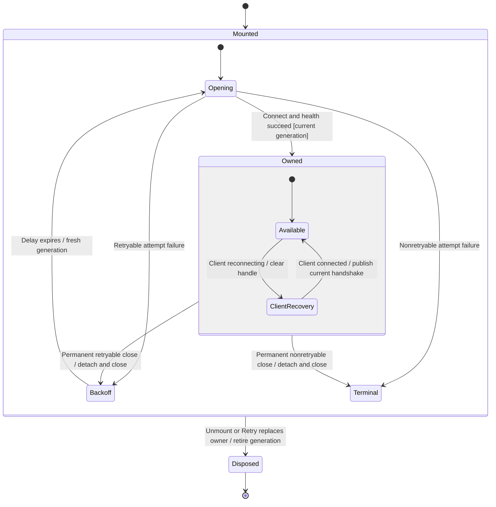

# Surface session supervision

One mounted panel session owns a connection supervisor. Authentication and the authorized health check finish before it publishes a client. A connected handle makes commands available; a reconnecting handle is cleared so new commands cannot use a retired transport.

The chart follows this frontend owner, not the provider, a conversation or the native service process. A command accepted by the gateway can continue after this owner disconnects. Read [command uncertainty](../../client/commands.md) before deciding whether to retry a send.

## Opening and publication

Opening discovers a credential and endpoint, authenticates the product connection and asks for authorized health. A health failure closes that attempt's client and retains the typed cause. Transport failure can be retried; an authorization refusal requires user action.

The supervisor checks its generation after the connection promise resolves and after registering the close listener. This second check matters because an already-closed client calls that listener synchronously. Such a result is closed without publishing Ready. A successful connection publishes its current handshake and health to the session reducer; this is transport readiness, not admission or completion of a user message.

## Two retry owners

The current client owns its finite reconnect window. While that client reports reconnecting, the application clears the shared handle and displays reconnecting without starting a competing client. Select the ClientRecovery box to inspect that lower-level machine.

When the client permanently closes with a retryable cause, the supervisor removes its listeners, clears the handle and closes the client. It then starts another connection after exponential delays of 500, 1000, 2000, 4000 and at most 5000 milliseconds. A validated larger server retry hint extends that delay. Successful adoption resets the delay sequence. There is no application retry-count limit; liveness depends on a future attempt succeeding and the surface staying mounted. No conversation command is retained or replayed by this owner.

## Refusal and explicit retry

A nonretryable failure clears access and reports the failure to the session reducer and, when supplied, the browser's terminal-failure handler. It schedules no timer. The session Retry action changes the effect dependency, disposes this owner and creates a new lifetime with fresh discovery.

The failure's typed cause decides retry eligibility. Its message supplies display text. A health wrapper does not turn a terminal cause into a retryable failure.

## Disposal and stale outcomes

Disposal retires the generation, cancels the pending timer, removes listeners, closes the current client and clears the handle. A later successful connection from the old generation is closed. A later rejection, captured close callback or captured connection-state callback cannot publish state or schedule another attempt; the ordering regressions exercise these cases.

There is no physical provider-cleanup acknowledgement in this chart. Calling the client's close requests transport teardown. The provider and server admission retain their separate ownership.

## Coverage and limits

The [supervisor regressions](../../../../../src/session/adapters/lifecycle/supervisor.test.ts) check deadline boundaries, recovery reset, current-client recovery, stale callbacks, late results, terminal failure and listener/timer release. The [connection setup tests](../../../../../src/session/adapters/client/dev-session.test.ts) cover health wrapping and client retirement.

The checkpoint records the committed implementation inspected. The same commit includes the added lifecycle tests. Native credential checks and server revocation policy remain on the parent page and are outside this bounded source review. See the [journey coverage inventory](../../../user-flow-coverage.md) for executed checks and unrun gates.
