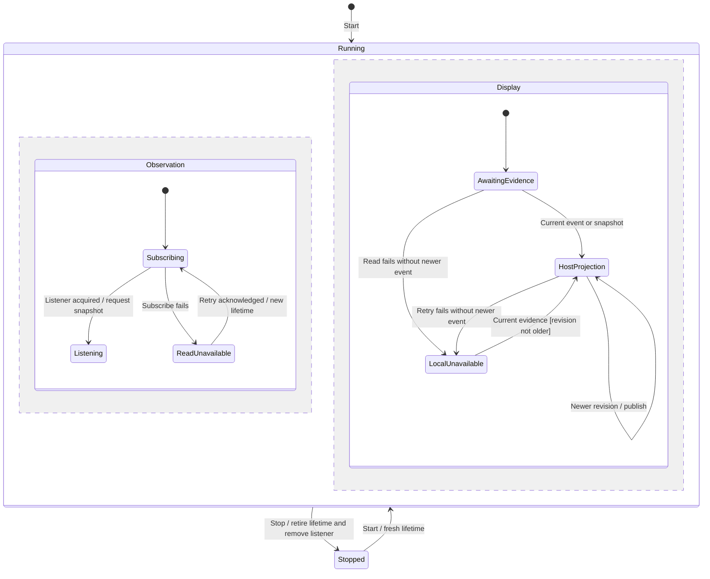

# Observe gateway startup and retry

The surface reads the native host's startup projection. Subscribing first prevents a slow snapshot from replacing a newer event. A revision describes host progress; a separate local lifetime identifies the subscription whose results may still affect this surface.

The chart follows one reusable monitor. Subscription ownership and displayed evidence evolve separately, shown by concurrent regions. A displayed Ready state does not create a product session or establish provider readiness.

## Subscribe before snapshot

Start establishes a listener and then asks for the snapshot. An event can arrive before either promise settles. Each callback carries its local lifetime; after stop or replacement, it has no authority to update the displayed state.

Once listening, a failed snapshot does not remove the listener. A later event can recover the display. If the listener itself cannot be established, a successful explicit Retry starts another subscription lifetime. Repeated Start while running does not create another listener.

## Revision and lifetime guards

Current host evidence is accepted only when its revision is no older than the latest accepted revision. A duplicate at the same revision is suppressed while that host projection is already displayed in this lifetime. Equal-revision evidence can restore the display after a local bridge error or redeliver it after restart.

The code does not reconcile contradictory payloads sharing a revision. It relies on the host's revision contract and retains the first displayed value until a newer revision or local recovery condition permits replacement. The ordering tests cross unmanaged, starting, failed and ready evidence with duplicate and older events and delayed snapshots.

## Failure and recovery

A subscribe, snapshot or retry bridge failure can display Unavailable. A failed snapshot or retry does not erase host evidence that arrived during that attempt. Retry awaits the host command before requesting a fresh snapshot; command acknowledgement alone is not proof that the gateway is Ready.

A retry already admitted before stop may still perform its host effect. The monitor only suppresses its obsolete publication and follow-up reads. Calling retry directly after stop is not guarded before the host command; normal UI ownership removes that action with the surface. This is an implementation limit, not a promise of cancellation at the host boundary.

## Stop and restart

Stop advances the local lifetime and removes an acquired listener. If a pending subscription returns its disposer later, the old attempt removes itself without taking a snapshot. A subsequent Start owns a new listener, including under React Strict Mode's start, stop, start sequence.

An old snapshot or retry with a numerically larger host revision still cannot update the replacement lifetime. The generation check precedes revision comparison. Neither monitor stop nor chart completion stops the managed gateway process.

## Coverage and limits

The [ordering regressions](../../../../../src/startup/application/gateway-startup-ordering.test.ts) cover old results settling after replacement, Strict Mode subscription order, repeated start/stop, all host projection states, retry recovery and newer evidence before failure. The [existing monitor tests](../../../../../src/startup/application/gateway-startup.test.ts) cover failure display, revision recovery and explicit retry.

The checkpoint covers the committed monitor implementation and port inspected, not native service reconciliation. That commit also contains the new ordering tests. Browser rendering of these charts and actual application E2E results are recorded separately in the [coverage inventory](../../../user-flow-coverage.md).
