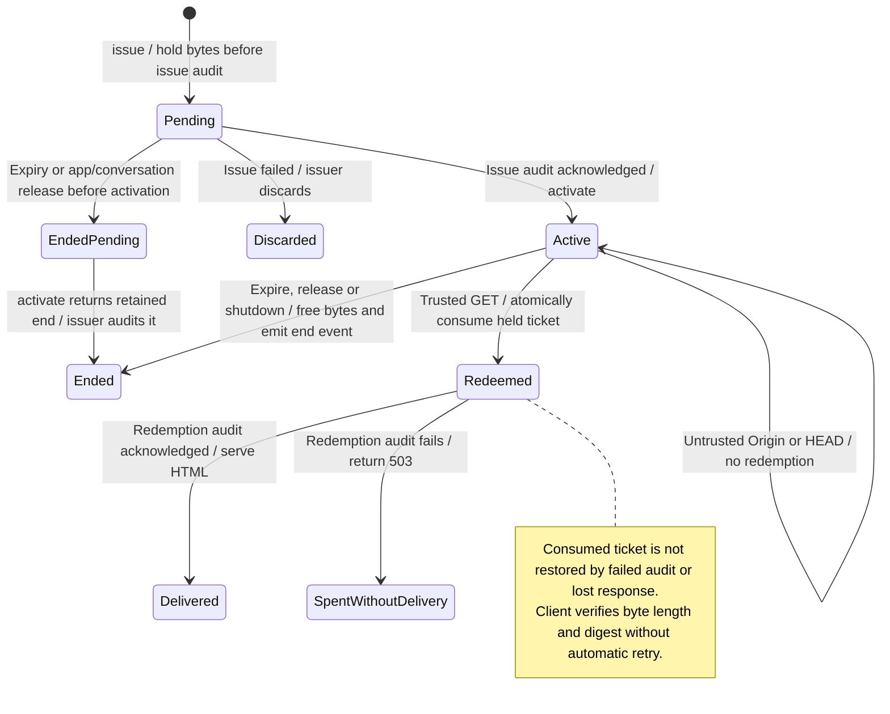
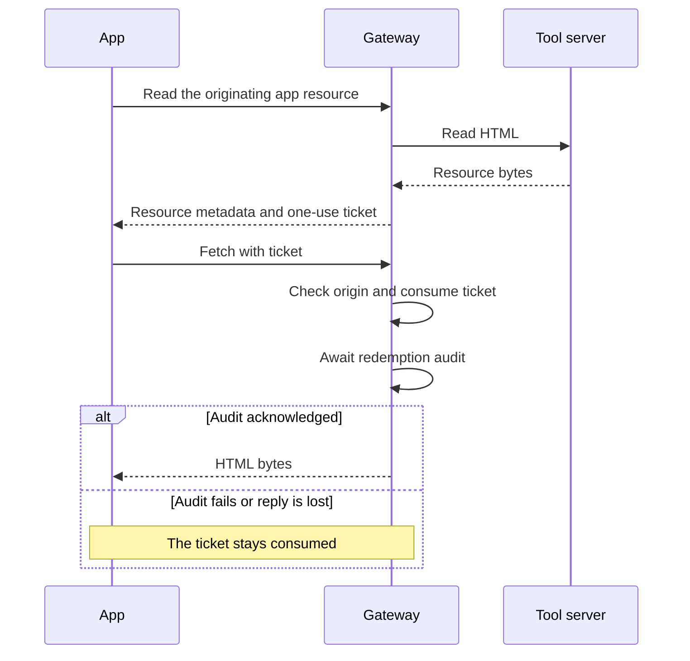

# One-use app resource tickets

A resource ticket lets an app fetch one prepared HTML resource. It expires after 60 seconds and can be used only once. Nessa keeps the bytes until redemption, expiry or explicit release.

Redemption consumes the ticket before returning the bytes and waits for its audit record. A lost reply or failed audit does not make the ticket reusable. Expiry can free the bytes even if its separate audit event fails. These tickets are different from file-read and image-upload tickets.

## Downloading once

## Bounded rule model

This model follows one successfully issued ticket. It explores issue acknowledgement,
early expiry or release, activation, consumption, and redemption audit success or
failure. Its phase strings match the chart above. The invariant checks require
at most one redemption, held bytes only while pending or active, and issue
acknowledgement plus consumption before delivery.

Expiry is an event rather than a clock. The model excludes capacity accounting,
randomness, concurrent tickets, HTTP origin parsing, byte integrity and audit
worker shutdown. An untrusted request, a repeated redemption or a lost reply
makes no new transition; delivery means the server's audited response path, not
proof the client received it. Terminal states deliberately allow stuttering;
there is no eventual-delivery claim. Source and the linked Rust tests were
reviewed at the page checkpoint; Rust tests were not run in this refresh.

Run the catalog and models with the [state verification commands](../../../../scripts/state-docs/README.md). A TLC result checks this design abstraction, not the implementation.

## Further reading

[Source](../../../../crates/nessa-server/src/mcp_servers/infrastructure/resource_tickets.rs) · [Related source](../../../../crates/nessa-server/src/conversation/application/service/app_calls.rs) · [Related tests](../../../../crates/nessa-server/tests/mcp_servers/resource_tickets.rs)
