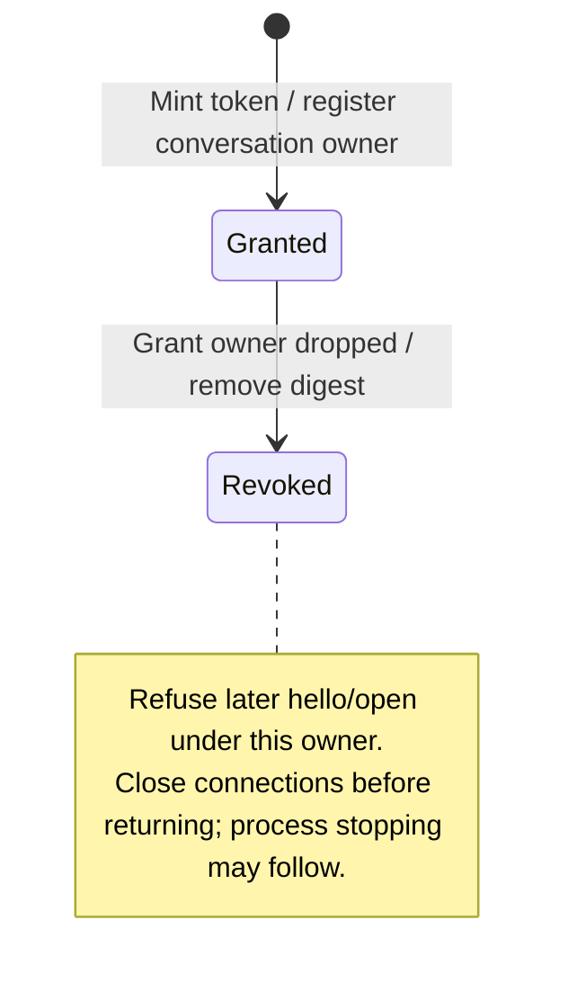
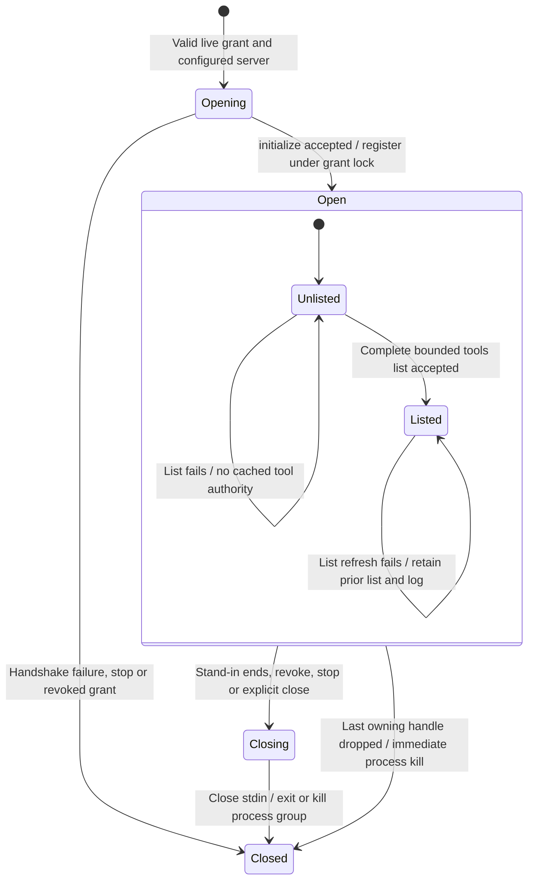

# Conversation grants and upstream sessions

An agent and its app need to talk to the same configured tool server. Nessa gives each provider opening a fresh access grant and routes their requests through a local relay rather than letting a tool choose an executable.

The grant is a secret token tied to that conversation's current opening. Revoking it prevents new use and closes logical sessions, but does not itself prove the external process stopped. An app can see only tools allowed for apps; model-visible tools can have different visibility. A failed tool-list refresh can leave the previous accepted list available.

## Further reading

[Source](../../../../crates/nessa-server/src/mcp_servers/infrastructure/grants.rs) · [Related source](../../../../crates/nessa-sdk/src/infrastructure/mcp/servers.rs) · [Related tests](../../../../crates/nessa-server/tests/mcp_servers/mod.rs)

## Model coverage

Direct model: One conversation grant and upstream handshake, registration versus revocation under the grant gate, cached list retention and separate physical release.

The finite model checks safety only. Tool visibility/validation is a contract; multiple servers, transport frames, bounded list pagination and process group cleanup are outside this model. Terminal states may stutter; no eventual completion or implementation proof is claimed.

This is a scoped source review at `77a6b620af4d94b234294f6d273fd74b3dfb44c7`. It adds the stated abstraction and does not refresh all earlier narrative claims. Existing page checkpoints are retained where present; reading regression sources is not a test run.
