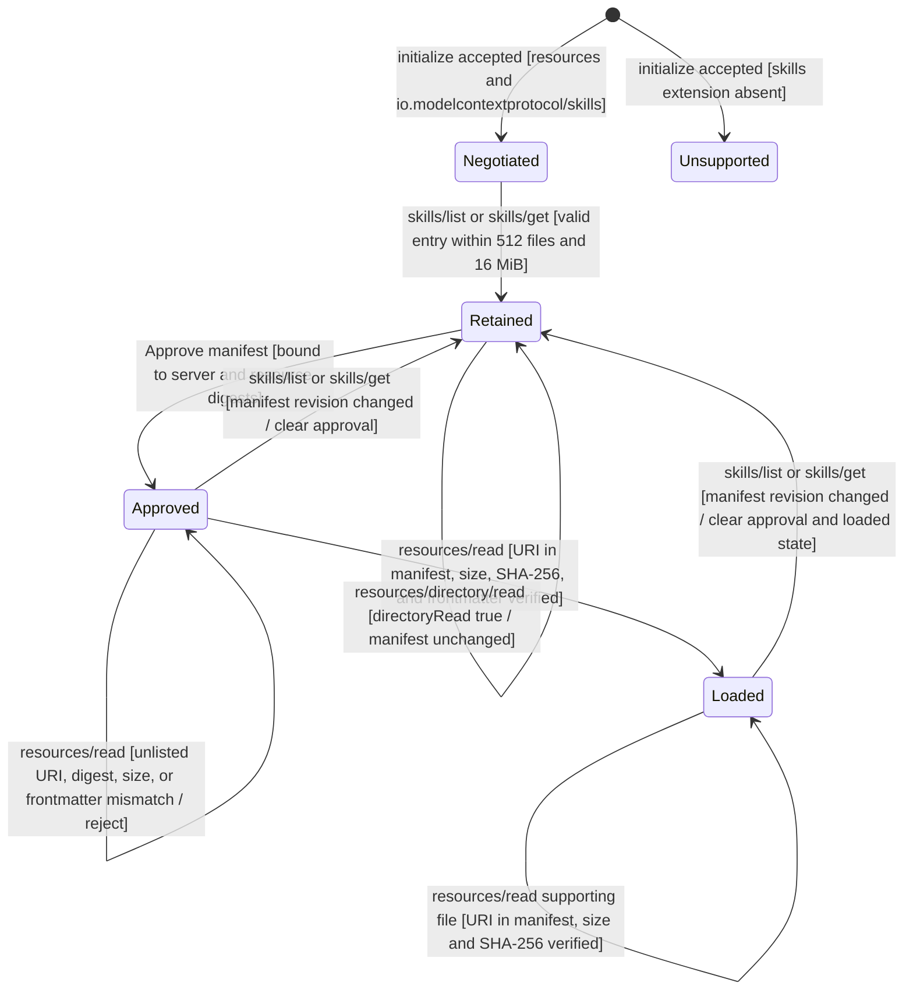

# Skills over MCP (SEP-2640)

An MCP server can ship Agent Skills (`SKILL.md` and optional supporting files) over the same connection it uses for tools by declaring `capabilities.resources` and `capabilities.extensions["io.modelcontextprotocol/skills"]`.

Discovery is lazy and manifest-bound. Calling `skills/list` or `skills/get` returns each skill's URI, verbatim YAML frontmatter, and a complete `{ uri, digest, size }` manifest (or `"dynamic"`). No skill file is fetched ahead of need. Before any file read via `resources/read` is accepted, the client checks that the URI belongs to the retained manifest, matches the declared byte size and SHA-256 digest, and (for `SKILL.md`) has YAML frontmatter identical field-by-field to the retained entry.

If the server updates a skill after discovery, reads against the previous manifest fail verification and deliver nothing. Recovering requires refreshing the entry with `skills/get` or `skills/list`, which invalidates any prior manifest-bound approval and loaded state until the new manifest is approved. Optional `resources/directory/read` is gated on `directoryRead: true` and never extends a retained manifest.

## Further reading

[SEP-2640](https://modelcontextprotocol.io/seps/2640-skills-extension) · [MCP sessions](sessions.md)

## Model coverage

Direct model: Capability gating (`io.modelcontextprotocol/skills` and `directoryRead`), manifest-bound entry retention, approval invalidation on manifest refresh, verified file delivery, and non-extension of retained manifests during directory reads.

The finite model checks safety only across two server revisions. Multi-page pagination cursors, per-file byte limits, YAML parsing details, and Cedar policy storage are verified by Rust domain and integration tests rather than this model. Terminal states may stutter; no liveness or implementation proof is claimed.
