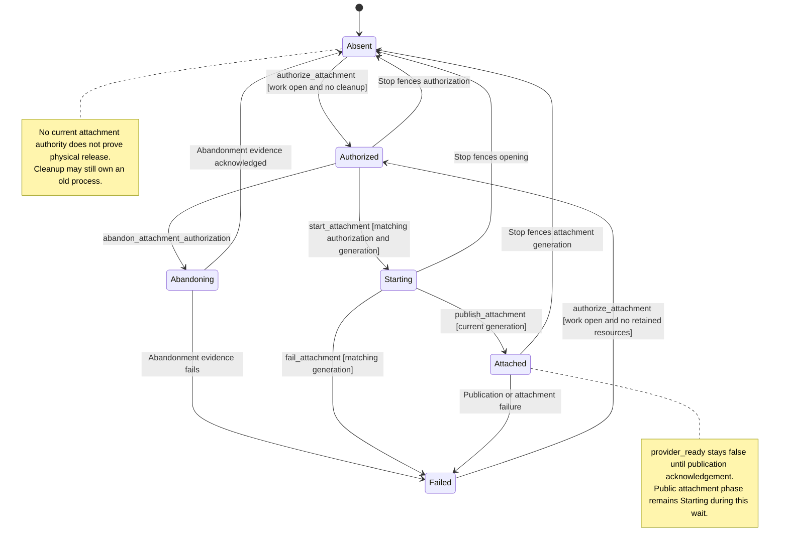

# Provider attachment

This follows one conversation connecting to its external agent. Nessa gives one opening attempt permission to start, then marks it ready after the required publication record is saved. Here, attachment means the agent connection, not a file upload.

Work can be accepted while the agent is starting. Stop invalidates the current opening attempt. A late success cannot make an old attempt ready, but any process it created still needs cleanup. Failure to save readiness also leaves cleanup and audit evidence attached to that same attempt.

## Further reading

[Source](../../../../crates/nessa-sdk/src/application/agent_execution/agents/lifecycle.rs) · [Related source](../../../../crates/nessa-sdk/src/application/agent_execution/agents/attachment.rs) · [Related tests](../../../../crates/nessa-sdk/tests/application/agent_execution/agents/initialization/startup_control.rs)

## Model coverage

Direct model: One authorized attachment, generation fence, readiness acknowledgement, failed publication and a late process return after stop.

The finite model checks safety only. Authorization abandonment detail, capability discovery, physical process cleanup (owned by sdk-cleanup), multiple reopenings and host readiness scheduling. Terminal states may stutter; no eventual completion or implementation proof is claimed.

This is a scoped source review at `77a6b620af4d94b234294f6d273fd74b3dfb44c7`. It adds the stated abstraction and does not refresh all earlier narrative claims. Existing page checkpoints are retained where present; reading regression sources is not a test run.

The model phase tracks the candidate opening operation, including a late returned candidate after Stop. It is not a replacement for the public attachment phase. A late candidate still owns cleanup resources and may never set ready in the fenced generation.
