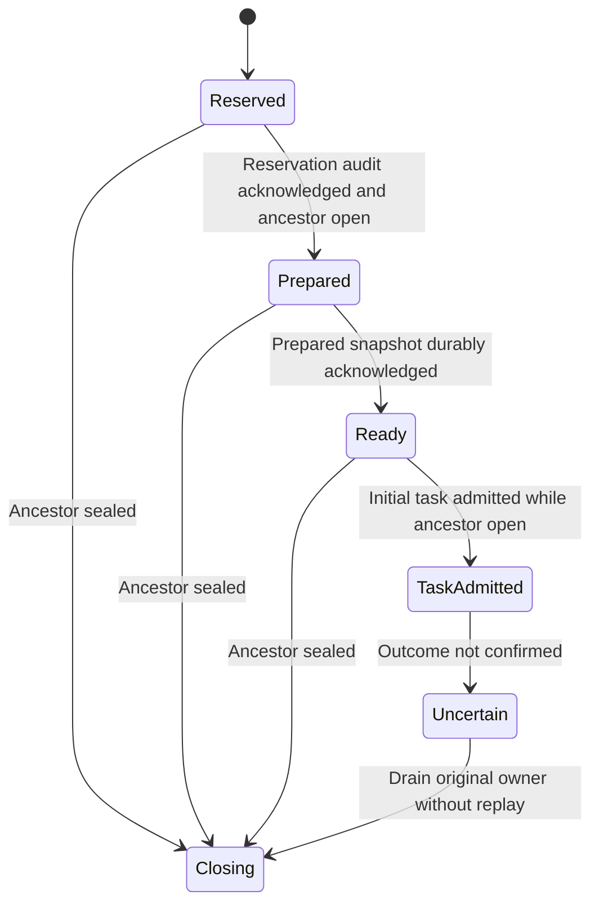

One exact child spawn binding: reservation audit, factory preparation, durable Ready distinct from task admission, and ancestor seal before new effects.

Task/request identity equality, capacity, inherited policy, native provider state and recovery of retained output are source contracts. Child cleanup joins sdk-ownership; no uncertain initial submit replay is permitted.

## Model coverage

Direct model. One exact child spawn binding: reservation audit, factory preparation, durable Ready distinct from task admission, and ancestor seal before new effects.

Task/request identity equality, capacity, inherited policy, native provider state and recovery of retained output are source contracts. Child cleanup joins sdk-ownership; no uncertain initial submit replay is permitted. Safety only; terminal stuttering is allowed and there is no liveness or implementation-proof claim. This scoped source review adds the abstraction at `77a6b620af4d94b234294f6d273fd74b3dfb44c7`; older page checkpoints remain unchanged. Source tests were inspected, not executed.
