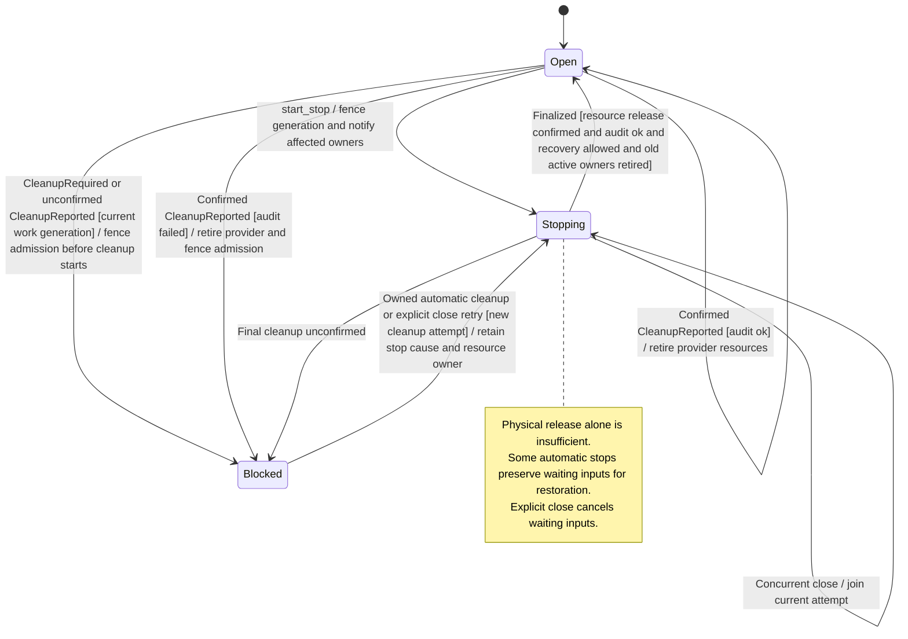

# Work admission and provider cleanup

When work is stopped, Nessa blocks new work for that owner and finishes the accepted work's cancellation and cleanup. It keeps the first cancellation cause instead of replacing it with a later caller's reason.

Cancelled work, a stopped process, released files and a saved audit record are separate facts. Recovery waits for the required cleanup and settlement. If cleanup is uncertain, Nessa retains the owner and retries rather than assuming the resources are free.

## Bounded rule model

This model follows one stop with recovery permitted, one old active work owner,
and one possible reopening. Physical release, evidence acknowledgement and owner
retirement can arrive in different orders. Reopening requires confirmed release,
acknowledged evidence, finalized settlement and retirement of old active work.
A failed audit remains failed even after physical release.

The model abstracts away generation identities, first-caller attribution,
waiting inputs that may survive automatic recovery, retries of uncertain physical
cleanup, sealed ownership lifetimes and descendant closure. It does not claim
that all work permits must retire: the implementation permits waiting work and
current-generation owners. The chart's Blocked paths remain explained above;
this model covers the successful physical result and both audit results. With no
fairness assumption it makes no claim that cleanup or reopening eventually
happens. Source and the linked Rust regressions were reviewed at the page
checkpoint; Rust tests were not run in this refresh.

Run the catalog and models with the [state verification commands](../../../../scripts/state-docs/README.md). A TLC result checks this design abstraction, not the implementation.

## Further reading

[Source](../../../../crates/nessa-sdk/src/application/agent_execution/agents/lifecycle.rs) · [Related source](../../../../crates/nessa-sdk/src/application/agent_execution/agents/attachment_evidence.rs) · [Related tests](../../../../crates/nessa-sdk/tests/application/agent_execution/agents/review_regressions/cleanup_audit.rs)
