# Native context admission and opening

A native context can be unused even when earlier completed turns remain in the conversation. Before awaiting a fresh opening, the manager captures the earlier terminal prefix. Work already pending and inputs accepted during opening still belong to the new context, even if those inputs are withdrawn before publication. Later terminal-prefix growth cannot move that captured boundary.

A resumed context keeps its watermark. A fresh open returning the same native ID under the same provider name also keeps the earlier watermark conservatively. After successful opening, the manager saves the context, watermark and related fingerprint or attributed switch together. A failed acknowledgement retains the attachment cleanup obligation; it does not establish that no bytes were written.

On reopening, the provider receives whether the current context admitted work, rather than whether any historical turn exists. Claude may replace unused native context. Missing native history for used context is a typed failure that preserves the saved history and ID, without replaying old prompts. Credential readiness remains a separate launch boundary.

```mermaid
stateDiagram-v2
    [*] --> BeforeOpen
    BeforeOpen --> Opening: Capture terminal prefix before waiting
    Opening --> Opening: Admit input; withdrawal cannot advance capture
    Opening --> Candidate: Native opening returns
    Candidate --> Published: Context and related identity changes acknowledged together
    Candidate --> Cleanup: Publication not acknowledged
    Published --> Ready: Native history available or context unused
    Published --> Refused: Used context has missing native history
```

This manager model is stronger than the raw storage contract: [context validation](context-validation.md) checks supplied semantic transitions but does not require every independent fingerprint change to publish a context in the same unit.

## Model coverage

Direct finite safety model. One manager opening captures a terminal prefix before waiting; later pending or withdrawn input still counts as context admission. Reused native IDs preserve evidence, and acknowledged fingerprint/context publication is atomic.

Two retained inputs and one opening/reopen; no native provider execution, secret lookup, serialized codec proof, payload erasure, timeout clock ordering or eventual restoration. Terminal states may stutter. This checks the authored design, not the implementation, and claims no liveness.

## Source reconciliation

Reviewed the owning source and regression assertions at `719dfce93892e09dcb95e86a060b6d2f42c8f3cc`, comparing changes since `77a6b620af4d94b234294f6d273fd74b3dfb44c7`. Product tests, native/browser execution and visual inspection were not performed. The checkpoint covers this page's narrow complete owner narrative; it does not recertify other SDK pages.
