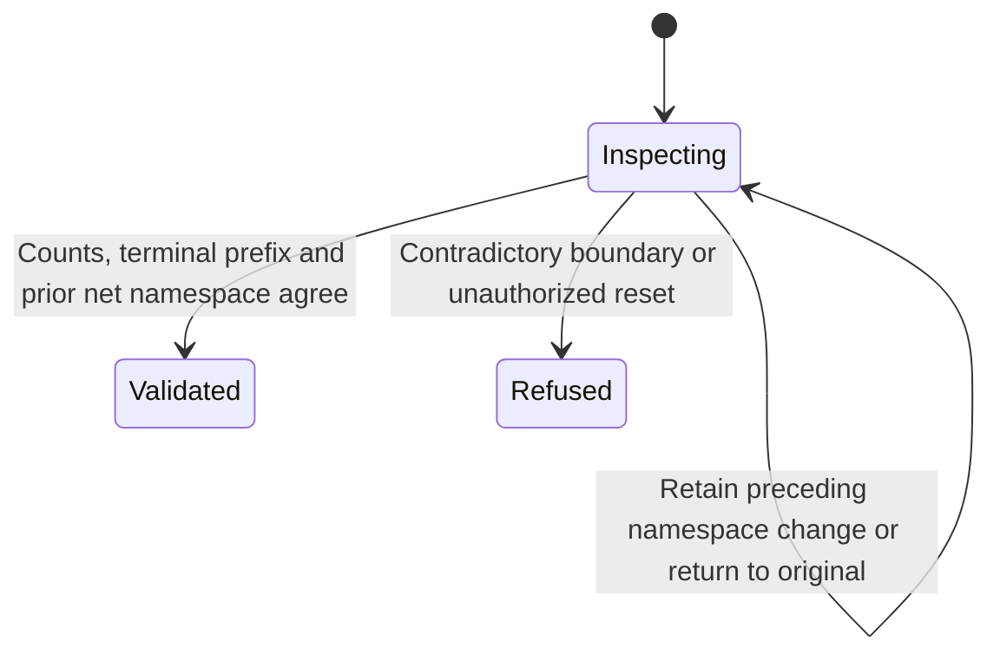

# Validate retained context admission evidence

Custom snapshots, semantic records and checkpoints retain a native ID with an admission watermark. The watermark must fit inside the consecutive terminal prefix. A saved result whose final scheduling edge is still Running does not extend that prefix. An opened empty history cannot claim earlier input.

Reusing the same native ID cannot move its watermark without a preceding net provider-namespace change in the same semantic unit. An identity change after the context update cannot authorize it. Changing away and back to the original namespace also supplies no authority. Invalid transitions are refused and retain the prior snapshot. Used context cannot be cleared merely because provider observations are absent.

The model starts with a previous recorded boundary in zero through two and a candidate snapshot or context update. Validation records the supplied boundary; it does not reconstruct opening time. [Native context admission](context-admission.md) owns the manager's pre-open capture and atomic publication.

## Model coverage

Direct finite safety model. One custom snapshot or semantic context transition validates retained counts and terminal-prefix bounds. A reused native ID can reset admission only after a preceding net namespace change; round trips and clearing used context are refused.

Prior and candidate boundary values zero through two and one namespace round trip. Provider names/text, exact serialized shape and manager opening-time capture are separate contracts; storage validates supplied evidence rather than reconstructing opening time. Terminal states may stutter. This checks the authored design, not the implementation, and claims no liveness.

## Source reconciliation

Reviewed the owning source and regression assertions at `719dfce93892e09dcb95e86a060b6d2f42c8f3cc`, comparing changes since `77a6b620af4d94b234294f6d273fd74b3dfb44c7`. Product tests, native/browser execution and visual inspection were not performed. The checkpoint covers this page's narrow complete owner narrative; it does not recertify other SDK pages.
