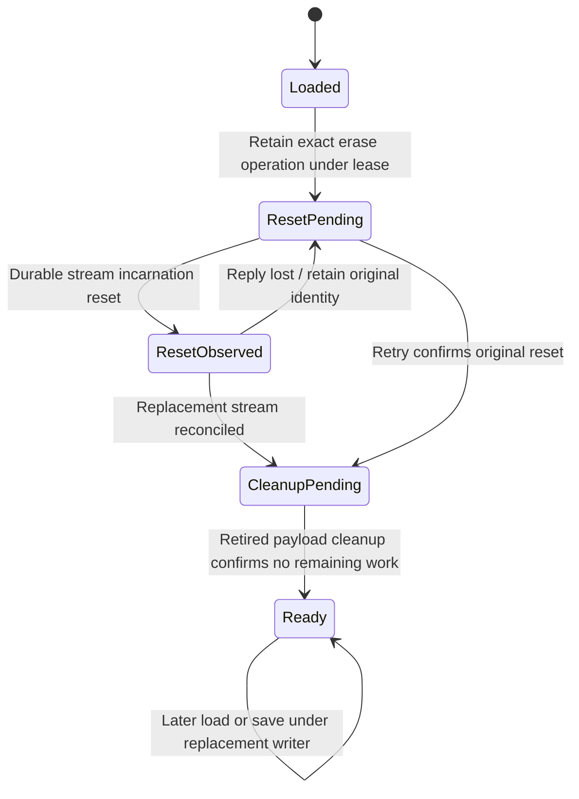

One retained erase operation identity and incarnation; physical reset may precede its reply, and later load/save reconciles reset plus retired-content cleanup before access.

Actual SQLite secure deletion, all retired payload rows, event-stream reset implementation and external provider memory are boundaries; no secure-erasure or eventual cleanup guarantee.

## Model coverage

Direct finite safety model. One retained erase operation identity and incarnation; physical reset may precede its reply, and later load/save reconciles reset plus retired-content cleanup before access.

Actual SQLite secure deletion, all retired payload rows, event-stream reset implementation and external provider memory are boundaries; no secure-erasure or eventual cleanup guarantee. Terminal states may stutter. This scoped review at `77a6b620af4d94b234294f6d273fd74b3dfb44c7` does not claim implementation proof or an executed source test.
