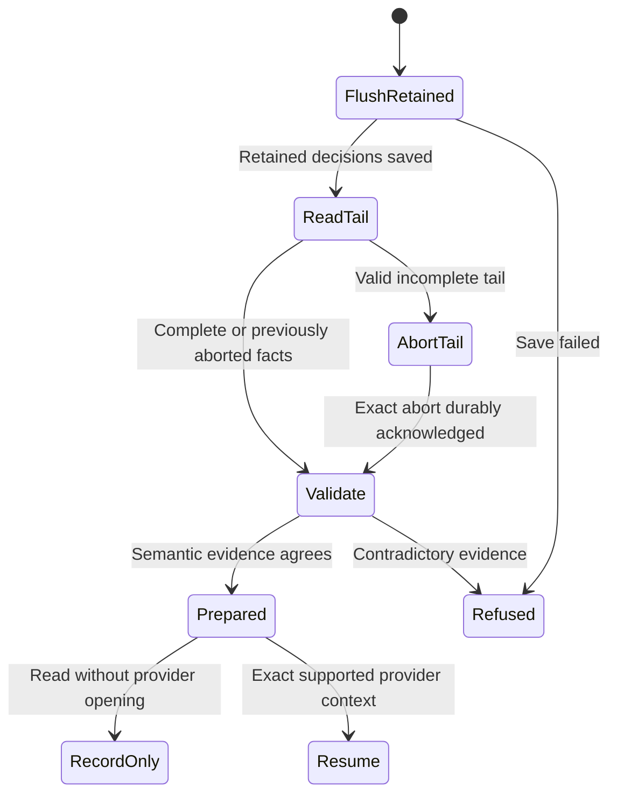

One preparation flushes retained writes, closes a valid incomplete physical tail before semantic validation, and separates record-only reads from exact-provider resumption.

Authorship, canonical successor and handoff agreement are abstract validation predicates. Erasure/reset, byte framing, actual provider restoration and transcript UI remain separate source contracts.

## Model coverage

Direct model. One preparation flushes retained writes, closes a valid incomplete physical tail before semantic validation, and separates record-only reads from exact-provider resumption.

Authorship, canonical successor and handoff agreement are abstract validation predicates. Erasure/reset, byte framing, actual provider restoration and transcript UI remain separate source contracts. Safety only; terminal stuttering is allowed and there is no liveness or implementation-proof claim. This scoped source review adds the abstraction at `77a6b620af4d94b234294f6d273fd74b3dfb44c7`; older page checkpoints remain unchanged. Source tests were inspected, not executed.
