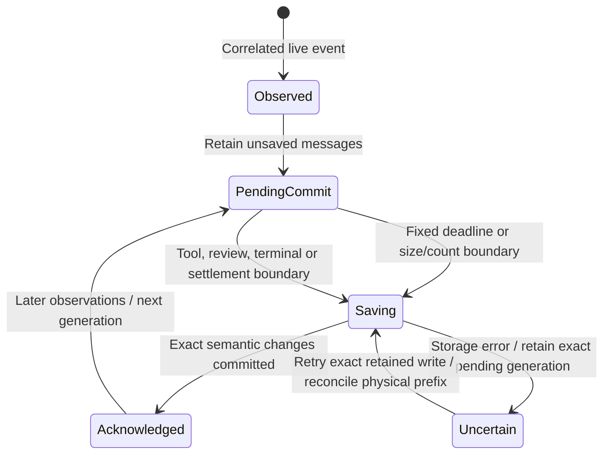
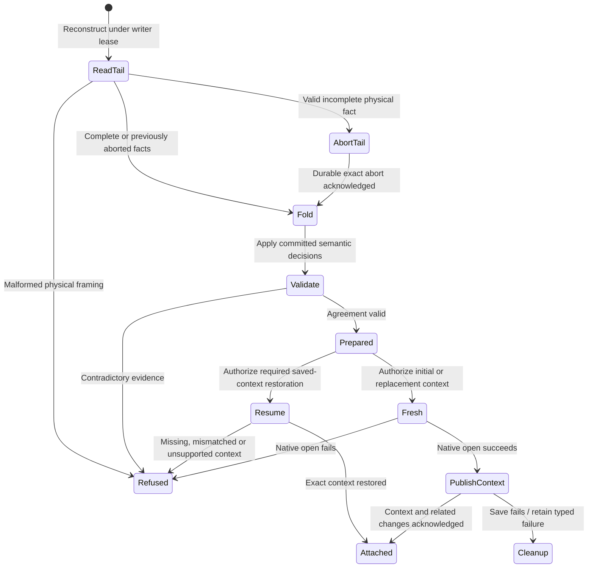

# Committed history and restoration

Nessa shows live output while saving conversation records in small batches. Reopening reconstructs history from the records that were successfully saved.

Text shown since the last successful save can be lost on a crash. A failed save is not advertised as committed history. Each save attempt has an identity so a retry can confirm an already-completed write without duplicating it. Reset must settle uncertain erasure before loading or saving new history.

## Work admitted to the current native context

A conversation can retain older turns while its current agent context has never
received work. For example, a person switches to Claude, closes the conversation
before sending, then reopens it. Claude saves a new native context only after a
prompt. Nessa may replace that unused context while retaining the older turns;
it does not try to resume an ID that no prompt made durable.

The saved context contains its native ID and an admission watermark. The manager
captures the earlier terminal prefix before waiting for native opening. Work
already pending at that boundary and inputs admitted during opening remain
counted, even if withdrawn before the context is published. The terminal prefix
can grow during opening; that does not advance the captured watermark. A result
saved before its final scheduling transition does not make that work terminal. Reattaching the same context preserves its watermark; reuse of the
same native ID by the same provider also preserves the earlier evidence
conservatively.

SessionManager publishes a replacement context and its watermark with the
fingerprint or attributed switch change in one save, after native opening
succeeds. Its evidence lock orders this publication against concurrent admission.
This is the manager's lifecycle contract. Raw semantic producers have their
supplied transitions validated, but the storage port does not require every
independent fingerprint change to include a context replacement in the same unit.

Snapshots from custom storage and record checkpoints retain the watermark and
validate it against the terminal prefix. A watermark beyond that prefix is
refused before provider opening. When current-context work requires restoration,
missing native history remains a typed provider failure with the saved ID and
conversation history retained. The composed local gateway's credential wrapper
delegates the same restoration query to Claude without reading credentials;
credential readiness does not decide whether a context is unused. Neither that
error nor absent provider events
permits reset or resubmission of stored prompts. An explicit handoff can carry
earlier text as context for a new turn; reopening does not dispatch those older
invocations again.

The [ACP restoration regressions](../../../../crates/nessa-sdk/tests/infrastructure/acp/contracts/current_context.rs)
exercise agent switch and fingerprint change with zero or one new input, native
history loss, and both pending and withdrawn admission while fresh opening waits. The
[custom snapshot checks](../../../../crates/nessa-sdk/tests/application/agent_execution/sessions/context_admission.rs)
and [checkpoint mapping checks](../../../../crates/nessa-sdk/src/infrastructure/session_storage/snapshot/context.rs)
inspect malformed boundaries and retained classification.

## Internal completion input

Committed history retains whether an input came from a person, an app, an agent
in another conversation, or an internal completion. Restoration keeps that
provenance. A record that claims two sender kinds is refused. Agent input keeps
its source conversation and execution in its saved initiation, from which its
message sender is reconstructed. Submission and restoration both require the
sender and initiation to name the same source. The gateway can therefore resume the
same provider session with tool output while omitting that input from user bubbles.
The save and restoration states above stay the same. Their shared input
constructor checks sender/initiation agreement before incremental retention as
well as during restoration. A contradictory public save is refused before append;
its writer binding and prior history stay unchanged.

## Agent origin in copied history

A fork or provider switch keeps an earlier input's typed agent source alongside
its text and final reply. That source survives handoff storage, reaches the new
model as historical origin, and labels the copied input in the transcript. The
new turn uses its own initiation; historical origin supplies no owner authority.
Text and turn bounds still apply, retained accounting includes source identity,
and frame checks count the serialized origin.

## Source review scope

This checkpoint compares the source since `6f3747e6b7189965d06368944319dc21ebe2508b`
and traces current-context admission through SessionManager, domain validation,
semantic folding, custom snapshots, checkpoint mapping and the Claude binding.
The existing provenance, copied-history, record-writer and streaming behavior was
checked against its unchanged owning source; the streaming chart keeps its
existing transitions. The restoration chart now distinguishes required resume
from fresh context publication and a failed publication's cleanup obligation.

The review also checks the captured pre-open boundary against withdrawal during
opening and the local credential wrapper's delegation to Claude. The latter uses
the provider-owned rule rather than a copied server-side admission check.

The final source checkpoint restores the original accurate Claude-binding comment.
The 45 protocol sources then match the base byte-for-byte; the admission behavior
and these diagram transitions are unchanged from the reviewed implementation.

The linked tests were read for their asserted behavior. This documentation review
does not claim executed tests, native or browser qualification, or visual diagram
inspection. Resume/decline atomicity (#1003), shared timers (#762) and metadata
admission (#934) remain planned work waiting for #981 to merge.

## Further reading

[Source](../../../../crates/nessa-sdk/src/application/agent_execution/sessions/manager.rs) · [Related source](../../../../crates/nessa-sdk/src/infrastructure/session_storage/record_writer.rs) · [Related tests](../../../../crates/nessa-sdk/tests/application/agent_execution/agents/streaming_persistence.rs)
