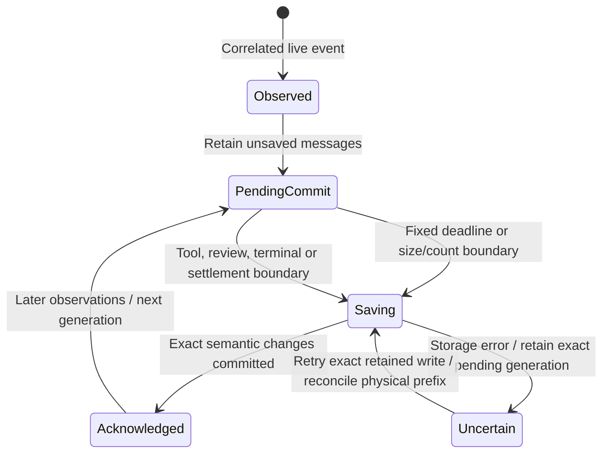
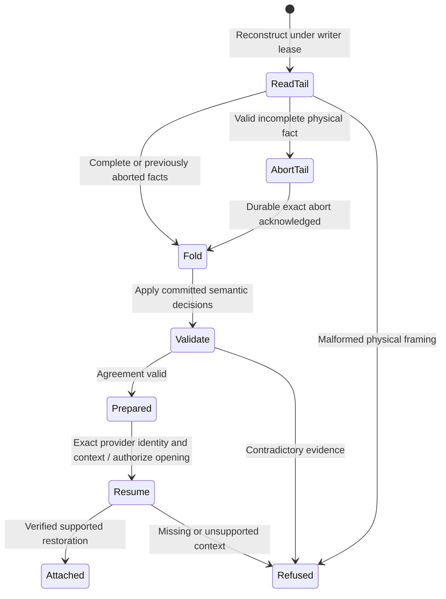

# Committed history and restoration

Nessa shows live output while saving conversation records in small batches. Reopening reconstructs history from the records that were successfully saved.

Text shown since the last successful save can be lost on a crash. A failed save is not advertised as committed history. Each save attempt has an identity so a retry can confirm an already-completed write without duplicating it. Reset must settle uncertain erasure before loading or saving new history.

## Internal completion input

Committed history retains whether an input came from a person, an app, an agent
in another conversation, or an internal completion. Restoration keeps that
provenance. A record that claims two sender kinds is refused. Agent input keeps
its source conversation and execution in its saved initiation, from which its
message sender is reconstructed. Submission and restoration both require the
sender and initiation to name the same source. The gateway can therefore resume the
same provider session with tool output while omitting that input from user bubbles.
The save and restoration states above stay the same. This review covers the new
sender facts and their snapshot agreement. The source changes since the prior
checkpoint affect admission and restoration validation; the record writer,
streaming boundaries and provider restoration protocol are unchanged. The codec
regression covers valid agent and internal input, plus records claiming both
agent and internal or app origins. The session-manager regression crosses valid
source identities before admission and on restore. Runtime results are recorded
on PR #1194; this source checkpoint alone does not claim those checks passed.

## Further reading

[Source](../../../../crates/nessa-sdk/src/application/agent_execution/sessions/manager.rs) · [Related source](../../../../crates/nessa-sdk/src/infrastructure/session_storage/record_writer.rs) · [Related tests](../../../../crates/nessa-sdk/tests/application/agent_execution/agents/streaming_persistence.rs)
