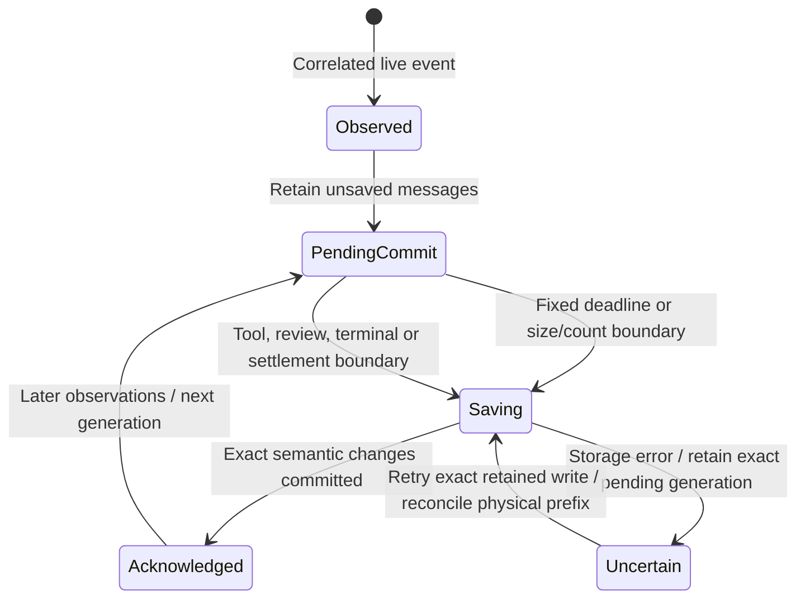
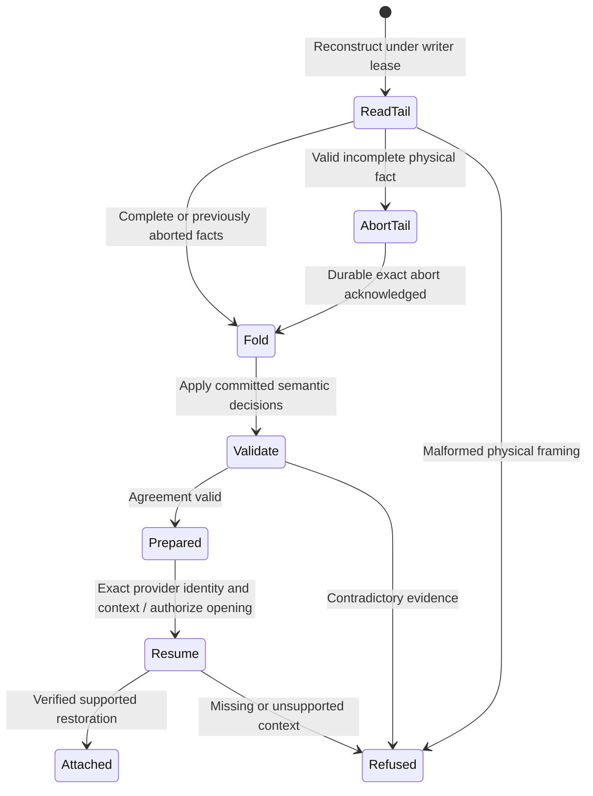

# Committed history and restoration

Nessa shows live output while saving conversation records in small batches. Reopening reconstructs history from the records that were successfully saved.

Text shown since the last successful save can be lost on a crash. A failed save is not advertised as committed history. Each save attempt has an identity so a retry can confirm an already-completed write without duplicating it. Reset must settle uncertain erasure before loading or saving new history.

## Internal completion input

Committed history retains whether an input came from a person, an app, or an
internal completion. Restoration keeps that provenance; a record cannot describe
both an app sender and an internal sender. The gateway can therefore resume the
same provider session with tool output while omitting that input from user bubbles.
The save and restoration states above stay the same. This review covers the new
sender fact and its snapshot agreement, not a new provider restoration protocol.

## Further reading

[Source](../../../../crates/nessa-sdk/src/application/agent_execution/sessions/manager.rs) · [Related source](../../../../crates/nessa-sdk/src/infrastructure/session_storage/record_writer.rs) · [Related tests](../../../../crates/nessa-sdk/tests/application/agent_execution/agents/streaming_persistence.rs)
