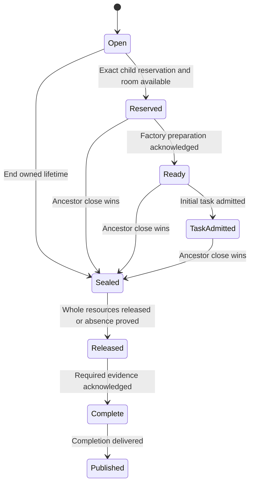

# Parent and child agent ownership

A parent lifetime admits child agents until its ownership seal closes. Reservation and ancestor close share one admission scope, so a child cannot enter after its ancestor has sealed. Attachment-only Stop permits recovery; ending the ownership lifetime drains descendants.

A reserved child can be prepared without its initial task being submitted. Ready preparation and task admission are separate durable milestones. Exact spawn retries retain the request binding; changed bindings conflict. Child/session identities, depth, direct-child count and live capacity constrain admission. Approval inheritance consumes the supplied policy result rather than defining another permission engine.

Close publishes a seal before asynchronous cleanup. Completion needs a real whole-resource observation or a valid absence proof, with required audit and storage acknowledgement. A callback that only reports attachment cleanup cannot certify resources owned by a surrounding child factory. Failed evidence remains a separate result. Dropping the caller does not cancel the independently owned drain.

The graph also owns transfer and report delivery identities. Those are not new permissions or evidence of tool effects. The bounded model below follows close admission and evidence coordination; graph row validation, preparation details and delivery recovery remain explicit source contracts.

## Model coverage

Direct model: One parent and one reserved child, shared ancestor admission seal, physical release or proven absence, close evidence and completion publication.

The finite model checks safety only. Full graph validation, capacity, spawn/task digests, transfers/report delivery, durable recovery and resource-authority identities are source contracts; this abstraction does not establish process release from an attachment callback. Terminal states may stutter; no eventual completion or implementation proof is claimed.

This is a scoped source review at `77a6b620af4d94b234294f6d273fd74b3dfb44c7`. It adds the stated abstraction and does not refresh all earlier narrative claims. Existing page checkpoints are retained where present; reading regression sources is not a test run.

[Child preparation](child-preparation.md) owns reservation through durable Ready and initial task admission separately from close.
