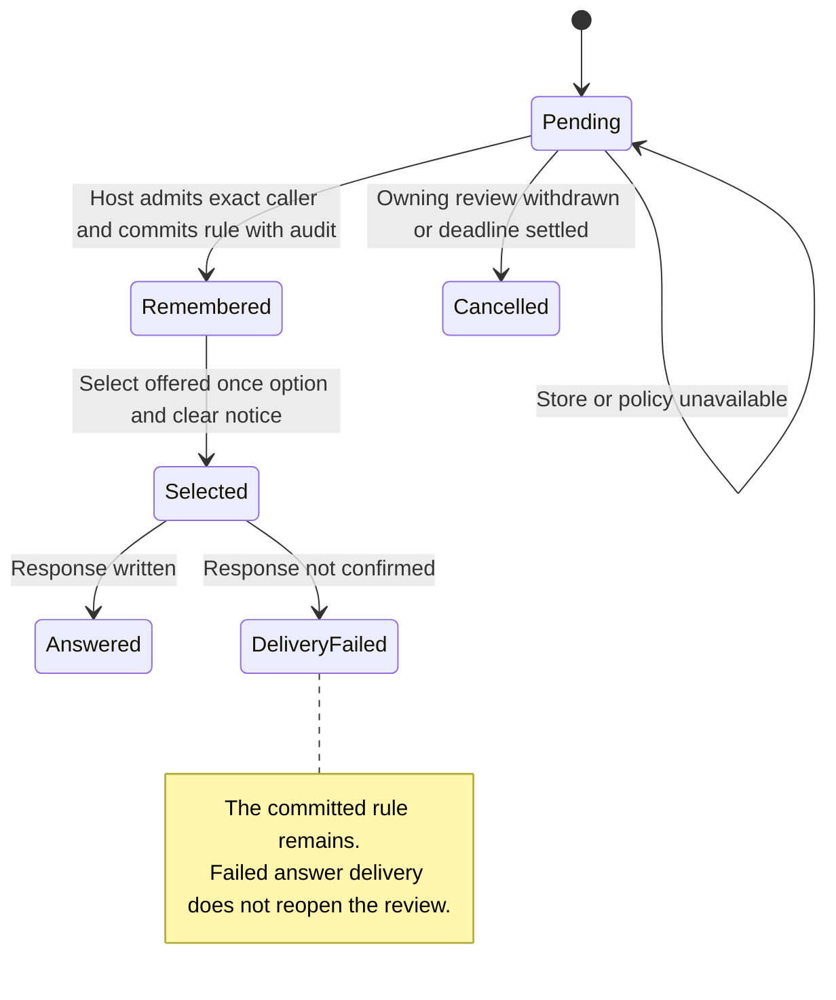

One host-authorized remembered choice atomically commits its rule and audit, then consumes the review and clears its notice; later answer failure retains the rule.

Cedar is the policy owner: PolicyAllow is an uninterpreted result, not a permission table. Workspace/source/tool/caller correlation, rule deletion and notice deadlines require real host tests.

## Model coverage

Direct model. One host-authorized remembered choice atomically commits its rule and audit, then consumes the review and clears its notice; later answer failure retains the rule.

Cedar is the policy owner: PolicyAllow is an uninterpreted result, not a permission table. Workspace/source/tool/caller correlation, rule deletion and notice deadlines require real host tests. Safety only; terminal stuttering is allowed and there is no liveness or implementation-proof claim. This scoped source review adds the abstraction at `77a6b620af4d94b234294f6d273fd74b3dfb44c7`; older page checkpoints remain unchanged. Source tests were inspected, not executed.
