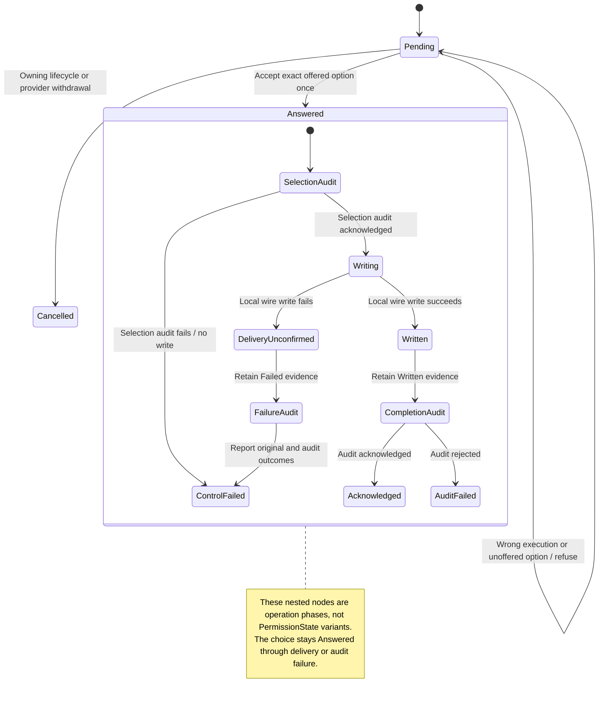

# Permission choice and response delivery

An agent can pause to ask whether a tool action is allowed. The request belongs to one execution and offers specific choices. Choosing an answer consumes that request locally.

Sending the answer and saving its audit record are later steps. A completed local write does not prove the agent performed the tool. A failed or missing reply does not reopen a consumed choice for automatic replay. Read the current request state before taking another action.

## Further reading

[Source](../../../../crates/nessa-sdk/src/domain/agent_execution/permissions/entities/permission_request.rs) · [Related source](../../../../crates/nessa-sdk/src/application/agent_execution/permissions/answer.rs) · [Related tests](../../../../crates/nessa-sdk/tests/infrastructure/acp/contracts/permissions/answers.rs)

## Model coverage

Direct model: Exact execution/review/shown-key validation, one consumed choice, withdrawal race, selection audit before wire, and nonreplay after failed delivery.

The finite model checks safety only. Question multi-choice validation is a pure contract; Cedar approval and remembered-rule policy results are abstracted as validated authority; no tool-effect or final audit-success claim. Terminal states may stutter; no eventual completion or implementation proof is claimed.

This is a scoped source review at `77a6b620af4d94b234294f6d273fd74b3dfb44c7`. It adds the stated abstraction and does not refresh all earlier narrative claims. Existing page checkpoints are retained where present; reading regression sources is not a test run.

[Remembered permission rules and notices](permission-rules.md) owns the independent host-store commit and notice lifetime. A failed selection audit does not undo a previously committed rule.
