# an authorized receiver reads physical history without opening an agent

An authorized receiver can read saved records without opening an agent or running a prompt. It pages through a bounded history source and keeps its downloaded position.

Applying those records to its local view is a separate step with a separate checkpoint. The receiver pairs with the device and uses a protected native connection. It checks the pinned TLS identity, opens a product session and authenticates with its issued credential ID. Automatic device discovery and writable collaboration remain outside this read-only path. See [protected reads](../../../../design/auth/device-pairing.md#protected-reads-over-the-native-channel-slice-3). Physical source work retains capacity until joined. The queued response releases its slots and read lease after encoding and bounds checks, before sending bytes. A timeout before source completion does not free the source permit.

```mermaid
stateDiagram-v2
    [*] --> Reserved: Socket and global capacity acquired
    Reserved --> Authorized: Fresh credential, policy, receiver and owner accepted
    Reserved --> Rejected: Admission refused
    Authorized --> Reading: Exact scope / tracked physical source
    Reading --> Preparing: Source not ready
    Reading --> Joined: Bounded head or page / join source worker
    Reading --> TimedOutOwned: Deadline / physical work still owns capacity
    TimedOutOwned --> ReleasedAfterTimeout: Outstanding source completes and joins / discard old result
    ReleasedAfterTimeout --> [*]: Source capacity released; deliberate retry required
    Joined --> Queued: Encoded bounded response retains delivery ownership
    Queued --> Released: Writer selects valid frame / release lease before physical send
    Queued --> Dropped: Response expired or socket torn down / release lease
    Released --> Delivered: Physical send succeeds
    Released --> Dropped: Send fails / no receiver progress established
    Delivered --> Downloaded: Receiver persists physical progress
    Downloaded --> Applied: Fold semantic progress
    Applied --> Reserved: Next page before captured target / fresh admission
    Preparing --> Reserved: Later deliberate read
    note right of Reserved
        A paired, protected product session is already established.
    end note
    note right of TimedOutOwned
        A timeout response alone does not release capacity.
        Downloaded and applied positions are separate.
    end note
```

## Direction and adapter ownership

Main pins `nessalabs/sync-engine` at `f2a05ef24fcff66df9d55e508539cec718e2d805`. The Rust device client already implements its record and catalogue source ports through the protected gateway connection, and its replica-store port through the private SQLite cache. Download position and semantic-apply progress remain distinct. These are implemented directional reads from gateway-owned history, not multi-master replication or offline CRUD convergence.

The [gateway source adapters](../../../../../crates/nessa-client-core/src/read_only_sync/infrastructure/gateway/sources.rs) and [replica-store adapter](../../../../../crates/nessa-client-core/src/read_only_sync/infrastructure/cache/records.rs) supply the integration evidence. PR #965's proposed reader changes remain outside this baseline; an external README is not authority for which adapters exist in this checkout.

## Further reading

[Source](../../../../../crates/nessa-server/src/conversation/application/passive_read.rs) · [Related source](../../../../../crates/nessa-server/src/conversation/application/record_read/read.rs) · [Related tests](../../../../../crates/nessa-server/tests/conversation/passive_read.rs)
