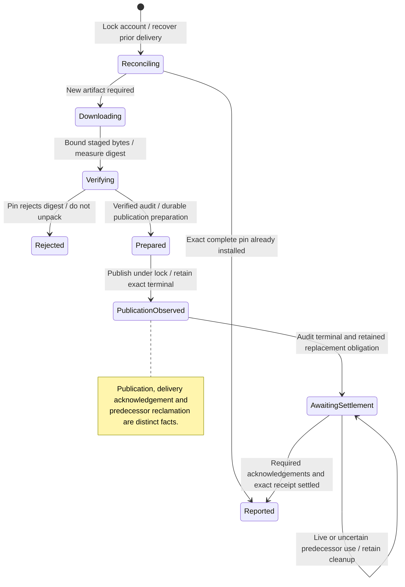

# install or replace a pinned agent runtime

Installation downloads and publishes the agent version Nessa has tested. Launch resolves the current installed version; an old printed path is not a promise that it remains safe to use.

Before spawning, Nessa records that the process owns a use of that version. Replacement cannot remove it until those uses are confirmed released. A dropped guard or process-exit message alone is insufficient. A file found after a crash does not invent missing proof that publication completed.

## Further reading

[Source](../../../../../crates/nessa-server/src/agent_install/application/install.rs) · [Related source](../../../../../crates/nessa-server/src/agent_install/domain/release_selection.rs) · [Related tests](../../../../../crates/nessa-server/tests/agent_install/install.rs)

## Model coverage

Direct model: One pinned runtime install with verified bytes, durable preparation, publication and predecessor use-release before physical reclamation.

The finite model checks safety only. Download signatures, platform unpacking, executable path leases, delivery receipt recovery and multi-version SQL are source contracts; process exit alone is not release. Terminal states may stutter; no eventual completion or implementation proof is claimed.

This is a scoped source review at `77a6b620af4d94b234294f6d273fd74b3dfb44c7`. It adds the stated abstraction and does not refresh all earlier narrative claims. Existing page checkpoints are retained where present; reading regression sources is not a test run.

The model's Reclaimed terminal means physical predecessor reclamation, not the API reporting installation success. An installed runtime can be returned while a cleanup obligation is durably deferred, with reclamation warnings; the Published model state permits that outcome. A live or uncertain predecessor use still prevents physical reclamation.
