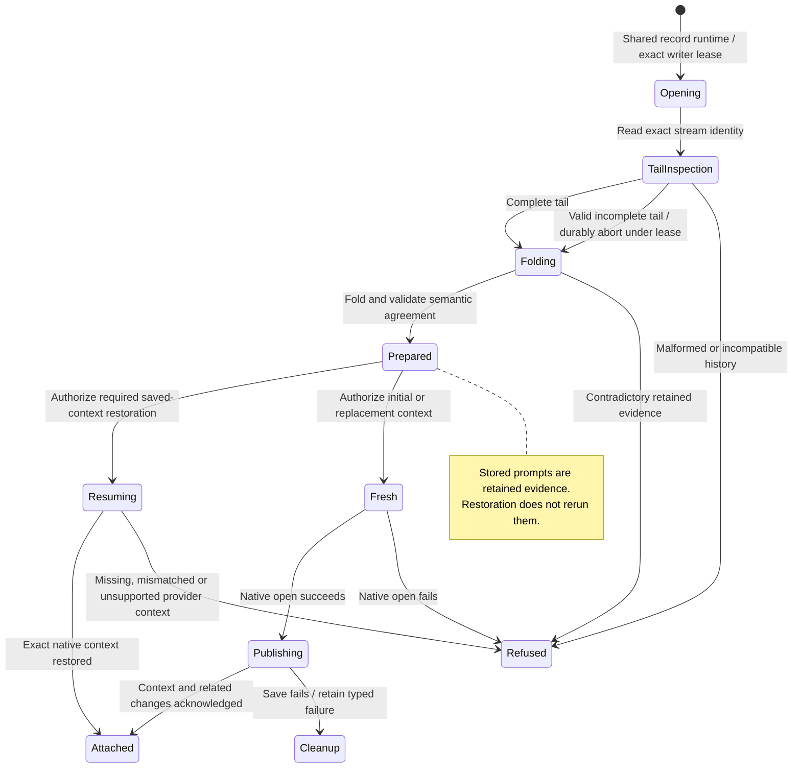

# restart and restore committed conversation history

Restart loads the saved conversation records and reconstructs the committed history. Live output that was never successfully saved is not recoverable from those records.

Saving batches messages and flushes at important boundaries such as reviews and results. Retry can confirm an already-written batch without adding it twice. Restoration validates the agent context and retained scheduling facts; it does not run old prompts again. Deleted identities remain blocked even while unfinished erasure is retried.

## Choosing resume or fresh context

The saved native ID travels with an admission watermark. That watermark excludes
only the earlier terminal prefix from current-context work. Older completed turns
retained across an agent switch or fingerprint change therefore do not make the
new context used. The manager captures the boundary before awaiting opening;
pending accepted input and later admission count even when withdrawn before
publication. Later terminal-prefix growth cannot move that captured boundary.

Claude may replace a context that has no current-context admission, because its
native history is saved only after a prompt. If current-context work requires
resume, losing its native history is a typed provider failure. Nessa retains the
saved ID and conversation history rather than resetting or replaying prompts.
The [committed-history page](../history.md#work-admitted-to-the-current-native-context)
explains the watermark, repeated native IDs and validation of custom snapshots.
The local credential wrapper delegates this query without consulting credentials;
its later launch-time credential read retains its separate failure semantics.

When SessionManager publishes a replacement, it saves the native ID and watermark
with the new fingerprint or attributed switch in one acknowledged save. A failed
save retains the failure and attachment cleanup obligation. This atomic
publication is owned by SessionManager; raw semantic producers are validated but
are not required to pair every independent fingerprint change with a context
transition. Record checkpoints preserve the same context evidence on reopen.

## Completion provenance

A saved internal background completion restores as internal input, with the same
execution identity. It does not become a person's message after reopening.
Snapshot decoding rejects a record marked as both app-authored and internal.
Agent-authored input also retains its source conversation and execution. Sender
and initiation must agree, as described on the
[committed-history page](../history.md#internal-completion-input). Provenance is
separate from whether the current native context has admitted work.

## Discarding unreadable history

Explicitly discarding unreadable local history holds the conversation's writer
reservation while removing a legacy journal, resetting its record stream and
cleaning retired rows. Once admitted, this operation keeps running when its
caller drops the wait. Another open or discard remains busy until the operation
ends. Cancellation itself does not acknowledge deletion. A failed journal
removal releases the reservation without resetting the saved records.

The [storage ordering table](../../../../../docs/design/semantic-record-writer.md#state-and-ordering)
and [public storage regressions](../../../../../crates/nessa-sdk/tests/infrastructure/session_storage/record.rs)
cover queued file removal, caller cancellation, failure release, reset
notification and reopen consistency with an unchanged sibling. This explicit
discard operation is separate from choosing whether a native context must resume.

## Source review scope

This checkpoint compares the source since `5ae45faa95fd88ae96c5f213e0e3fcd811284a91`
and traces current-context admission, native restoration selection and persisted
watermarks at `ae6e33529887746079702d4eca5f528ec42146bd`. The owning discard,
record-writer and streaming paths retain their existing behavior. The review also
reconciles the later agent-origin representation with the existing provenance
section. The provider attachment chart remains about authorization, opening and
readiness; the choice between resume and fresh context belongs to this operation.

The final source checkpoint restores the original accurate Claude-binding comment.
The 45 protocol sources then match the base byte-for-byte; the admission behavior
and these diagram transitions are unchanged from the reviewed implementation.

Tests linked by these pages were inspected, not executed as part of this review.
Gateway deletion policy, native and browser qualification, and visual diagram
inspection are excluded. The checkpoint does not mark #1003, #762 or #934 as
implemented; their dependent work still waits for #981 to merge.

## Further reading

[Source](../../../../../crates/nessa-sdk/src/infrastructure/session_storage/record.rs) · [Related source](../../../../../crates/nessa-sdk/src/infrastructure/session_storage/record_writer.rs) · [Related tests](../../../../../crates/nessa-sdk/tests/infrastructure/session_storage.rs)
