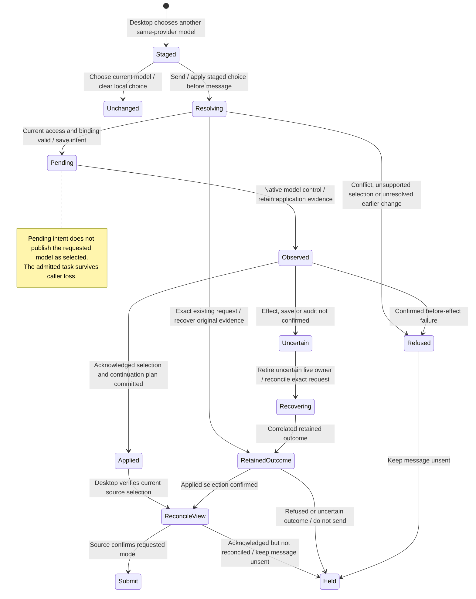

# select a model, approval preset, or reasoning effort

A conversation can change to a supported model on the same provider session. The gateway keeps the existing context and commits the provider's acknowledged model and approval preset together. The provider states whether the choice affects subsequent responses or the next turn.

In the desktop workspace, choosing a model stages it locally. Send applies that choice before submitting the next message; refusal or uncertainty prevents that send. Picking the current model again clears the staged choice. A native acknowledgement without a reconciled source view also keeps the message unsent. A cross-provider choice uses the separate agent-switch path; the model chart below covers same-provider changes. Approval-preset changes have their own idle checks and durable request journal. The Rust SDK also supports verified reasoning-effort changes for supported agents, but that alone does not establish a product control. A requested change is separate from the agent confirming that it applied it.

## Recovery and configuration boundaries

The model journal binds the original conversation, request, actor and before/after identities. An exact retry reads or recovers that request rather than issuing another native control. The SDK retains the active turn's execution binding separately from the acknowledged selection, so a next-turn change does not rewrite the running turn's model. New admissions use the selected model's limits; retries retain their original complete submitted input.

An applied model change invalidates the causal usage limit and reconciles its [scheduled continuation](usage-limit-continuation.md) before completion. Reasoning effort remains a separate SDK capability; this page does not claim a product effort control. The [model journal](../../../../../crates/nessa-server/src/conversation/application/service/model_changes.rs) and [desktop staging regressions](../../../../../src/desktop/workspace/adapters/store/model-commands.test.ts) own these boundaries.

## Further reading

[Source](../../../../../crates/nessa-server/src/conversation/application/service.rs) · [Related source](../../../../../crates/nessa-server/src/conversation/infrastructure/mode_audit.rs) · [Related tests](../../../../../crates/nessa-server/tests/conversation/application.rs)
