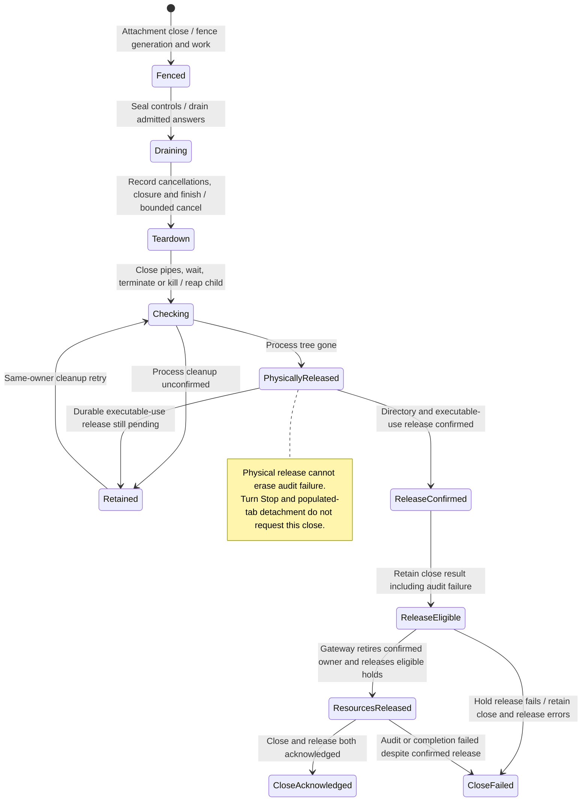
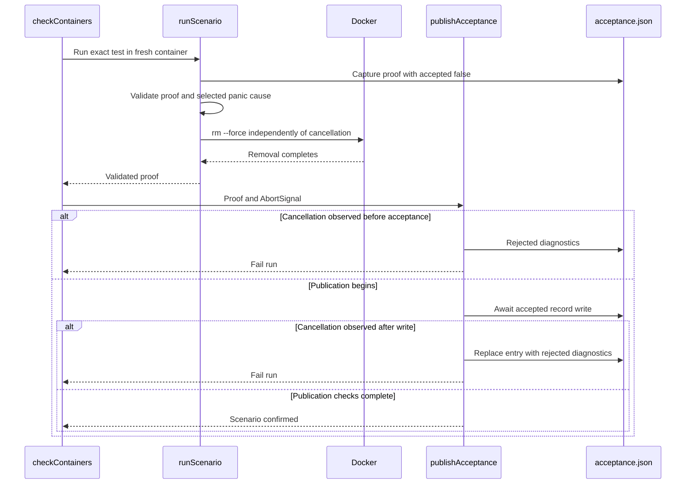

# Turn Stop and attachment cleanup have different owners

Turn Stop cancels one captured turn; attachment close fences work and owns process cleanup. A queued turn is withdrawn, an active turn uses provider cancellation, and a finished turn sends nothing. Turn Stop leaves the attachment open. Archive only changes list visibility; closing a populated tab only detaches its view.

The cleanup chart below follows attachment close, including failure-driven cleanup, rather than the turn Stop command. Physical process cleanup, release of installed-runtime use and audit delivery are separate results. A repeated close can retry unfinished cleanup. Delete additionally asks the provider to dispose of its session and erases Nessa-owned data. A provider may archive or retain its record, so local erasure must not be presented as proof that every external copy was deleted.

A cleanup record can fail after physical release is confirmed. The gateway then retires that owner and attempts eligible image-hold release while returning the failure. Audit success is not a prerequisite for physical release or slot retirement. A proven-empty idle tab has a separate automatic-close exception; ordinary populated-tab detachment only removes the view.

## Turn cancellation and ownership

[The command owner](../../../../../crates/nessa-server/src/conversation/application/service/mutation.rs) checks the exact turn and saves its attempt before effects. [Agent cancellation](../../../../../crates/nessa-sdk/src/application/agent_execution/agents/agent.rs) accepts only the active turn on a capable attached provider. Moving from queue to execution is retried within a bounded wait; a concurrent close is answered from the turn's eventual final state. A saved attempted Stop without a terminal receipt stays interrupted after restart and is not sent again.

The SDK's [parent and child close settlement](../README.md#parent-and-child-close-settlement) is an implemented ownership lifecycle. It is not evidence that product Stop cascades through child turns. PR #981 remains unmerged at this audit baseline. The [turn Stop flow](../../desktop/chat/stop-active-and-queued-work.md) follows the product operation.

## Confirming the process group

`ProcessScope` closes the child's stdin, waits out `shutdown_grace`, then
`SIGTERM` and `SIGKILL`, each followed by at most `kill_timeout`. Those bounds
are real time. They are not what made macOS CI report `CleanupUncertain` on a
harness that had already answered and then exited on EOF: a cooperative exit
is reaped in well under `kill_timeout`, and `SIGKILL` does not wait for the
child to be scheduled. The shared fixture keeps `kill_timeout` at two seconds
because that wait is the escalation for a process that survives `SIGTERM`, not
a slack factor for a slow runner.

A `kill` or `waitpid` result is a verdict only when it says the group was
signalled or that it is gone (`ESRCH` after the leader is reaped). Anything
else keeps the same budget.

| Call | Result | Verdict | Next |
| --- | --- | --- | --- |
| `kill` | 0 | delivered | wait for `ESRCH` or the budget |
| `kill` | `ESRCH` | group already empty | reap; not a failure |
| `kill` | `EPERM` | no verdict (macOS: exiting or unreaped leader; otherwise a real refusal) | keep waiting; `CleanupUncertain` only if `ESRCH` never arrives |
| `kill` | `EINTR` | no verdict (macOS `kill(2)` when a caught signal interrupts the call) | retry, then the same as no verdict; not a failure |
| `kill` | anything else | cannot tell | `CleanupUncertain` |
| `waitpid` | exited or still running | observed | probe the group |
| `waitpid` | `EINTR` | no verdict | keep polling inside the same budget |
| `waitpid` | anything else | cannot tell | this phase is not confirmed |
| probe `kill(0)` | 0 | a member exists | keep polling |
| probe `kill(0)` | `ESRCH` | gone | confirmed |
| probe `kill(0)` | `EPERM`, `EINTR`, or anything else | no verdict | keep polling until the budget |

Held by `infrastructure::process::tests`: `an_interrupted_group_kill_retries_then_returns_the_verdict` (the injected signal: interrupt then absence, a refusal asked once, and sixteen interrupts), `an_interrupted_group_signal_is_not_a_cleanup_failure`, `a_group_probe_classifies_delivery_refusal_and_absence`, `an_interrupted_reap_keeps_the_same_cleanup_budget`, `signalling_an_exited_unreaped_group_is_not_a_cleanup_failure` (the macOS zombie), and `a_group_that_refuses_signals_is_never_confirmed_gone`.

## Linux container acceptance (#630)

Linux cleanup requires an init that reaps adopted descendants: use Docker
`--init`, or launch the owning process under `tini -s --`. A non-reaping PID 1
can retain a killed descendant as a zombie, so process-group absence remains
unconfirmed and private directories remain owned. The SDK does not enable a
process-global subreaper or treat a zombie as an absent group.

The opt-in [container harness](../../../../../scripts/process-cleanup/README.md)
uses the same explicitly selected SDK library test executable and fixture mounts
in four disposable PID namespaces. Its orderings are specified before the harness:

| Ordering | Required observation | Evidence test |
| --- | --- | --- |
| Directory test exits under non-reaping PID 1; inspect before PID 1 exits | One failed test, selected-test panic caused by `CleanupUncertain`, new PPID-1 zombie, retained private directory | negative directory acceptance; missing-zombie and wrong-failure unit cases |
| ACP TERM-resistant parent creates child before `running`; close kills group; inspect after test exits | One failed test, selected-test panic caused by `CleanupUncertain`, new PPID-1 zombie | negative ACP acceptance |
| Either test runs with Docker `--init`; init adopts and reaps descendants before inspection | One passing test, no new orphan zombie, no retained private directory | both positive acceptances; zero-test and positive-failure unit cases |
| Image inspection is interrupted, or timeout, repeated interrupt, malformed/missing proof, validation or Docker failure occurs during a scenario | Harness fails; inspection receives cancellation; required identities, flags and metadata are validated; diagnostics recorded before validation/removal; removal attempted independently of cancelled work | orchestration removal-on-interrupt, rejected-evidence and failure tests |

Acceptance publication has one owner, after independent container removal:

| Ordering | Publisher result | Evidence test |
| --- | --- | --- |
| Docker output splits a UTF-8 character across chunks, contains malformed bytes, or crosses the retained-output budget | One bounded capture owner preserves incremental decoding and retains at most 128 KiB of diagnostic UTF-8 bytes per stream; overflow rejects | multibyte boundary, split Unicode and malformed-output tests |
| Selected test panics for another cause; unrelated output mentions `CleanupUncertain` | Reject; the selected panic header and following unwrap error must establish the cause | incidental-token/wrong-panic tests |
| Interrupt arrives during successful removal, before acceptance is written | Retain diagnostics with `accepted: false`; fail the run | last-removal interrupt test |
| Interrupt arrives while the acceptance record is being written | Publisher observes cancellation after the write, replaces that entry with rejected diagnostics and fails the run | final-write interrupt test |
| Acceptance write fails | Publisher fails; captured diagnostics remain unaccepted | acceptance-write failure test |
| Publication checks finish before a later interrupt | Confirm that scenario; overall acceptance requires four confirmed entries and a successful harness exit | complete orchestration and real four-case acceptance |

This diagram illustrates the table with the harness's actual functions:

The harness supervisor waits only for its direct test process. Inspection occurs
while that supervisor remains alive; container removal then destroys the disposable
PID namespace, including its intentionally unreaped zombies.

## Further reading

[Source](../../../../../src/conversation/adapters/store/slice.ts) · [Related source](../../../../../crates/nessa-server/src/conversation/application/provider_sessions.rs) · [Related tests](../../../../../crates/nessa-sdk/tests/infrastructure/process.rs)
