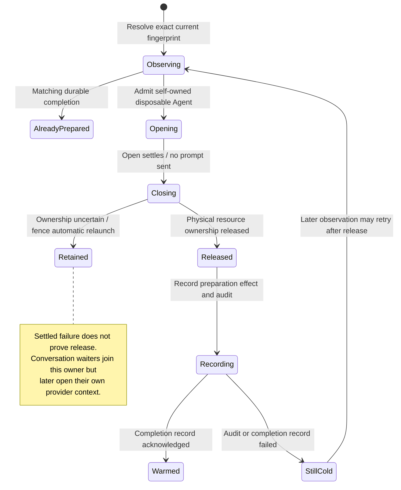

# the first agent launch is warmed in the background

Nessa can prepare the first agent launch by opening and closing a disposable session without sending a prompt. A conversation arriving during this warm-up joins the existing run rather than starting another.

Warm-up is separate from the conversation's own result. Process release, saved audit and completion-record delivery can succeed or fail independently. Another automatic launch must wait when the previous run may still hold resources.

## Further reading

[Source](../../../../../crates/nessa-server/src/agent_warm_up/application/service.rs) · [Related source](../../../../../crates/nessa-server/src/agent_warm_up/application/terminal.rs) · [Related tests](../../../../../crates/nessa-server/tests/agent_warm_up/service.rs)

## Model coverage

Direct model. One fingerprint-bound self-owned disposable launch, physical release versus retained ownership and independent audit/completion-record delivery.

Fingerprint bytes, prior durable-record lookup, multiple warmup coordinators and provider launch behavior are source/adapter contracts. A failed completion record is still a prepared effect but is not a durable Warmed record. Safety only; terminal stuttering is allowed and there is no liveness or implementation-proof claim. This scoped source review adds the abstraction at `77a6b620af4d94b234294f6d273fd74b3dfb44c7`; older page checkpoints remain unchanged. Source tests were inspected, not executed.
