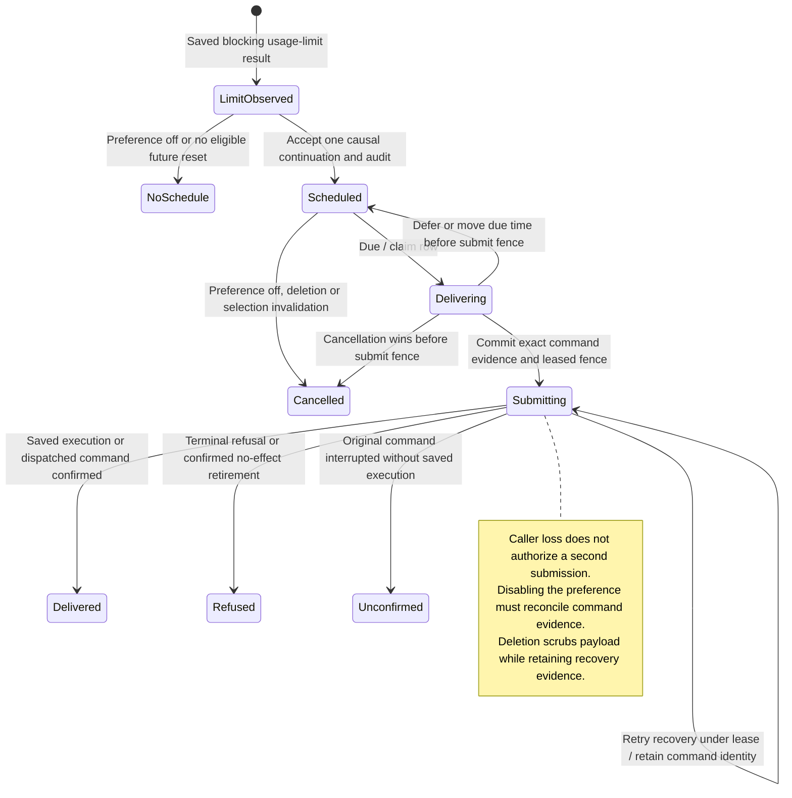

# Usage limits and scheduled continuation

A recognized provider usage limit ends the current turn. It does not use ordinary SDK failure backoff to keep retrying that blocked work. With the gateway preference enabled and a future reset time, the conversation service can save one later continuation for that causal turn. The preference defaults off.

The scheduled-message store owns the due time, cancellation and submission lease. The continuation still passes through ordinary command admission with the original turn's initiation, so current access and deletion checks apply. A saved schedule does not grant permission to send.

## Recovery and cancellation

A submitting row can outlive the process or caller. Recovery checks the saved execution and original command receipt before considering delivery. An unread execution leaves recovery pending. A retryable failure or uncommitted outcome keeps the row submitting with bounded retry timing; it does not mint another execution identity. An interrupted command is recorded as unconfirmed rather than submitted again.

Turning the preference off cancels scheduled or delivering rows. A submitting row needs its lease and command evidence reconciled: a dispatched command remains delivered, an attempted command can remain unconfirmed, and an unattempted command can be durably refused before effect. A model or agent selection invalidates the exact causal limit. A later limit remains eligible; replaying the old selection request does not cancel it. Deletion removes prompt and payload identifiers while preserving the non-content command evidence needed for recovery.

The diagram follows one continuation row, not the preference command or the running provider. The full [ordering table and regression mapping](../../../../design/usage-limit-continuation.md#state) distinguish restart, preference changes, model changes, audit failures and submission races. Provider classification is also bounded there: an arbitrary HTTP 429 or diagnostic string is not enough to select this lifecycle.

## Further reading

[Scheduling owner](../../../../../crates/nessa-server/src/conversation/application/service/scheduled_messages.rs) · [Durable row adapter](../../../../../crates/nessa-server/src/conversation/infrastructure/scheduled_messages.rs) · [Design and evidence](../../../../design/usage-limit-continuation.md)
