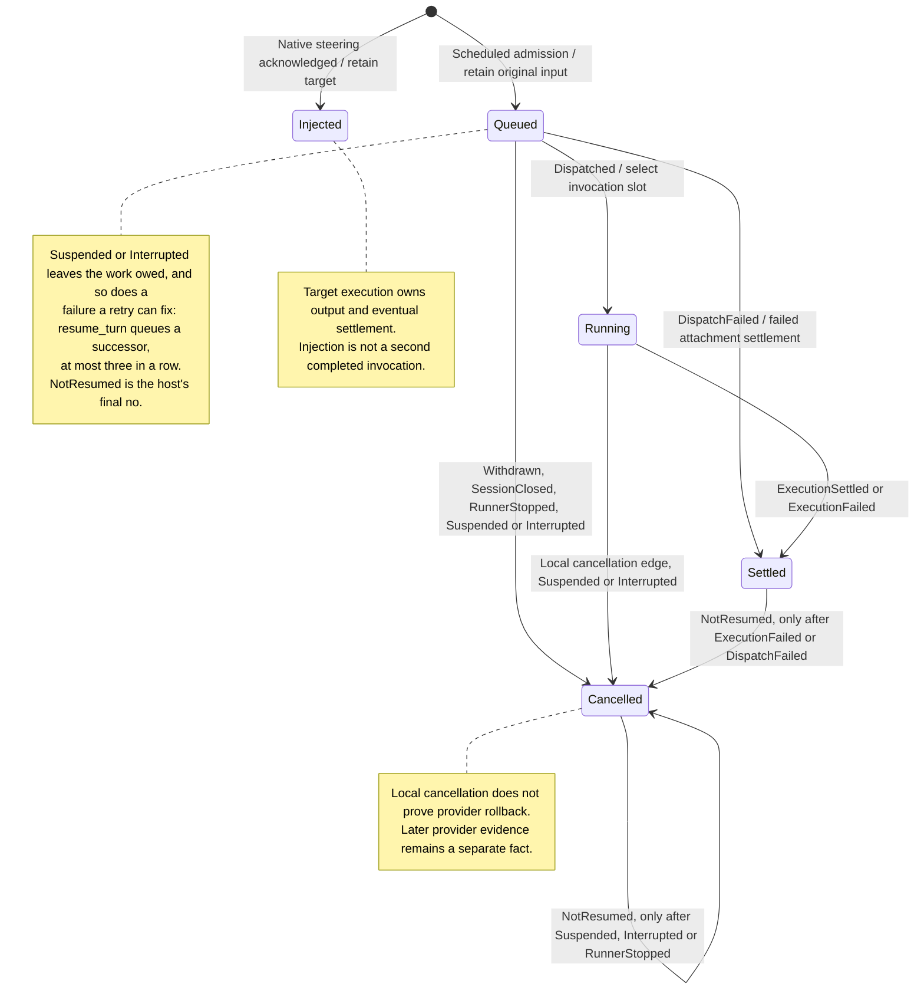

# Submission scheduling and recovery

Nessa keeps each accepted input's original ID, content, caller and delivery mode. Up to 64 inputs can wait while the agent is busy or starting. Boundary steering gets priority over ordinary waiting inputs without interrupting active work. For example, it can put your correction ahead of ordinary follow-ups once the current invocation finishes.

Retrying the same input can join its existing receipt or recover a retained result. Changing its content, caller or mode conflicts with that identity. If previous delivery cannot be safely resolved, Nessa refuses replay. A turn cut off by a restart, stopped by the gateway's own shutdown, or ended by a failure a retry can fix (the provider or its connection failed), is owed: the gateway queues a successor turn that tells the agent why the turn stopped and repeats the request, so the model checks what is done and carries on or says it is finished. After a restart that happens when the gateway starts again; after a failure, after a backoff that doubles with each failure in a row. A person's stop and a failure a retry cannot fix (a refusal, a sign-in the provider needs) stay final, and so does the gateway's own decision not to resume a turn (`NotResumed`). Native steering falls back only when the agent explicitly confirms it did not consume the input; a timeout does not authorize fallback.

## Steering configuration admission

| Operation phase | Configuration owner and refusal boundary | Regression |
| --- | --- | --- |
| Exact saved steering retry | Recover the original identity/receipt before current configuration checks. | `native_approval_next_turn_accepts_active_pin_and_recovers_retry` |
| Fresh native steering | The same operation-selected configured provider supplies capabilities and approval mode: NextTurn retains A; SubsequentResponses uses acknowledged B. A mode mismatch is `ApprovalModeChanged` before saving or native dispatch. | `native_approval_next_turn_accepts_active_pin_and_recovers_retry`, `native_approval_next_turn_refuses_selected_only_pin`, `native_approval_subsequent_responses_uses_selected_pin` |
| Direct acknowledged preset control during native execution | Normalize only the active binding's approval component before native dispatch, preserving its model/capabilities/effort; publish on verified ACK. The model operation alone chooses NextTurn vs SubsequentResponses, while the lifecycle owns replacement under Scheduler. Initial steering-only fix regressed four direct-preset cases; old production passed all four. | `native_direct_approval_ack_accepts_new_pin`, `native_direct_approval_ack_refuses_old_pin`, `native_direct_approval_after_next_turn_preserves_active_model`, `native_direct_approval_after_next_turn_refuses_old_pin` |
| Explicit nonconsumption / independent queued fallback | Current configured B must admit capabilities and the submitter's required mode before queue ownership, dispatch or QueueAdmitted. The attempted steering record can already be saved. Queue audit mode/model/effort and original actor describe B. | `native_approval_prompt_required_refuses_active_only_pin`, `native_approval_prompt_required_records_current_queue_binding`, `native_approval_finished_target_refuses_active_only_pin`, `native_approval_foreign_initiator_queues_at_selected_mode` |

A blocking usage limit is not ordinary failure-backoff work. The gateway may create an opt-in [scheduled continuation](runtime/usage-limit-continuation.md) for a future reset; it has a separate durable row and submission lease. The latest saved blocking limit also prevents ordinary resumption of later runner-stopped work behind it.

## Further reading

[Source](../../../../crates/nessa-sdk/src/domain/agent_execution/executions/value_objects/scheduling.rs) · [Related source](../../../../crates/nessa-sdk/src/application/agent_execution/agents/scheduling.rs) · [Related tests](../../../../crates/nessa-sdk/tests/application/agent_execution/scheduling/retries.rs)
