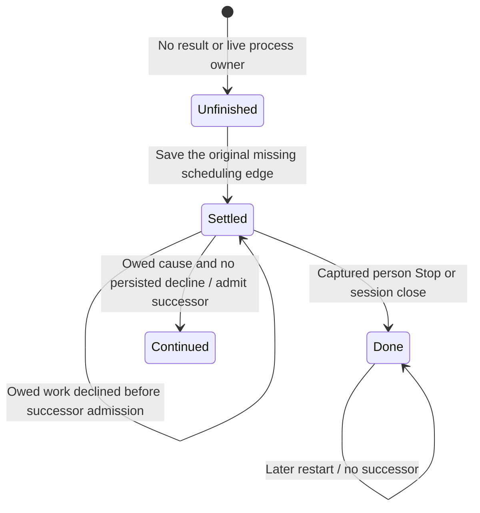

# Finish a captured Stop after restart

A restarted turn may already contain a person's Stop or a session close while its last scheduling edge remains Queued or Running. With no result and no live owner in this process, recovery owes the missing edge. Both resume and decline record that original cancellation cause and admit no successor. They do not append NotResumed after a final captured stop. A second restart finds that source settled.

Interrupted or retryable-failure work is different: settlement can precede successor admission. After that save releases the scheduler, a waiting decline can persist NotResumed first. Successor admission reacquires the same scheduler and checks that durable decision before saving anything. If decline won, resume returns NotOwed; it cannot undo the decline. Ordinary input that happens to choose the derived successor ID does not acquire resumption provenance.

A confirmed gateway Stop command receipt is reconciled by its own gateway owner. This SDK model starts with the captured invocation cause and does not infer it from a command receipt or prove physical provider rollback.

## Model coverage

Direct finite safety model. One restarted queued/running source with no result or live process records its missing scheduling edge. Captured person/session stops terminate without successors; owed work admits a successor only if no persisted decline won first.

Cause classifications are fixed inputs; exact actors, command-receipt Stop ownership, stable successor request identity, failure backoff, audit retries, provider rollback and source execution effects are separate owners. Terminal states may stutter. This checks the authored design, not the implementation, and claims no liveness.

## Source reconciliation

Reviewed the owning source and regression assertions at `719dfce93892e09dcb95e86a060b6d2f42c8f3cc`, comparing changes since `77a6b620af4d94b234294f6d273fd74b3dfb44c7`. Product tests, native/browser execution and visual inspection were not performed. The checkpoint covers this page's narrow complete owner narrative; it does not recertify other SDK pages.
