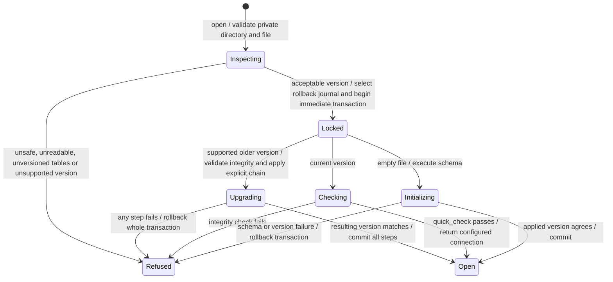

# Database opening and version refusal

Nessa opens its private database only when the file and format are acceptable. It checks the schema version before changes that could affect the database.

An unsupported version is preserved rather than silently repaired. An older version with an explicit validated forward upgrade chain is upgraded in one transaction; failure rolls back the whole chain. A private file path alone does not prove every platform permission guarantee. This page follows database opening, not the lifetime of every row stored in it.

## Further reading

[Source](../../../../crates/nessa-local-database/src/lib.rs)

## Model coverage

Direct model: One version-2 database with an explicitly supported upgrade to version 3; staged schema changes commit together or roll back.

The finite model checks safety only. Fresh schema creation, current-version open, multiple migration steps, SQL contents, private path and encrypted-key boundaries remain source contracts; arbitrary older versions are still refused. Terminal states may stutter; no eventual completion or implementation proof is claimed.

This is a scoped source review at `77a6b620af4d94b234294f6d273fd74b3dfb44c7`. It adds the stated abstraction and does not refresh all earlier narrative claims. Existing page checkpoints are retained where present; reading regression sources is not a test run.

Optional encrypted opening supplies a validated database key before schema access. Encryption/key management and platform private-file permissions are boundary contracts, not migration states.
