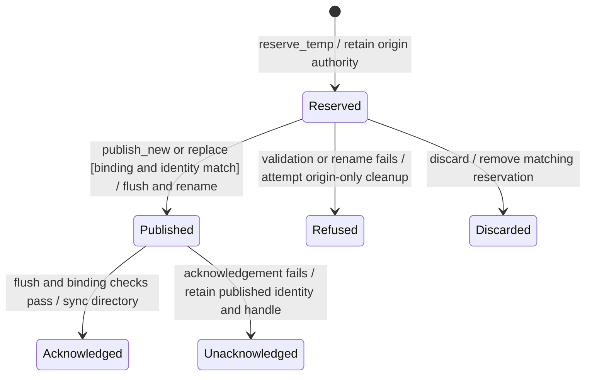

# Private publication and acknowledgement

Publishing here means putting a prepared private file at its intended location. Nessa first prepares and syncs the file, replaces the destination, then confirms the containing directory was synced.

The new file can already be visible when a later sync fails. Error therefore does not mean nothing changed. Cleanup has its own result and must not remove a newer publication. Platform limits remain part of the storage contract.

## Further reading

[Source](../../../../crates/nessa-local-storage/src/retained_directory.rs)

## Model coverage

Direct model: One origin-bound reservation, rename before directory acknowledgement, retained published identity on failure and newer destination replacement.

The finite model checks safety only. OS inode/handle binding checks and permissions are trusted boundaries; multi-process adversaries, platform durability and every caller cleanup policy are not proven. Terminal states may stutter; no eventual completion or implementation proof is claimed.

This is a scoped source review at `77a6b620af4d94b234294f6d273fd74b3dfb44c7`. It adds the stated abstraction and does not refresh all earlier narrative claims. Existing page checkpoints are retained where present; reading regression sources is not a test run.
