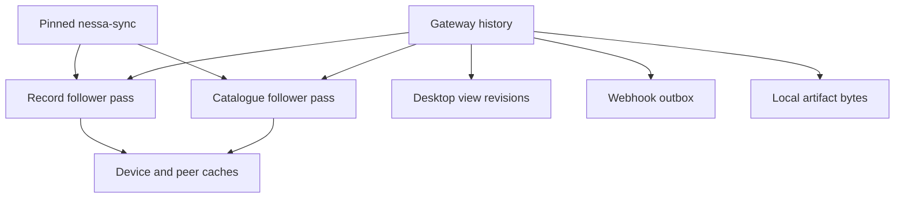

# How Nessa sync works

Nessa copies saved conversation history from the gateway that owns it to another process that is allowed to read it. The follower asks for a bounded page, checks it, and saves it. A record written after that ask is copied on a later pass.

The library that defines that ask is `nessa-sync`, pinned in the workspace `Cargo.toml` at `nessalabs/sync-engine` revision `341c9b844257403bb297f27d7ed9aecbe93e4406`. The library validates pages and calls host ports. It does not open sockets, start timers, or retry. This repository supplies the gateway source, the product RPCs, and the follower caches.

## What it copies

Two streams share one scope identity and stay separate in storage.

A **record stream** is the conversation's committed physical history. Positions start at 1 and must arrive with no gaps. The follower saves the bytes and, in the same local transaction, folds them into a semantic transcript. The last downloaded position and the last applied semantic position are stored as different numbers. [One record change](one-record-change.md) follows one new save from the writer to the follower.

A **catalogue stream** is the current list of conversations for one owner or one granted reader. Each entry has a revision. A later revision replaces the value. A deleted entry stays deleted. The catalogue pass does not replay the transcript.

Artifact manifests and a recent-tail plus older-history API also live in the pinned library. This repository's live attachment path uses the library's chunk-size ceiling for local reads. It does not run the library's artifact transfer. No crate here calls `replication::history`.

## Who holds a copy

The gateway is the origin. `NessaRecordSource` in the SDK pages committed frames for an authorized scope. Catalogue reads page conversation metadata from the gateway's SQLite store. Both are served as product methods on the authenticated socket: `conversation.recordsHead`, `conversation.recordsPage`, `conversation.catalogueHead`, `conversation.catalogueManifest`, and `conversation.catalogueResolve`.

Followers implement the library ports by turning each port call into one of those RPCs, then saving the accepted page in a private SQLite cache:

| Follower | What starts it |
| --- | --- |
| Read-only example in `nessa-client-core` | Commands `sync-records`, `check-records`, `sync-catalogue`, and `follow` |
| `RetainedCache` | A paired device, a phone, or a peer gateway reading grants it was given |
| Peer poller in `nessa-peer-gateways` | A cadence over enrolled peers, each through `RetainedCache::follow_grants` |

The desktop workspace is a reader of gateway views, with its own revision counters. The webhook runtime is a reader of the same physical records, with its own outbox cursor. Neither one is a `ReplicaStore`.

## When copying runs

The library moves data only while a host calls it. `begin_pass` captures one head. `step` copies at most one record page toward that frozen head. `finish_pass` exists in the library and has no caller in this repository. The driver `run_records` loops `step` until the pass is complete or a caller-supplied page budget runs out.

Catalogue copying is `begin_or_resume` followed by `apply_next_page`, again under a page budget in `run_catalogue`. An unchanged catalogue head starts no payload read.

`follow` subscribes to one conversation, runs one recheck pass, then runs another pass when a newer view reports a different cursor. `check-records` is the records command with a page budget of zero: it captures the head and saves no page. The peer poller starts a read when the interval is due, when a peer is new, or when the previous read was incomplete, stopped, or failed. A failure waits on a backoff that doubles up to a cap.

A person using the desktop does not wait for these passes. The panel reads conversation views and list updates. See [How the paths relate](#how-the-paths-relate).

## How the paths relate

`nessa-sync` is the shared contract for scope, page shape, and the follower loop. Product code on both sides of the socket speaks that contract through adapters.

The gateway path answers one RPC at a time. Admission, Cedar, and the physical source run on that request. The follower path is the loop that issues many of those RPCs and commits them locally. Peer gateways are followers of another gateway: the poller uses the same retained cache, so a peer copy is still one-way from the granting gateway.

Desktop resynchronize is a third path. `supersedes` in `src/desktop/workspace/model/revision.ts` keeps the replacement with the larger revision for that same object. A summary revision and a conversation revision are different counters. `{ kind: "resync" }` rereads the index. Those numbers are not `nessa-sync` positions.

Webhook delivery pages the canonical record read and queues the encoded page under a cursor that stores a `Scope`. A later observation of a different source scope records a reset and returns `ResetRequired`. That cursor is the outbox's, not the follower cache's.

Local attachment reads enforce `MAX_CHUNK_BYTES` (64 KiB in the pinned library) on ranges of bytes already stored on the gateway. The attachment store's own comment says protected transport and composed shutdown remain a separate integration.

## Known gaps and risks

These are observations from the pinned library and this checkout. They are not a test run.

The record loop authorizes, fetches one page, validates it, and commits it. It does not authorize again between the fetch and the local commit. The catalogue loop does authorize again immediately before `apply_page`. A grant that disappears in that record window can still be stored locally. The library's `step` is written that way; the read-only design record treats an already fetched immutable page as committable.

`downloaded` and `applied` can differ after a successful page. `downloaded` is the last physical position. `applied` is the last completed semantic save. A physical record that the fold cannot read, or an abort that publishes no semantic progress, advances the physical cursor while the published snapshot stays put. A caller that treats "caught up on downloaded" as "the transcript view is current" overstates the fold.

An uncertain SQLite commit stops the pass. The engine requires the next attempt to call `begin_pass` again and reload. `run_records` does that by returning. The peer poller does not treat `CacheUncertain` like a damaged cache: it does not empty the replica immediately. The next scheduled read loads whatever the store kept.

`LinkSchedule` and `run_quantum` pace work in tests and `measure.rs`. `follow` and the peer poller do not call them. A weak link still spends the caller's page budget inside each connection deadline.

`CatalogueStore::reset` on `ReadOnlyCache` always returns `ResetAttributionRequired`. Operator reset goes through `reset` and `reset_catalogue` on the cache, which require a caller, a generation, and an exact old scope. The library function `reset_catalogue` cannot drive this cache.

The library's `replication::history` module defines a recent tail and older pages with separate progress. This repository has no caller. Whether a follower is expected to bootstrap through that API is an open question.

## Open questions

- The workspace uses one Sync Engine pin. [The pin compatibility note](../../../design/authorized-record-reads.md#sync-engine-pin-compatibility) records which newer outcomes were reviewed and which Product behaviors are unchanged. These pages do not vendor the library.
- No production caller of `replication::history` or of the library's artifact manifest ports was found. The design note in `docs/design/artifact-sync.md` describes transport as inactive; the code comment in `crates/nessa-attachments/src/infrastructure/store.rs` is the claim these pages rely on.
- `finish_pass` is public in the library and unused here. The live bound is the driver's `max_pages`.

## Browse this area

- [Sync data model](data-model.md)
- [One record change, end to end](one-record-change.md)
- [Ordering and conflict rules](ordering.md)
- [Failure and retry](failure.md)
- [Where the code lives](code-map.md)

## Further reading

[Driver](../../../../crates/nessa-client-core/src/read_only_sync/application/driver.rs) · [Record source](../../../../crates/nessa-sdk/src/infrastructure/session_storage/record_source.rs) · [Peer poller](../../../../crates/nessa-peer-gateways/src/infrastructure/poller.rs)
